# SpatialView 前端 UI 设计

| 文档版本 | 日期 | 说明 |
| --- | --- | --- |
| 1 | 2026-10-13 | 初稿：设计原则、布局、设计令牌、组件、三维场景视觉、各画面规范、文案；附静态原型 |
| 2 | 2026-10-15 | 机械臂确定为 AUBO i5H：机械臂状态增加"未启动"；三维区增加机械臂提示（急停、未启动的说明和"复位急停"）；机械臂改用官方网格，规定材质修正和配色。原型未同步本版改动 |
| 3 | 2026-10-16 | 目标平板确定为 Chainway P100（10.95 英寸，1920 × 1200）：设计基准对应该平板隐藏系统栏后的尺寸；3.5 的毫米换算按该平板计算 |
| 4 | 2026-10-18 | 隐藏系统栏已确定（需求 3.5）；工程面板底部增加 WebView 版本 |
| 5 | 2026-10-26 | 方向箭头的大小与间距成比例：工件较小时调小间距，箭头随之变小（服务端演示用的工件直径约 15 厘米） |
| 6 | 2026-11-07 | 服务端团队反馈方向箭头太大、遮住工件，空行程的箭头与工件同色：箭头的大小改为以屏幕像素计，缩放时不变；改为半透明，颜色取所在线段颜色的深色。原型和截图未同步本版改动 |
| 7 | 2026-11-08 | 服务端团队建议方向箭头只用线条：改为线条画的折角"›"，始终与屏幕平行，尖端沿路径在屏幕上的方向，远近不同的箭头在屏幕上一样大。原型和截图未同步本版改动 |

本文规定 APP "长什么样"：布局、颜色、字体、尺寸、组件和各画面的视觉细节。功能和行为以[需求文档](需求文档.md)为准，本文引用其章节编号（写作"需求 x.y"），不重复定义规则；状态码的含义和显示文字见[服务端对接接口文档](服务端对接接口文档.md)第 7 节。

**静态原型**：[prototype/index.html](prototype/index.html) 是本文的可视化版本，用浏览器打开即可查看全部画面（三维区需要联网加载 three.js）。按钮没有功能；工件、路径和机械臂是示意数据。原型与本文不一致时以本文为准。

读者：APP 前端开发、视觉设计。

## 1 设计原则

1. **现场可读**：操作员站在平板前一臂距离操作，常戴手套。字号、按钮、对比度都按这个条件取值，而不是按普通手机 APP。
2. **状态先于操作**：Status Bar 在任何画面中都完整可见；每个状态同时用颜色和文字表达（需求 12.3）。
3. **安全控件永远可达**：急停和"关闭激光"不被任何对话框、面板、遮罩遮挡。
4. **一屏完成**：没有菜单和二级页面。工具条、播放条、进度和提示都显示在三维区内部（需求 5）。
5. **克制用色**：只有状态、主操作、选中和危险使用彩色，其余为中性灰；同一种颜色在全 APP 中只表达一种含义。
6. **亮色主题**（需求 12.3）。

## 2 布局

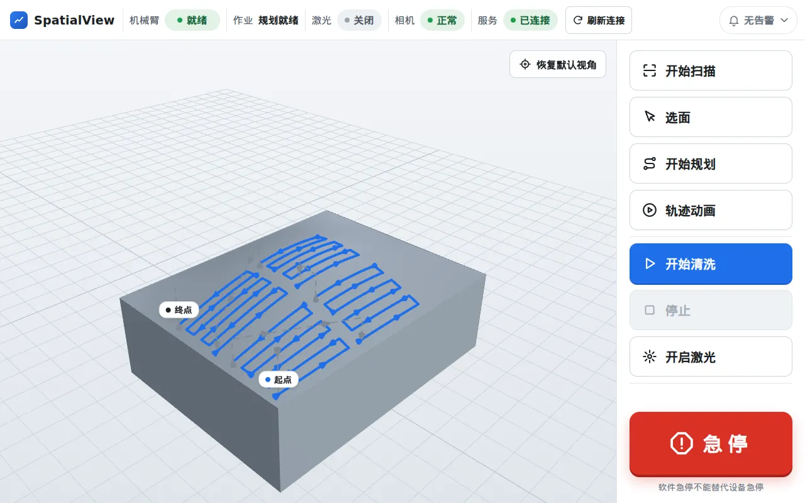

| 区域 | 尺寸 | 内容 |
| --- | --- | --- |
| 画面 | 1280 × 800（CSS 像素，横屏） | 设计基准。目标平板 Chainway P100 在 `devicePixelRatio` 为 1.5、隐藏系统栏时正好是这个尺寸（需求 3.5、12.1）。更大的屏幕只加宽三维区，Status Bar 和按钮栏尺寸不变 |
| Status Bar | 高 64 | 顶部通栏（4.1） |
| 三维区 | 980 × 736 | 左侧，三维场景和全部浮层（4.3、第 5 节） |
| 按钮栏 | 宽 300 | 右侧，内边距上下 16、左右 20（4.2） |

- **间距**：以 4 为单位，常用 8、10、12、16、20。
- **圆角**：主按钮 12；对话框 18；卡片、浮动条 14–16；状态胶囊为全圆角；小按钮 8–10。
- **层次**：浮在三维区上的元素（工具条、卡片、提示、对话框）用柔和阴影与场景分开；Status Bar 和按钮栏是平面的，只用 1 像素分隔线。
- **叠放顺序**（由下到上）：三维场景 → 场景标签 → 三维区浮层 → 断线遮罩 → 告警面板 → 对话框遮罩 → 急停区、"关闭激光"按钮。

## 3 设计令牌

APP 代码中用同名的 CSS 变量定义以下令牌，组件只引用令牌，不直接写颜色值。

### 3.1 颜色

**中性色**

| 令牌 | 值 | 用途 |
| --- | --- | --- |
| `--app-bg` | `#E9EDF1` | 画面底色 |
| `--surface` | `#FFFFFF` | Status Bar、按钮栏、卡片、对话框 |
| `--surface-2` | `#F5F7F9` | 次级底色（告警面板中的说明行） |
| `--border` | `#CDD4DC` | 按钮、输入框描边 |
| `--divider` | `#E1E6EB` | 分隔线 |
| `--text` | `#1B1F24` | 正文 |
| `--text-2` | `#4D5662` | 次要文字、标签 |
| `--text-3` | `#6B7480` | 说明、时间、状态码 |
| `--dis-bg` / `--dis-fg` / `--dis-bd` | `#EEF1F4` / `#A4ACB6` / `#E1E5EA` | 不可用按钮的底色、文字、描边 |

**功能色**

| 令牌 | 值 | 用途 |
| --- | --- | --- |
| `--primary` | `#1F6FEB` | 主操作按钮、进度条、当前选项 |
| `--primary-tint` | `#E6EFFE` | 当前模式按钮、选中的倍速 |
| `--danger` | `#D93025` | 急停按钮、急停状态、失败提示 |
| `--danger-dark` | `#A8231B` | 急停按钮的底边、失败提示中的大号文字 |
| `--select` | `#F28C28` | 选中的表面、选面计数色块 |
| `--warn-bg` / `--warn-fg` / `--warn-bd` | `#FFF2D9` / `#7A4B00` / `#F0C46A` | "轨迹动画 · 非实际位置"标签 |

**状态色**：每种状态由底色、文字色、圆点色组成，用于状态胶囊（4.1）。

| 状态 | 底色 | 文字色 | 圆点色 |
| --- | --- | --- | --- |
| 正常（ok） | `#E2F3E7` | `#16653A` | `#1E9E50` |
| 运行（run） | `#E4EDFD` | `#1A56B8` | `#2F6FED` |
| 暂停（pause） | `#FCF0CF` | `#7F5100` | `#DE9B00` |
| 故障（fault） | `#FBE4E2` | `#A8231B` | `#D93025` |
| 激光开启（laser） | `#FFE6CF` | `#983C00` | `#EF6C00` |
| 关闭（off） | `#EDF0F3` | `#4D5662` | `#9AA3AD` |
| 离线、未知（gray） | `#EDF0F3` | `#5F6873` | `#A9B1BA` |
| 急停（crit） | `#D93025` | `#FFFFFF` | `#FFFFFF` |

以上文字色在各自底色上的对比度都不低于 4.5:1；白字在 `--primary`、`--danger` 上约为 4.6:1。

### 3.2 状态到颜色的对应

与需求 5.2 一致：

| 区域 | 取值与颜色 |
| --- | --- |
| 机械臂 | 就绪 ok；运行中 run；暂停 pause；故障 fault；急停 crit（红底白字）；未启动 off；离线、未知 gray |
| 作业 | 不用胶囊，默认文字色加粗；未知时为 `--text-3` |
| 激光 | 关闭 off；开启 laser（橙）；异常 fault；离线、未知 gray |
| 相机 | 正常 ok；异常 fault；离线、未知 gray |
| 服务 | 已连接 ok；正在连接… pause；连接断开，正在重连… fault |
| 告警 | 无告警为中性描边；最高级别为警告时用 pause，为错误时用 fault |

### 3.3 字体

字体栈：`"PingFang SC", "Noto Sans CJK SC", "Source Han Sans SC", "Microsoft YaHei", system-ui, sans-serif`；状态码用等宽字体。数字（百分比、时间）使用等宽数字（`font-variant-numeric: tabular-nums`），数值变化时不抖动。

| 用途 | 字号 | 字重 |
| --- | --- | --- |
| 按钮栏按钮 | 20 | 600 |
| 急停按钮 | 32，字间距 8 | 700 |
| Status Bar：APP 名称 | 19 | 700 |
| Status Bar：标签 / 状态值 | 16 / 16 | 400 / 600 |
| 对话框标题 / 正文 / 补充说明 | 24 / 19 / 16 | 700 / 400 / 400 |
| 三维区中央提示 / 下方说明 | 22 / 16 | 600 / 400 |
| 工具条、播放条按钮 | 17 | 600 |
| 短时提示 标题 / 补充说明 | 18 / 15 | 600 / 400 |
| 告警 名称 / 说明 / 时间 | 17 / 15 / 13 | 600 / 400 / 400 |
| 场景标签（起点、终点） | 14 | 700 |
| 状态码 | 12–13，等宽 | 400 |

正文不小于 15；只有状态码、时间等辅助信息使用 12–14。

### 3.4 图标

24 × 24 网格，2 像素描边，圆角端点，不填充，颜色跟随文字色。按钮栏中图标为 26，Status Bar 和工具条中为 18–20。

| 功能 | 图形 |
| --- | --- |
| 开始扫描 | 取景框加中间横线 |
| 选面 | 指针 |
| 开始规划 | 两点之间的 S 形路线 |
| 轨迹动画 | 圆圈中的播放三角 |
| 开始清洗、继续 / 暂停 / 停止 | 播放三角 / 两条竖线 / 圆角方块 |
| 开启激光、关闭激光 | 放射状光芒 |
| 急停 | 八边形加感叹号 |
| 机械臂未启动 | 电源符号（带缺口的圆加竖线） |
| 刷新连接 / 恢复默认视角 | 带箭头的圆弧 / 准星 |
| 告警 | 铃铛 |
| 连接断开 | 带斜线的无线信号 |
| 无模型 | 立方体线框 |

### 3.5 尺寸与触控

以目标平板 Chainway P100 计（10.95 英寸、1920 × 1200，WebView 中为 1280 × 800 CSS 像素），1 个 CSS 像素约 0.18 毫米。

| 元素 | 尺寸 | 约合 |
| --- | --- | --- |
| 按钮栏按钮 | 260 × 64，间距 10 | 高 12 毫米 |
| 急停按钮 | 260 × 100 | 高 18 毫米 |
| 对话框按钮 | 高 56，宽至少 136 | 高 10 毫米 |
| 其他可点元素（Status Bar 按钮、工具条按钮、播放条按钮、提示的关闭按钮） | 不小于 44 × 44，间距不小于 8 | 8 毫米 |

可点元素之间不重叠；进度条的拖动手柄直径 28，实际触控范围扩大到 44。

## 4 组件

### 4.1 Status Bar

从左到右：APP 名称 ｜ 机械臂 ｜ 作业 ｜ 激光 ｜ 相机 ｜ 服务和"刷新连接" ｜（空白）｜ 告警。各项之间用 1 像素竖线分隔。

- **APP 名称**：蓝色方形标志加"SpatialView"，同时是工程入口，长按 5 秒（需求 10.3）。长按期间不给任何视觉反馈，避免引导操作员尝试。
- **状态胶囊**：高 34，左侧 8 像素圆点，颜色见 3.2。机械臂胶囊最小宽度 88、作业文字最小宽度 64，状态变化时 Status Bar 布局不跳动。
- **刷新连接**：描边小按钮，高 44，图标加文字，任何状态下都可用。
- **告警按钮**：铃铛加"无告警"或"N 个告警"，右侧小箭头；有告警时按最高级别着色；面板展开时加一圈浅色外框，箭头朝上。
- **未连接服务**：机械臂、作业、激光、相机都显示"未知"（灰），服务显示"连接断开，正在重连…"（需求 5.2）。

### 4.2 按钮栏

顺序与分组（需求 5.1）：开始扫描、选面、开始规划、轨迹动画 ｜ 主按钮、停止、激光 ｜ 急停。组之间用分隔线。每个按钮由左侧图标和文字组成，文字左对齐。

| 状态 | 外观 | 何时 |
| --- | --- | --- |
| 可用 | 白底、灰色描边、深色文字 | 一般操作 |
| 主操作 | 蓝底白字，底边加深 2 像素 | 主按钮可用时（开始清洗、暂停、继续） |
| 当前模式 | 浅蓝底、蓝色描边和文字 | 处于选面或轨迹动画模式时的对应按钮 |
| 警示 | 浅橙底、橙色描边和文字 | 激光开启、异常、离线时的"关闭激光" |
| 进行中 | 灰底，图标换成转圈，文字改为"正在扫描…""正在规划…" | 服务端耗时阶段（需求 5.5） |
| 指令在途 | 被按下的按钮图标换成转圈，文字不变 | 等待服务端回复（需求 5.5） |
| 不可用 | 灰底、浅灰文字和图标 | 需求 5.3 中不可用的情况 |

- **主按钮**按阶段显示"开始清洗""暂停"或"继续"，位置固定。
- **激光按钮**激光关闭时显示"开启激光"（普通样式），否则显示"关闭激光"（警示样式）。
- **急停**：红底白字，八边形图标，底边 4 像素深红加投影，像一个实体按钮。下方常驻小字"软件急停不能替代设备急停"。急停区（按钮和小字）带白色衬底，叠放在所有遮罩之上，对话框打开时仍然清晰可按。
- 不可用的按钮仍然显示，不隐藏，位置不变。

### 4.3 三维区浮层

| 浮层 | 位置 | 说明 |
| --- | --- | --- |
| 恢复默认视角 | 右上角，距边 16 | 白底描边按钮，高 44，任何时候显示 |
| 选面工具条 | 顶部居中 | 白色浮动条：橙色色块加"已选 N 个表面"、"清空选择"、"退出选面" |
| 轨迹动画标签 | 顶部居中 | 琥珀色胶囊"轨迹动画 · 非实际位置"，动画期间常驻 |
| 播放条 | 底部，左右距边 20 | 高 76 的白色浮动条：播放/暂停（蓝色圆形）、重新播放、进度条、"当前时间 / 总时长"、倍速分段按钮、退出 |
| 中央提示 | 三维区中央 | 无模型：立方体图标加"暂无模型，请开始扫描"；耗时阶段：白色卡片，转圈加"正在扫描…"等，有进度时右侧显示百分比、下方显示进度条 |
| 机械臂提示 | 顶部居中，有工具条或动画标签时排在它们下方 | 见 4.8 |
| 短时提示 | 顶部居中，排在工具条、动画标签和机械臂提示下方 | 见 4.5 |
| 断线遮罩 | 覆盖整个三维区 | 半透明灰白加轻微模糊，中央卡片：无线断开图标、"连接断开，画面内容可能已过期"、"正在重连…" |

- 进度卡片只在服务端提供进度（`progress` 不为 -1）时显示百分比和进度条，否则只有转圈和文字。
- 本地加载使用同一张卡片，文字为"正在加载模型…""正在加载规划…"，不显示百分比。
- 时间超过 1 小时显示为"时:分:秒"。

### 4.4 对话框

宽 560，居中；遮罩为 46% 的深灰。同一时间只显示一个，其余排队（架构设计 5.8）。

| 类型 | 图标 | 按钮 | 用于 |
| --- | --- | --- | --- |
| 确认 | 琥珀色三角警示 | 右侧"取消"（描边）和确认按钮（蓝色，文字与操作一致，如"开始清洗"） | 需求 5.4 的全部确认 |
| 结果：失败、中断 | 红色三角警示 | "确定" | 扫描失败、重建失败、规划失败、清洗已中断、扫描已中断 |
| 结果：部分完成 | 琥珀色三角警示 | "确定" | 部分表面未能规划 |
| 结果：完成 | 绿色对勾 | "确定" | 清洗完成 |
| 信息 | 蓝色圆圈"i" | "确定" | 服务端已重启 |
| 安全警示 | 红色横幅加八边形图标 | 红色"我知道了" | 急停发送失败、激光关闭失败 |

- **结果提示框**的正文由三行组成（需求 5.5）：原因（19，APP 按原因码给出），补充说明（16，服务端的 `detail`，为空时省略），状态码（13，等宽灰字）。
- **安全警示**：红色横幅写"急停发送失败"或"激光关闭失败"；下方大号深红字"请立即使用设备急停按钮"；再下方一行说明原因。
- 对话框不遮挡急停区和"关闭激光"（4.2）。

### 4.5 短时提示

用于指令被拒绝、"服务端无响应，请检查连接"、"连接成功"、"服务端连接失败，请检查网络"（需求 5.5、7.3）。

- 三维区顶部居中，宽 560；白底，左侧 6 像素色条：失败为红，成功为绿。
- 内容：图标、主要文字（18）、补充说明（15，可为空）、状态码（12，等宽灰字），右侧关闭按钮。
- 成功提示 2 秒后自动消失；失败提示 5 秒后自动消失，也可以点关闭。新提示替换旧提示，不堆叠。

### 4.6 告警面板

- 从 Status Bar 的告警按钮下方展开，靠右，宽 480，最多显示 6 条，超出时面板内滚动。
- 标题行"告警（N）"和关闭按钮；按时间倒序（需求 9.2）。
- 每条：左侧 6 像素级别色条（错误红、警告黄）；名称（APP 按告警码给出）后跟"错误""警告"小标签，级别不只靠颜色表达；补充说明；底部一行左侧为时间（服务端时间），右侧为告警码。
- 断线时顶部加一行灰底说明"以下为断线前的告警"（需求 7.4）。
- 点击面板外任意位置或关闭按钮收起。

### 4.7 工程入口

只有维护人员使用，不追求视觉效果，但保持同一套令牌：

- 密码对话框：标准对话框，一个数字密码输入框，"取消""确定"。
- 工程面板：全屏白色页面，顶部标题栏带"返回"；常用项表单（ROSbridge 地址、HTTP 地址）、完整 JSON 编辑区（等宽字体）、"恢复默认""保存"按钮，底部显示 APP 版本、期望接口版本、WebView 版本、配置版本（需求 10.3）。

### 4.8 机械臂提示

需求 5.6 的提示条，在机械臂急停或未启动时显示，文案见需求 5.6。

- 三维区顶部居中，宽 560，高 72；白底，左侧 6 像素色条，柔和阴影，与短时提示（4.5）同一风格。
- 左侧 28 的图标；中间两行文字：标题（18，600）和说明（15，`--text-2`）；右侧按钮。
- **急停**：色条和图标为 `--danger`，图标为急停的八边形。软件急停时右侧有"复位急停"按钮：主操作样式（蓝底白字），高 44，宽至少 120；不可用时为不可用样式。设备急停没有按钮。
- **未启动**：色条和图标为 off 的圆点色 `#9AA3AD`，图标为电源符号，没有按钮。
- 没有关闭按钮，随机械臂状态出现和消失。
- 层级与其他三维区浮层相同，在断线遮罩和对话框遮罩之下。"复位急停"会让机械臂恢复可运动状态，不属于必须始终可达的安全控件。

## 5 三维场景视觉

| 元素 | 规范 |
| --- | --- |
| 背景 | 自上而下的浅灰渐变 `#F4F6F9` → `#DFE5EB` |
| 地面网格 | `base_link` 的 XY 平面，边长和格距按配置（默认 4 米、0.1 米）；中心线 `#AAB4C0`，网格线 `#C9D1DA`，不透明度 0.85 |
| 光照 | 半球光（天空白、地面 `#8F9AA6`）加一盏主方向光和一盏淡蓝补光，保证曲面有明暗层次 |
| 相机 | 垂直视场角 38°，Z 轴向上；默认方向取配置，距离使工件包围球充满三维区（需求 6.2） |
| 工件：默认 | `#A9B4C0`，粗糙度 0.62，金属度 0.12，双面渲染，带多边形偏移 |
| 工件：选中 | `#F28C28` |
| 工件：不可处理 | `#59616B` |
| 工件：淡化 | 默认色，不透明度 0.32，不写深度（扫描中、重建中的旧模型） |
| 表面分界线 | 仅选面模式显示：每个表面的边界，`#39414B`，线宽 1.6 像素，不透明度 0.75 |
| 工艺段 | `#1F6FEB` 实线，线宽 4 像素 |
| 空行程段 | `#7F8995` 虚线，线宽 1.8 像素，线段 18 毫米、间隔 14 毫米 |
| 方向箭头 | 线条画的折角"›"，尖端指向行进方向，两臂对称跨在路径线两侧；间距 0.16 米（可配置）。工艺段的箭头长 6 像素、两臂末端相距 13 像素、线宽 2 像素，空行程的箭头为其 0.75 倍。颜色取所在线段颜色的深色：工艺段 `#1A56B8`，空行程 `#4D5662`；不透明度 0.8 |
| 进度 | 已走过的工艺段叠加 `#1E9E50` 实线（线宽 5 像素），对应的箭头一起变为深绿 `#16653A`；空行程段不着色 |
| 起点、终点标签 | 白色胶囊，14 号粗体，左侧圆点：起点蓝、终点深灰；位于路径点上方 24 像素 |
| 机械臂 | 只在轨迹动画中显示。使用 i5H 官方网格，加载后统一改为不透明的中性色（架构设计 5.6）：官方网格中的橙色外壳用 `#E9ECF0`，灰色部件（关节端盖、底座、法兰）用 `#48505A`；末端工具用 `#48505A`。不保留官方的橙色，避免与选中表面、激光开启的橙色混淆（原则 5） |
| 轨迹动画视角 | 进入时视角拉远，使工件和机械臂同时可见；退出时恢复进入前的视角（需求 6.6） |

- 线宽和方向箭头的大小以屏幕像素计，缩放时不变（需求 6.5）；放大工件时，箭头不会随之变大而遮住工件。远近不同的箭头在屏幕上一样大。
- 方向箭头始终与屏幕平行，尖端沿路径在屏幕上的方向，旋转视角时形状不变。路径几乎正对视线（夹角小于约 3°）时，在屏幕上看不出方向，该处的箭头不显示。
- 方向箭头被工件挡住的部分不显示。路径点在工件表面上，箭头绘制时沿视线朝相机前移，距离为箭头半径的 2 倍（约 15 像素）：视线与表面的夹角不小于约 27° 时，箭头不会被表面挡住一部分；屏幕上的位置和大小不变。
- 进度绿线叠在蓝线之上，用负的多边形偏移避免两条线闪烁。
- 场景只在需要时重绘（需求 6.2）；以上元素都不需要逐帧动画，轨迹动画除外。

## 6 画面规范

以下截图由原型生成，尺寸 1280 × 800。

### 6.1 规划就绪

见第 2 节截图。工件居中；蓝色工艺段、灰色虚线空行程、方向箭头、起点和终点标签。全部操作可用，主按钮为蓝色"开始清洗"。

### 6.2 无模型

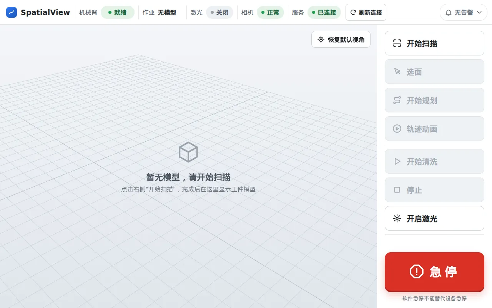

只显示地面网格和中央提示；只有"开始扫描"和"开启激光"可用。

### 6.3 扫描中、重建中、规划中

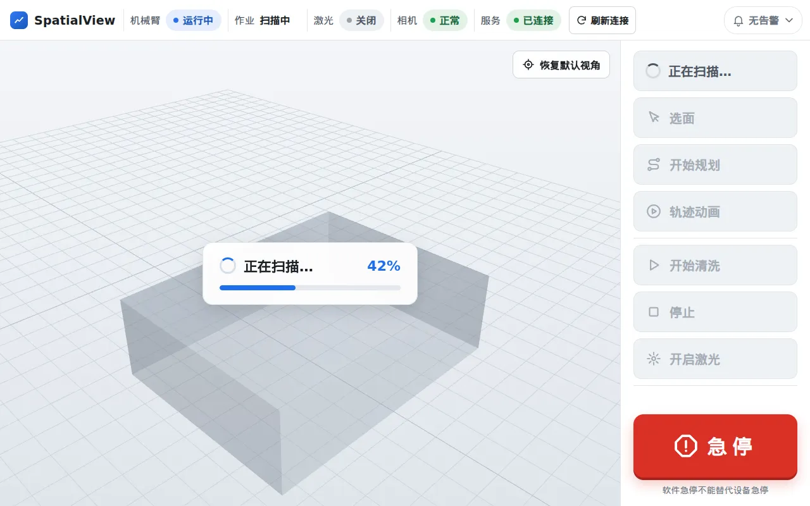

- 被按下的按钮变为进行中样式，文字为"正在扫描…""正在重建…""正在规划…"。
- 中央进度卡片；重新扫描时旧模型淡化显示，规划中工件正常显示。
- 机械臂状态为"运行中"（扫描），重建和规划时为"就绪"。

### 6.4 选面

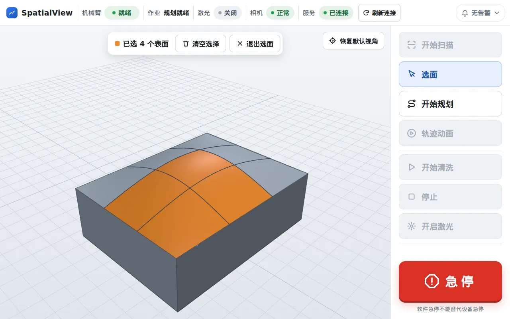

- 模式独占：按钮栏只有"开始规划"可用，"选面"按钮显示为当前模式（需求 5.3 规则 7）。
- 细线勾出各表面的分界；选中的表面为橙色，不可处理的表面为深灰色；TCP 路径隐藏。
- 顶部工具条显示已选数量，可以清空或退出。

### 6.5 轨迹动画

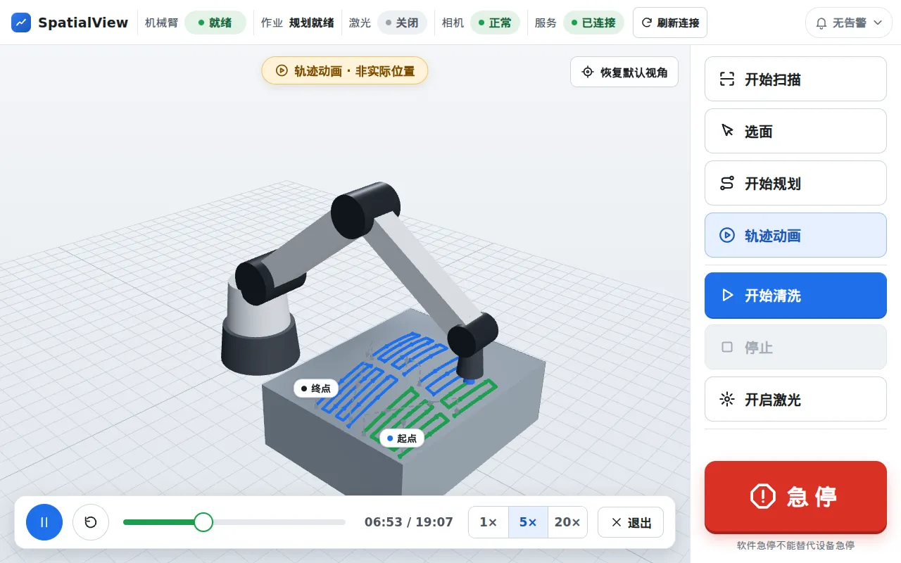

- 视角拉远到能看到整个机械臂；顶部常驻琥珀色标签"轨迹动画 · 非实际位置"。
- 已走过的工艺段变绿；底部播放条。
- 按钮栏与规划就绪相同，"轨迹动画"按钮显示为当前模式。

### 6.6 执行中、已暂停、停止中

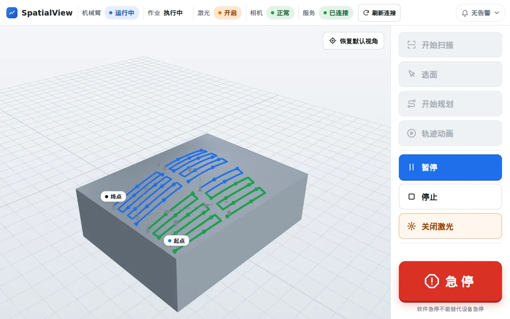

- 不显示机械臂；路径按服务端的实际已执行时间着色（需求 6.5）。
- 执行中：主按钮"暂停"，"停止"可用；激光开启时按钮为橙色"关闭激光"。
- 已暂停：机械臂状态为黄色"暂停"，主按钮变为"继续"。
- 停止中：主按钮"开始清洗"和"停止"都不可用。

### 6.7 确认对话框

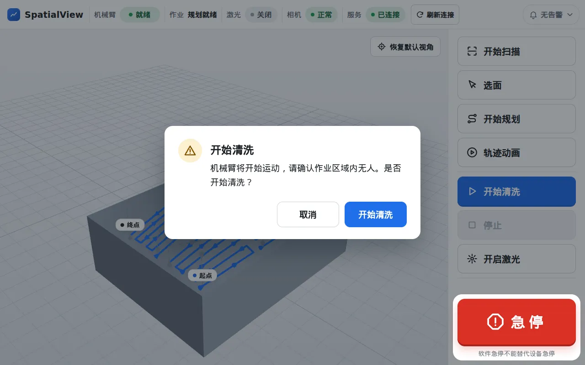

确认按钮的文字与操作一致；急停区在遮罩之上仍然清晰可按。

### 6.8 结果提示框

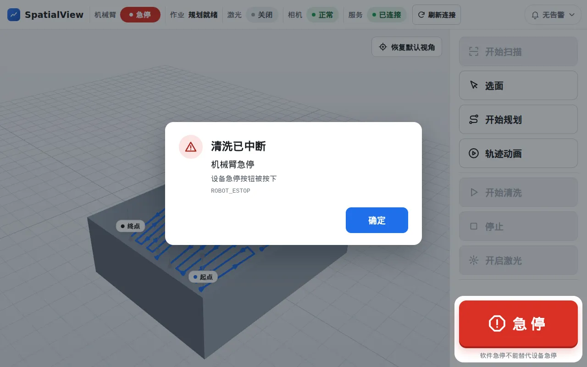

清洗中急停：标题"清洗已中断"，原因"机械臂急停"，补充说明和原因码。机械臂状态为红底白字"急停"，开始扫描、开始清洗、开启激光不可用。软件急停时三维区顶部还有机械臂提示和"复位急停"（6.13），截图中没有。

### 6.9 指令被拒绝

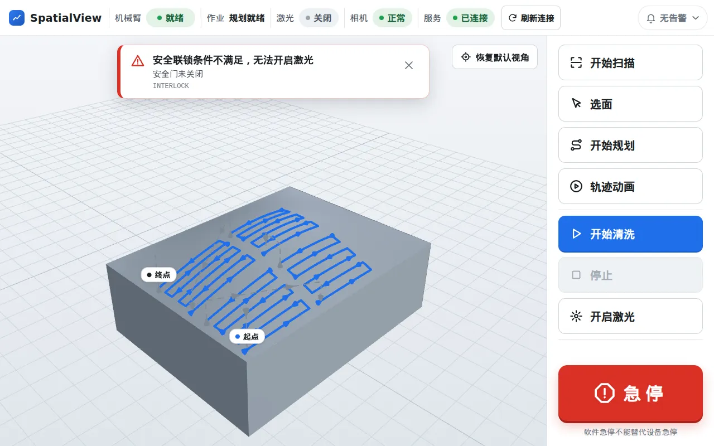

开启激光被拒绝（`INTERLOCK`）：顶部短时提示，主要文字由 APP 给出，"安全门未关闭"来自服务端的补充说明。

### 6.10 告警面板

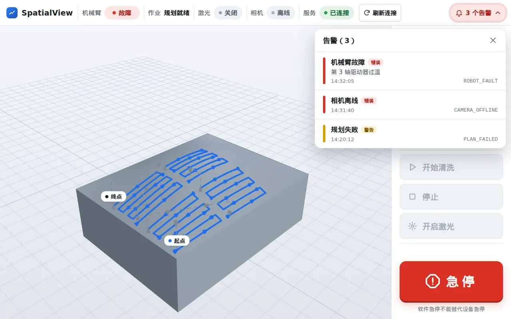

机械臂故障、相机离线、规划失败三条告警；Status Bar 中告警按钮为红色，机械臂"故障"，相机"离线"。

### 6.11 连接断开

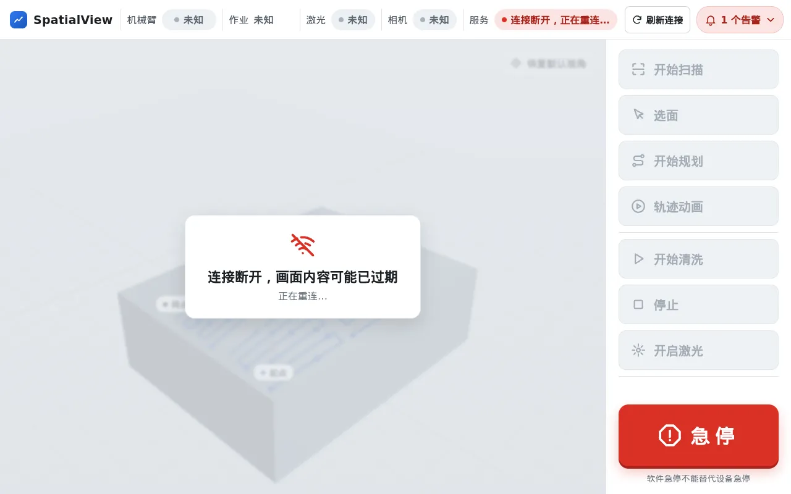

保留最后的画面并加遮罩；设备和作业状态为"未知"；除急停和"刷新连接"外全部不可用；告警数包含本地告警"网络连接断开"。

### 6.12 急停发送失败

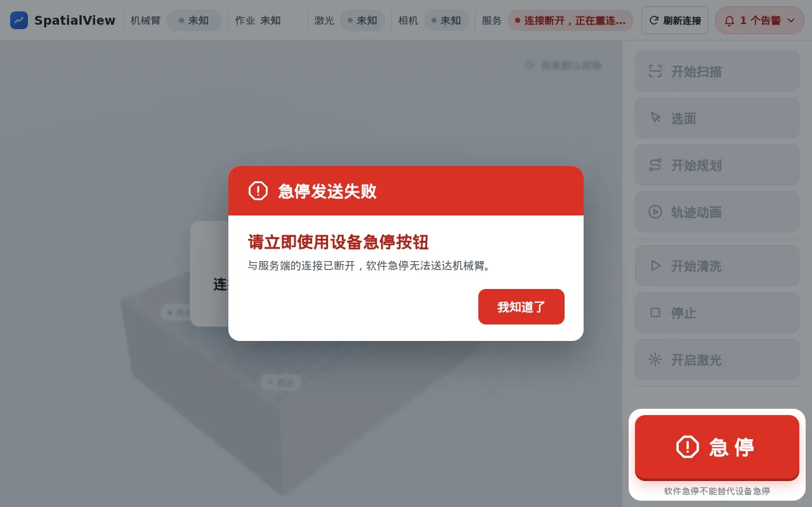

安全警示对话框；急停区仍在遮罩之上，可以继续尝试。

### 6.13 软件急停、设备急停、未启动（原型未包含）

- 软件急停：Status Bar 机械臂为红底白字"急停"；三维区顶部为急停样式的机械臂提示，标题"软件急停已触发"，右侧"复位急停"。点击后弹出确认对话框（需求 5.4），确认按钮文字为"复位急停"；复位成功后提示消失，机械臂状态按服务端的新状态显示。
- 设备急停：同样的急停样式，标题"设备急停已触发"，没有按钮。
- 未启动：Status Bar 机械臂为灰色"未启动"；三维区顶部为未启动样式的提示，没有按钮；开始扫描、开始清洗、开启激光不可用。

## 7 文案

- **简短**：按钮用动词开头的 2–4 个字；提示一句话说清结果和下一步。
- **不出现技术术语**：不出现 ROS、Topic、Service、rosbridge 等词（需求 12.3）；状态码只作为小号灰字附在末尾。
- **标点**：使用中文全角标点；进行中的文字以"…"结尾；不使用感叹号。
- **固定文案的出处**：确认对话框见需求 5.4，结果提示框见需求 5.5，机械臂提示见需求 5.6，Status Bar 见需求 5.2，状态码文字见接口文档第 7 节。

本文新增的固定文案：

| 位置 | 文案 |
| --- | --- |
| 无模型提示下方说明 | 点击右侧"开始扫描"，完成后在这里显示工件模型 |
| 断线遮罩第二行 | 正在重连… |
| 急停发送失败 | 标题"急停发送失败"；正文"请立即使用设备急停按钮"；说明"与服务端的连接已断开，软件急停无法送达机械臂。"（超时或驱动返回失败时为"软件急停未生效。"） |
| 激光关闭失败 | 标题"激光关闭失败"；正文"请立即使用设备急停按钮" |
| 安全警示按钮 | 我知道了 |

## 8 动效

只保留帮助理解状态的动效：

| 动效 | 时长 |
| --- | --- |
| 转圈（进行中、指令在途） | 0.9 秒一圈，匀速 |
| 对话框、告警面板出现 | 150 毫秒淡入加轻微放大 |
| 短时提示出现、消失 | 200 毫秒自上滑入、淡出 |
| 机械臂提示出现、消失 | 200 毫秒淡入、淡出 |

状态胶囊和按钮的颜色变化不做过渡，立即切换，状态以最新为准。

## 9 原型

- 打开 [prototype/index.html](prototype/index.html)，左侧列表切换 12 个画面，键盘 ↑ ↓ 也可切换；三维区可以拖动旋转、滚轮或双指缩放。
- 截图模式：`index.html?capture=1&screen=<画面 id>`，只输出 1280 × 800 的 APP 画面。运行 `prototype/capture.sh` 重新生成本文的全部截图（需要 Google Chrome 和网络）。
- 原型中的工件是解析曲面，路径是在示意表面上的往复扫描，机械臂用简化逆解驱动，都只用于展示视觉效果。原型中的机械臂是简化几何，外形和尺寸都不是 i5H，以第 5 节为准。
- 原型对应需求文档第 6 版，没有本文第 2 版新增的"未启动"状态和机械臂提示（6.13）。
