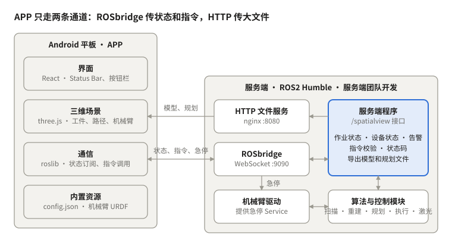
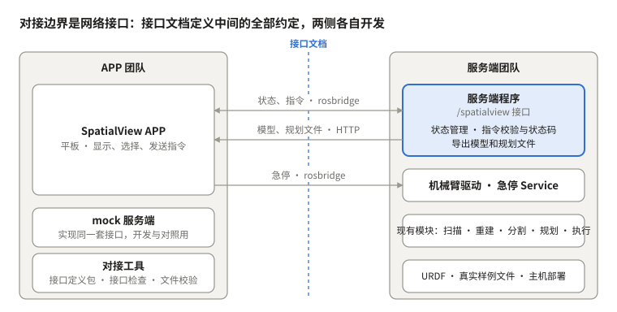
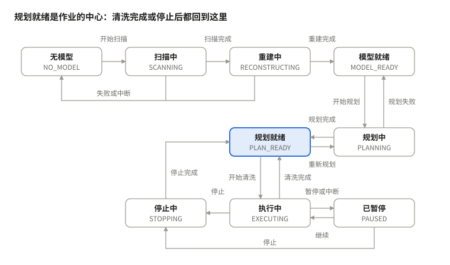

# SpatialView 服务端对接接口文档

| 文档版本 | 日期 | 说明 |
| --- | --- | --- |
| 1 | 2026-10-09 | 初稿：APP 团队开发接口节点，服务端团队实现后端类 |
| 2 | 2026-10-12 | 重写：服务端团队实现全部服务端功能；本文档成为 APP 与服务端之间唯一的对接文档，定义全部接口、状态码、服务端行为和服务端需要具备的功能 |
| 3 | 2026-10-13 | 架构与可行性审核：机械臂急停须在服务端程序异常时仍可用（进程独立、自动重启）；急停延迟暂不作要求；补充线程与 GIL 的实现提示、URDF 面数、启动时离线告警延迟、状态码常量位置、时钟说明；接口检查默认不开启激光 |
| 4 | 2026-10-15 | 机械臂确定为 AUBO i5H，控制系统 ARCS 0.31.1-rc.5：机械臂状态按 ARCS 的机械臂模式和安全模式得出，新增"未启动"（DISABLED）；ARCS 不能由软件触发急停，软件急停改为驱动停止运动并锁存、机械臂保持上电，新增 `software_estop` 字段和复位 Service ResetEstop；新增保护性停止、防护停止、未启动的原因码和告警码；URDF 改用官方 i5H 模型；补充控制器连接，aubo_sdk 使用 0.27.1-rc.4，rosbridge 不放行驱动的其他 Service；规划文件示例改为 i5H 的关节名和可达位姿 |
| 5 | 2026-10-15 | 修正 15.2 中 SetLaser 的命令行示例：键名 `on` 要加引号 |
| 6 | 2026-10-15 | 15.1 补充工具、mock 服务端和开发环境的说明位置 |
| 7 | 2026-10-16 | 服务端确认：0.31.1-rc.5 是示教器的版本，服务端使用 aubo_sdk 0.27。1.1、8.2、14.6 按此修改，控制器的 ARCS 版本以服务端启动时读取的为准，第 16 节增加相应的填写项；1.1 增加平板（Chainway P100，Android 14） |
| 8 | 2026-10-26 | 服务端确认：接口以本文为准，本版定稿。16.2 的默认做法全部采用，去掉正文中的【待确认】；机械臂急停 Service 使用 `/robot_driver/emergency_stop`；16.1 的信息和 URDF 改为联调前提供（1.3） |
| 9 | 2026-11-03 | 服务端提供主机 IP 192.168.1.10：14.1 和示例中的地址按此修改，APP 的默认配置同步修改 |
| 10 | 2026-11-15 | 按服务端团队提出的三项需求修改，接口版本改为 1.1：StartScan 增加工件类型 `workpiece_type`，供服务端选择重建算法（6.3）；新增上电 Service PowerOn（6.9），机械臂状态增加"启动中"（STARTING，8.2），操作结果增加 POWER_ON（8.7）；APP 不再因设备状态禁用"开始清洗""继续"，TaskControl 的 START、RESUME 不再检查激光器，开始时激光器异常或离线的清洗整次不出光（6.5、8.5、8.6）。2.1、4、7.1–7.3、15.4、16.1、附录 A 相应修改。APP 0.1.1 可以继续连接：不传工件类型时服务端按通用处理；机械臂为启动中时，0.1.1 按接口不匹配处理，期间除急停和关闭激光外的按钮不可用 |
| 11 | 2026-11-18 | 服务端团队要求选面与原工程 RViz 中的选面工具（roi 插件）一致。接口不变，仍为 1.1，只写明表面的含义和服务端的做法：表面就是规划服务的任务面，按三角面邻接关系和法向分区，不按连通块划分，显示与规划使用同一份分面结果（10.1）；StartPlan 在完整网格上为所选任务面规划，找不到对应的任务面时报错，不改为规划全部（6.4）；旋转体只导出一个表面（10.1）。APP 联调期间把激光器离线视为关闭，开始清洗前不再警告（6.5）。2.1、16 相应修改 |

**阅读说明**

- 读者：服务端团队（包括用本文档制定开发计划的 agent）、APP 团队。
- 本文档是 APP 与服务端之间**唯一**的对接约定。接口、状态码、服务端行为都以本文为准；[需求文档](需求文档.md)只描述 APP 的界面和交互，涉及接口时引用本文。
- "必须"为硬性要求；"建议"可按实际情况调整。
- 【服务端填写】：需要服务端团队补充的信息，汇总在 16.1。APP 团队拟定的默认做法已由服务端团队确认（2026-10-26），汇总在 16.2。
- 第 2 节的功能编号 F-01 至 F-22 用于制定开发计划和逐项验收。

## 1 概述

### 1.1 系统组成

SpatialView 是现场操作员使用的 Android 平板 APP：发起扫描，浏览重建出的工件模型，选择表面并发起路径规划，查看 TCP 路径和轨迹动画，控制清洗任务。所有算法、状态判断和设备控制都在服务端完成，APP 只负责显示、选择和发送指令。

现场设备：

| 设备 | 型号与版本 | 说明 |
| --- | --- | --- |
| 机械臂 | AUBO i5H | 6 轴协作机械臂。按官方 URDF，上臂 0.408 米、前臂 0.376 米，工作半径约 0.89 米 |
| 机械臂控制器 | ARCS，示教器版本 0.31.1-rc.5 | 遨博机械臂控制系统。服务端经 aubo_sdk 0.27 连接，RPC 端口 30004，RTDE 端口 30010（14.6）；APP 不访问控制器 |
| 激光器 | 【服务端填写】 | |
| 相机 | 【服务端填写】 | |
| 平板 | Chainway P100，Android 14 | 运行 SpatialView APP，经现场无线网络连接服务端；Wi-Fi 支持 2.4 GHz 和 5 GHz（14.1） |



APP 只通过两条通道访问服务端：

- **rosbridge（WebSocket）**：状态和指令。一个状态 Topic、一个状态查询 Service、六个指令 Service，以及机械臂驱动提供的急停 Service。
- **HTTP**：工件模型 GLB 和规划文件等大文件。

机械臂 URDF 由服务端团队提供，随 APP 打包，不在运行时传输。

### 1.2 分工



| 内容 | 负责方 |
| --- | --- |
| 服务端全部功能（第 2 节），包括状态管理、`/spatialview` 接口、模型和规划文件导出、设备状态、机械臂急停 Service 与锁存、主机部署 | 服务端团队 |
| 机械臂 URDF 与网格（第 12 节）：官方 i5H 模型加末端工具 | 服务端团队提供，APP 团队打包 |
| APP | APP 团队 |
| 接口定义包 `spatialview_msgs`（第 5、6 节的消息和服务） | APP 团队按本文编写，服务端直接使用，不自行修改 |
| mock 服务端：实现本文全部接口，用模拟数据代替设备和算法 | APP 团队；用于 APP 开发，服务端也可用它对照接口行为 |
| 接口检查工具、文件校验工具（第 15.1 节） | APP 团队提供，服务端自测使用 |

接口有任何修改，先修改本文档，双方确认后再同步修改 `spatialview_msgs` 和两端代码。

### 1.3 交付物与时间点

| # | 交付物 | 提供方 | 时间点 |
| --- | --- | --- | --- |
| 1 | 确认本文的接口和 16.2 的默认做法（2026-10-26 已确认）；填写 16.1 的信息 | 服务端团队 | 确认：M1 结束前；16.1：联调前 |
| 2 | `spatialview_msgs`、mock 服务端、接口检查工具、文件校验工具 | APP 团队 | M1 |
| 3 | 机械臂 URDF 与网格：官方 i5H 模型加末端工具 | 服务端团队 | 联调前 |
| 4 | 真实样例文件：按第 10、11 节导出的 GLB 和规划文件，至少各一组 | 服务端团队 | M2 |
| 5 | 服务端实现第 2 节全部功能，通过接口检查工具 | 服务端团队 | M3 |
| 6 | 主机部署，现场联调，通过第 15.4 节的验收场景 | 双方 | M4 |

里程碑的内容见[架构设计](架构设计.md)第 9 节。

## 2 服务端需要具备的功能

### 2.1 功能清单

服务端目前是仅具备功能的 demo。下表列出与 APP 对接必须具备的全部功能。"现状"一栏请服务端团队填写（已具备 / 部分具备 / 未具备），作为制定开发计划的依据。

| 编号 | 功能 | 要求 | 详见 | 现状【服务端填写】 |
| --- | --- | --- | --- | --- |
| F-01 | 状态发布 | 每 500 毫秒发布一次 SystemState，状态变化时立即补发；维护 `session_id`、`seq` | 5 | |
| F-02 | 状态查询 | GetSystemState 返回最近一次发布的状态 | 6.2 | |
| F-03 | 指令处理 | 六个指令 Service：按规定顺序校验，返回状态码，先发布状态再回复，500 毫秒内返回 | 6、7.1 | |
| F-04 | 作业状态管理 | 维护作业阶段 phase；新模型、新规划成功后才替换旧的；失败或中断时回到发起前的阶段 | 8.1、8.4 | |
| F-05 | 设备状态监测 | 机械臂状态由 ARCS 的机械臂模式、安全模式和软件急停锁存得出；机械臂、相机、激光器的状态在变化后 500 毫秒内反映到 SystemState；设备异常时中断进行中的扫描或清洗 | 8.2、8.3、8.5 | |
| F-06 | 操作结果与告警 | 维护 `last_result`、`alarms`，使用第 7 节的原因码和告警码 | 7.2、7.3、8.7 | |
| F-07 | 扫描 | 机械臂按扫描轨迹运动、相机采集；建议提供进度 | 6.3 | |
| F-08 | 重建与表面分割 | 按 APP 传入的工件类型（旋转体、通用）选择重建算法；在 `base_link` 下生成三角网格，并把网格划分为表面（规划服务的任务面），标注每个表面能否清洗 | 6.3、10.1 | |
| F-09 | 模型导出 | 按第 10 节导出 GLB，经 HTTP 提供 | 9、10 | |
| F-10 | 路径规划 | 在完整网格上对指定表面规划清洗路径；部分表面无法规划时仍给出其余表面的规划 | 6.4 | |
| F-11 | 规划导出 | 按第 11 节导出规划文件，包含关节轨迹和 TCP 路径点 | 11 | |
| F-12 | 任务执行 | 开始、暂停、继续、停止；执行的轨迹与规划文件一致；提供实际已执行时间；开始时激光器异常或离线的，整次不出光 | 6.5 | |
| F-13 | 激光控制 | 开关激光；开启时检查联锁；执行中由任务按工艺段自动开关；按规则自动关闭 | 6.6、8.6 | |
| F-14 | 机械臂急停 Service | 由机械臂驱动提供，APP 直接调用，不经过作业逻辑；立即停止机械臂运动并锁存，锁存在驱动重启后保持；服务端程序异常时仍可用 | 6.7、14.4 | |
| F-15 | APP 断开检测 | 通过 rosbridge 客户端数判断 APP 断开，据此关闭手动开启的激光 | 8.6、14.2 | |
| F-16 | 启动与重启 | 每次启动生成新会话，清理旧文件，停止上一次遗留的扫描或清洗 | 8.8 | |
| F-17 | 文件服务 | nginx 提供模型和规划文件，带跨域响应头 | 9、14.3 | |
| F-18 | 日志 | 记录每次 Service 调用、阶段迁移、设备状态变化、告警和操作结果 | 14.5 | |
| F-19 | 部署 | rosbridge 访问限制与参数、开机自动启动、进程异常退出后自动重启、隔离网络 | 14 | |
| F-20 | URDF 交付 | 在官方 i5H URDF 上加末端工具和 TCP 坐标系，连同网格交给 APP 团队 | 12 | |
| F-21 | 急停复位 | ResetEstop：清除软件急停的锁存，机械臂不运动，作业阶段不变 | 6.8 | |
| F-22 | 机械臂上电 | PowerOn：机械臂上电并松开刹车，进入可以运动的状态；上电期间 `robot_state` 为启动中，结束时给出操作结果 | 6.9、8.2 | |

### 2.2 建议的实现顺序

按以下顺序实现，APP 可以在每一步完成后开始对应的联调，不必等全部完成：

| 步骤 | 实现内容 | 完成后可联调的内容 |
| --- | --- | --- |
| 1 接口骨架 | F-01 至 F-04、F-06、F-17。设备和算法暂用模拟值，模型和规划直接提供样例文件 | 连接、状态显示、按钮可用性、状态码提示、断线重连 |
| 2 设备接入 | F-05、F-13、F-14、F-15、F-21、F-22 | 设备状态显示、激光规则、急停与复位、上电 |
| 3 扫描与模型 | F-07 至 F-09 | 扫描、模型显示、选面 |
| 4 规划 | F-10、F-11 | TCP 路径、轨迹动画 |
| 5 执行 | F-12 | 开始、暂停、继续、停止，执行进度 |
| 6 运行保障 | F-16、F-18、F-19 | 现场验收 |

F-20 与步骤 1 同时进行（M1 交付）。

## 3 通用约定

| 项目 | 约定 |
| --- | --- |
| ROS 版本 | ROS 2 Humble |
| 接口包 | `spatialview_msgs`。枚举值常量定义在所属消息中（例如 `SystemState.PHASE_NO_MODEL`）；第 7 节的全部状态码定义在只含常量的 `StatusCode.msg` 中（例如 `StatusCode.ROBOT_NOT_READY`）。代码中引用常量，不手写字符串 |
| 命名空间 | 本文定义的 Topic 和 Service 都在 `/spatialview` 下；机械臂急停 Service 例外，见 6.7 |
| 命名 | Topic 用名词，Service 用动词开头，全小写下划线；消息和服务类型用大驼峰；枚举值和状态码全大写下划线。后续新增接口沿用同一规则，例如工艺设备控制可命名为 `/spatialview/set_device` |
| 坐标系 | 所有几何数据（GLB 顶点、TCP 路径、URDF 根坐标系）都在机械臂 `base_link` 下，Z 轴向上，不做任何轴变换 |
| 单位 | 长度米，角度弧度，时间秒；四元数顺序为 x、y、z、w |
| 枚举与状态码 | 字符串，取值见各字段和第 7 节 |
| 文字 | 面向操作员的文字全部由 APP 按状态码给出。服务端只在 `detail` 字段提供可选的补充说明（见 7.4） |
| ID | `model_id`、`plan_id` 由服务端生成：只含字母、数字、下划线、连字符；带时间戳，服务端重启后也不重复，例如 `model_20261012T153012`、`plan_20261012T153512` |
| 时间戳 | `builtin_interfaces/Time`，服务端系统时间。现场网络没有对时服务，平板与服务端的时钟可能不一致，APP 只显示服务端时间，不与平板时间比较 |

**接口版本**：SystemState 的 `interface_version` 为"主版本.次版本"，本文档对应 `1.1`。

| 变化 | 版本号 |
| --- | --- |
| 新增字段、新增枚举值、新增状态码 | 次版本号 +1，旧 APP 可以继续使用 |
| 删除或重命名字段，改变字段含义、迁移规则或状态码含义 | 主版本号 +1；主版本号不一致时，APP 禁用除急停和关闭激光以外的全部指令 |

## 4 接口总览

| 类型 | 名称 | 类型定义 | 方向 | 用途 |
| --- | --- | --- | --- | --- |
| Topic | `/spatialview/system_state` | `spatialview_msgs/msg/SystemState` | 服务端 → APP | 完整系统状态 |
| Service | `/spatialview/get_system_state` | `spatialview_msgs/srv/GetSystemState` | APP → 服务端 | 连接时获取完整状态 |
| Service | `/spatialview/start_scan` | `spatialview_msgs/srv/StartScan` | APP → 服务端 | 按工件类型开始扫描，扫描后自动重建和分割 |
| Service | `/spatialview/start_plan` | `spatialview_msgs/srv/StartPlan` | APP → 服务端 | 开始规划 |
| Service | `/spatialview/task_control` | `spatialview_msgs/srv/TaskControl` | APP → 服务端 | 开始、暂停、继续、停止清洗 |
| Service | `/spatialview/set_laser` | `spatialview_msgs/srv/SetLaser` | APP → 服务端 | 开启、关闭激光 |
| Service | `/spatialview/reset_estop` | `spatialview_msgs/srv/ResetEstop` | APP → 服务端 | 复位软件急停 |
| Service | `/spatialview/power_on` | `spatialview_msgs/srv/PowerOn` | APP → 服务端 | 机械臂上电 |
| Service | `/robot_driver/emergency_stop` | `std_srvs/srv/Trigger` | APP → 机械臂驱动 | 软件急停（6.7） |
| HTTP GET | `http_base_url` + `model_url` | glTF 二进制 | 服务端 → APP | 工件模型 |
| HTTP GET | `http_base_url` + `plan_url` | JSON | 服务端 → APP | 规划文件 |

- APP 不使用其他 Topic、Service、参数，也不使用 ROS 2 Action（rosbridge 和各客户端库对 Action 的支持程度不一）。耗时过程统一为"Service 立即回复是否受理 + SystemState 反映进度和结果"。
- APP 通过 rosbridge 的 JSON 协议访问以上接口，报文示例见附录 A。
- `http_base_url` 是 APP 配置中的文件服务根地址，例如 `http://192.168.1.10:8080`。

## 5 状态 Topic

### 5.1 SystemState

```text
# spatialview_msgs/msg/SystemState
string interface_version        # 接口版本，本文档为 "1.1"
string session_id               # 服务端每次启动生成一个新值
uint64 seq                      # 本会话内每发布一次加 1，从 1 开始
builtin_interfaces/Time stamp   # 发布时间

string robot_state              # 机械臂状态：READY RUNNING PAUSED FAULT ESTOP DISABLED STARTING OFFLINE（8.2）
bool software_estop             # 软件急停已触发、尚未复位（6.7、6.8）；为 true 时 robot_state 为 ESTOP
string camera_state             # 相机状态：OK ERROR OFFLINE（8.3）
string laser_state              # 激光器状态：OFF ON ERROR OFFLINE（8.3）
string phase                    # 作业阶段（8.1）

float32 progress                # 扫描中、重建中、规划中的完成百分比 0–100；其他阶段或无法提供时为 -1
float64 exec_time               # 本次清洗实际已执行的时间，秒，不含暂停
                                # 执行中、已暂停、停止中有效，其他阶段为 0

string model_id                 # 当前模型；无模型时为空
string model_url                # 当前模型文件的相对路径，例如 /models/model_20261012T153012.glb
string plan_id                  # 当前规划；无规划时为空
string plan_url                 # 当前规划文件的相对路径，例如 /plans/plan_20261012T153512.json
string[] plan_surface_ids       # 当前规划实际包含的表面

Alarm[] alarms                  # 当前活动告警（5.2）
OperationResult last_result     # 最近一次操作结果（5.3）；本会话还没有结果时 id 为空
```

字段规则：

- `model_id`、`model_url` 只在新模型重建成功、GLB 导出完成后同时更新；扫描中、重建中保持旧值。`plan_*` 同理，规划中保持旧值。更新时，URL 指向的文件必须已经可以下载。
- 新模型生效时，`plan_id`、`plan_url`、`plan_surface_ids` 同时清空。
- `plan_surface_ids` 与规划文件中的 `surface_ids` 一致；规划全部表面时也逐个列出。
- `progress` 在扫描中、重建中、规划中各自从 0 开始。
- `exec_time` 在开始清洗时从 0 开始，暂停期间不增长，与规划文件的时间轴 `t` 对齐；APP 用它给 TCP 路径做进度着色。

### 5.2 Alarm

```text
# spatialview_msgs/msg/Alarm
string code                     # 告警码（7.3）；同一 code 同时最多一条
string level                    # WARNING（不影响作业）或 ERROR（影响作业）
string detail                   # 补充说明，可为空（7.4）
builtin_interfaces/Time stamp   # 产生时间；同一告警持续期间不变
```

### 5.3 OperationResult

```text
# spatialview_msgs/msg/OperationResult
string id                       # 每个结果唯一，服务端重启后也不重复，例如 "<session_id>-<序号>"
string operation                # SCAN RECONSTRUCT PLAN TASK POWER_ON
string result                   # SUCCEEDED FAILED INTERRUPTED STOPPED
string code                     # 原因码（7.2）；没有需要说明的原因时为空
string detail                   # 补充说明，可为空（7.4）
builtin_interfaces/Time stamp   # 操作结束时间
```

可能出现的组合见 8.7。

### 5.4 发布规则

- 每 500 毫秒发布一次；除 `progress`、`exec_time` 外的任何字段变化时，200 毫秒内立即补发一次。
- APP 超过 3 秒收不到 SystemState 即判定断线，因此服务端在任何情况下（包括执行耗时操作时）都不能停止定时发布。
- `seq` 每次发布加 1。APP 只应用 `seq` 不小于已收到值的消息；`session_id` 变化时重新计数。
- 使用默认 QoS（reliable、volatile）。
- 实现提示：定时发布、Service 回调和耗时工作必须互不阻塞。建议使用 `MultiThreadedExecutor`，为它们分配不同的回调组，耗时工作放到独立线程。Python 中大文件序列化等纯 Python 计算会长时间占用 GIL、拖延定时发布，建议放到子进程中进行。

## 6 指令 Service

### 6.1 通用规则

六个指令 Service（StartScan、StartPlan、TaskControl、SetLaser、ResetEstop、PowerOn）的响应部分相同：

```text
---
string code                     # 状态码："OK" 表示受理，其他值为拒绝原因（7.1）
string detail                   # 补充说明，可为空（7.4）
SystemState state               # 处理该指令后的完整状态
```

处理规则：

1. **快速返回**：Service 只表示受理或拒绝，必须在 500 毫秒内返回。扫描、重建、规划、执行等耗时过程在后台进行，通过 SystemState 体现。
2. **校验顺序**：按各 Service 表格中的顺序逐项检查，返回第一个不满足条件的状态码。
3. **受理流程**：完成阶段迁移并启动对应操作 → 以新的 `seq` 发布 SystemState → 在回复中带上这同一份状态。这样 APP 收到回复后立即更新界面，不会与 Topic 交替导致按钮闪烁。
4. **启动失败**：受理过程中启动操作失败（例如模块无响应、设备拒绝指令）时，不改变阶段，返回对应状态码（`MODULE_UNAVAILABLE`、`DEVICE_ERROR` 或 `INTERNAL_ERROR`）。
5. **拒绝时**：不改变任何状态，回复中带最近一次发布的状态。
6. **重复指令**：例如扫描中再次收到 StartScan，返回 `INVALID_STATE`。
7. **串行处理**：指令逐个处理，不并发修改状态。rosbridge 会并发发起 Service 调用（14.2），服务端需要自行加锁。
8. **日志**：每次调用都记录（14.5）。

### 6.2 GetSystemState

```text
# spatialview_msgs/srv/GetSystemState
---
SystemState state               # 最近一次发布的状态
```

任何时候都可以调用。APP 每次建立连接后先调用它，再订阅 Topic。

### 6.3 StartScan：开始扫描

```text
# spatialview_msgs/srv/StartScan
string WORKPIECE_TYPE_REVOLVED="REVOLVED"
string WORKPIECE_TYPE_GENERAL="GENERAL"

string workpiece_type           # 工件类型：REVOLVED 旋转体，GENERAL 通用；为空时按 GENERAL 处理
---
string code
string detail
SystemState state
```

| 工件类型 | 含义 |
| --- | --- |
| REVOLVED | 旋转体：可以由一个截面绕一根轴旋转 360° 形成的工件 |
| GENERAL | 通用：其他工件 |

| 顺序 | 受理条件 | 不满足时 |
| --- | --- | --- |
| 1 | `workpiece_type` 为 REVOLVED、GENERAL 或空 | `INVALID_ARGUMENT` |
| 2 | `phase` 为 NO_MODEL、MODEL_READY 或 PLAN_READY | `INVALID_STATE` |
| 3 | `robot_state` 为 READY | `ROBOT_NOT_READY` |
| 4 | `camera_state` 为 OK | `CAMERA_NOT_READY` |
| 5 | 扫描、重建所需模块可用 | `MODULE_UNAVAILABLE` |

- 操作员每次开始扫描都在 APP 上选择工件类型，APP 不预选，总是传入 REVOLVED 或 GENERAL。为空只出现在不传该字段的旧版 APP（0.1.1 及以前）上，服务端按 GENERAL 处理。
- 服务端按工件类型选择重建算法；是否同时调整扫描轨迹由服务端决定。旋转体的轴由服务端从扫描数据中求得，APP 不提供。

受理后：

- 阶段变为扫描中；记录发起前的阶段。
- 关闭手动开启的激光；移除 `SCAN_FAILED`、`RECONSTRUCT_FAILED`、`PLAN_FAILED`、`LEFTOVER_TASK_STOPPED` 告警。
- 机械臂按服务端确定的扫描轨迹运动，相机采集。除工件类型外，APP 不提供其他扫描参数。
- 扫描成功后自动进入重建中，完成重建、表面分割和 GLB 导出，不需要新的指令。
- 当前模型和规划保留到新模型生成成功；扫描或重建失败时继续有效。

### 6.4 StartPlan：开始规划

```text
# spatialview_msgs/srv/StartPlan
string model_id                 # APP 当前加载的模型
string[] surface_ids            # 要规划的表面；为空表示该模型全部可清洗表面
---
string code
string detail
SystemState state
```

| 顺序 | 受理条件 | 不满足时 |
| --- | --- | --- |
| 1 | `phase` 为 MODEL_READY 或 PLAN_READY | `INVALID_STATE` |
| 2 | `model_id` 等于当前模型 | `MODEL_MISMATCH` |
| 3 | `surface_ids` 中每个表面都存在且可清洗 | `INVALID_SURFACE` |
| 4 | 规划模块可用 | `MODULE_UNAVAILABLE` |

`model_id` 或某个 `surface_id` 对应不上当前模型的任务面时，按上表拒绝，**不能改为规划全部**。APP 只在操作员没有选择表面、并在"规划全部"对话框中确认后才发送空数组（需求 5.4）。

受理后：

- 阶段变为规划中；记录发起前的阶段；移除 `PLAN_FAILED` 告警。
- `surface_ids` 为空时，规划全部可清洗表面。"空 = 全部"只用在这里。
- 规划使用**完整的原始网格**：按 `surface_ids` 找到对应的任务面（10.1），只为这些任务面生成路径；不先裁切出所选部分再重新分面。碰撞检测始终使用完整工件，包括未选中的表面。
- 规划模块需要种子点时，每个任务面取一个经过验证、确实落在该面内的点；不能直接用面的中心，凹面或带孔的面，中心可能不在面上。
- 当前规划保留到新规划生成成功；规划失败时继续有效。
- 部分表面无法规划（例如不可达）时，规划其余表面并视为成功：结果为 PLAN SUCCEEDED，原因码 `PLAN_PARTIAL`，`detail` 说明原因；`plan_surface_ids` 只包含实际规划的表面。全部表面都无法规划时，结果为 PLAN FAILED，原因码 `NO_SOLUTION`。

### 6.5 TaskControl：清洗任务控制

```text
# spatialview_msgs/srv/TaskControl
string command                  # START PAUSE RESUME STOP
string plan_id                  # START 时为 APP 当前加载的规划；其他命令不校验，可为空
---
string code
string detail
SystemState state
```

| command | 顺序 | 受理条件 | 不满足时 |
| --- | --- | --- | --- |
| 任意 | 1 | `command` 为 START、PAUSE、RESUME、STOP 之一 | `INVALID_ARGUMENT` |
| START | 2 | `phase` 为 PLAN_READY | `INVALID_STATE` |
| | 3 | `plan_id` 等于当前规划 | `PLAN_MISMATCH` |
| | 4 | `robot_state` 为 READY | `ROBOT_NOT_READY` |
| | 5 | 执行模块可用 | `MODULE_UNAVAILABLE` |
| PAUSE | 2 | `phase` 为 EXECUTING | `INVALID_STATE` |
| RESUME | 2 | `phase` 为 PAUSED | `INVALID_STATE` |
| | 3 | `robot_state` 为 PAUSED（即机械臂没有故障、急停、未启动、离线） | `ROBOT_NOT_READY` |
| STOP | 2 | `phase` 为 EXECUTING 或 PAUSED | `INVALID_STATE` |

受理后：

| command | 新阶段 | 服务端执行 |
| --- | --- | --- |
| START | 执行中 | `exec_time` 从 0 开始；按当前规划文件中的轨迹执行；激光由任务按工艺段自动开关，此前手动开启的激光也转由任务控制；整次不出光的任务不开启激光（见下文） |
| PAUSE | 已暂停 | 机械臂减速停止，保持可以继续的状态；关闭激光 |
| RESUME | 执行中 | 从暂停处继续；激光由任务重新开启，整次不出光的任务仍不开启 |
| STOP | 停止中 | 机械臂有序停止，关闭激光；停止完成后回到规划就绪，结果为 TASK STOPPED |

- 只有 START 校验 `plan_id`。PAUSE、RESUME、STOP 作用于当前任务，避免 APP 本地规划尚未同步时停止被拒绝。
- 清洗完成或停止后回到规划就绪，同一规划可以再次执行，再次执行从头开始。
- 指令发给控制器失败时返回 `DEVICE_ERROR`，阶段不变。
- APP 不因设备状态禁用"开始清洗"和"继续"：操作员确认 APP 列出的设备异常后照常发送，由服务端按上表受理或拒绝。

**激光器不可用时的清洗**：START、RESUME 不检查激光器。

- START 受理时 `laser_state` 为 ERROR 或 OFFLINE 的，本次任务**整次不出光**：机械臂照常按轨迹运动，任务不开启激光；激光器在任务中途恢复也不开启，直到本次任务结束。APP 在开始前已经警告操作员"本次清洗不出光，只运行轨迹"；联调期间 APP 把激光器离线视为关闭（需求 10.2 的 `integration.assume_laser_connected`，默认开启），离线时不警告，激光器异常时仍然警告。
- START 受理时 `laser_state` 为 OFF 或 ON 的为正常任务。任务中激光器变为异常或离线时按 8.5 中断，因此正常任务不会以激光器异常的状态停在已暂停；整次不出光的任务暂停后继续，仍不出光。
- 整次不出光的任务中，激光器的状态变化不影响任务。

### 6.6 SetLaser：激光开关

```text
# spatialview_msgs/srv/SetLaser
bool on                         # true 开启，false 关闭
---
string code
string detail
SystemState state
```

开启（`on = true`）：

| 顺序 | 受理条件 | 不满足时 |
| --- | --- | --- |
| 1 | `phase` 为 NO_MODEL、MODEL_READY 或 PLAN_READY | `INVALID_STATE` |
| 2 | `robot_state` 为 READY | `ROBOT_NOT_READY` |
| 3 | `laser_state` 为 OFF（为 ON 时视为重复指令） | ON 时 `INVALID_STATE`；ERROR、OFFLINE 时 `LASER_NOT_READY` |
| 4 | 联锁条件全部满足【服务端填写】 | `INTERLOCK`，`detail` 写明哪一项，例如"安全门未关闭" |
| 5 | 开启指令送达激光器 | `DEVICE_ERROR` |

关闭（`on = false`）：

- 任何阶段、任何设备状态下都受理；激光已经关闭时同样返回 `OK`。
- 只关闭激光，不改变任务和机械臂的运动。执行中关闭后，本次任务后续的工艺段不再自动开启激光，暂停后继续时由任务恢复。
- 关闭指令无法送达激光器（例如激光器离线）时返回 `DEVICE_ERROR`。

`OK` 表示激光器已接受指令，实际状态以 `laser_state` 为准。

### 6.7 机械臂急停 Service

软件急停由 APP **直接调用机械臂驱动提供的急停 Service**，不经过 `/spatialview` 接口和作业逻辑，即使作业逻辑异常也能停止机械臂。

ARCS 没有让控制器进入急停的软件接口：控制器的急停安全模式（`RobotEmergencyStop`、`SystemEmergencyStop`）只能由控制柜、示教器的急停按钮或安全输入触发。因此软件急停由驱动实现为**立即停止运动并锁存**：机械臂停下后保持上电、不抱闸；锁存期间不执行任何运动，直到通过 ResetEstop 复位（6.8）。

```text
# std_srvs/srv/Trigger
---
bool success                    # true：控制器已接受停止指令
string message                  # 失败原因，仅用于日志
```

| 项目 | 要求 |
| --- | --- |
| 名称 | `/robot_driver/emergency_stop` |
| 提供者 | 机械臂驱动，或直接与控制器通信的节点 |
| 停止 | 收到后立即以最快速度停止机械臂运动，例如调用 ARCS 的 `RuntimeMachine::abort()`：终止正在运行的程序；没有程序运行但机械臂在运动时，停止运动。驱动自己下发的运动（例如伺服模式下逐点下发的目标）同时停止下发。任何状态下都执行；可以重复调用 |
| 锁存 | 停止的同时进入软件急停锁存：锁存期间驱动不向控制器下发任何运动指令，也不执行服务端程序的运动请求，直到复位（6.8）。锁存状态写入文件，驱动进程重启、主机重启后仍然保持 |
| 不断电 | 不调用 `RobotManage::poweroff()`，不抱闸。复位后机械臂可以直接接受新的运动指令，不需要重新上电 |
| 返回 | 停止指令被控制器接受后立即返回 `success = true`；不能被该节点的其他回调阻塞（使用独立的回调组） |
| 失败 | 控制器未连接或拒绝时返回 `success = false`，但同样进入锁存，连接恢复后也不会运动。APP 收到 false、rosbridge 调用失败或 1 秒超时，都提示"急停发送失败，请立即使用设备急停按钮" |
| 急停之后 | 服务端从驱动取得锁存状态：`software_estop` 为 true，`robot_state` 为 ESTOP；按 8.5 中断进行中的扫描或清洗，关闭激光 |
| 访问 | rosbridge 白名单必须放行该 Service（14.2） |
| 独立性 | 服务端程序停止或重启期间，该 Service 仍然可用（14.4）；服务端程序重启后从驱动重新取得锁存状态 |

驱动还要向服务端程序提供锁存状态和清除锁存的方法，供 `software_estop` 和 ResetEstop 使用。这是服务端内部的接口，名称和形式由服务端团队决定，不需要经 rosbridge 访问。

如果驱动现有的停止接口不是 Service，或类型不是 `std_srvs/srv/Trigger`，请在驱动中增加一个该类型的 Service，直接调用控制器的停止功能，不转发给其他节点。遨博官方的 ROS 2 驱动（aubo_ros2_driver）没有急停 Service 和锁存，使用它时需要补充（14.6）。

### 6.8 ResetEstop：复位软件急停

```text
# spatialview_msgs/srv/ResetEstop
---
string code
string detail
SystemState state
```

| 顺序 | 受理条件 | 不满足时 |
| --- | --- | --- |
| 1 | `software_estop` 为 true（没有锁存时视为重复指令） | `INVALID_STATE` |
| 2 | `phase` 不是扫描中、执行中、已暂停、停止中，即急停引起的中断已经完成（8.5） | `INVALID_STATE` |
| 3 | 驱动确认已清除锁存 | `DEVICE_ERROR` |

受理后：

- 驱动清除锁存，包括文件中的记录；服务端以新的 `seq` 发布 `software_estop` 为 false 的状态，再回复。
- `robot_state` 按 8.2 重新得出：机械臂可以运动时为 READY；设备急停仍未解除时仍为 ESTOP；机械臂未上电时为 DISABLED，可以经 PowerOn 上电（6.9）。
- 复位不让机械臂运动，不恢复被中断的扫描或清洗，也不改变作业阶段。之后的任何运动都由操作员重新发起。
- 设备急停（急停按钮、安全输入）不能通过本 Service 复位，在设备上解除。

### 6.9 PowerOn：机械臂上电

让机械臂从未启动（DISABLED）进入可以运动的状态：上电并松开刹车，代替在示教器上启动机械臂。APP 在操作员两次确认后调用（需求 5.4）。

```text
# spatialview_msgs/srv/PowerOn
---
string code
string detail
SystemState state
```

| 顺序 | 受理条件 | 不满足时 |
| --- | --- | --- |
| 1 | `phase` 不是扫描中、执行中、已暂停、停止中 | `INVALID_STATE` |
| 2 | `robot_state` 为 DISABLED | READY、RUNNING、PAUSED、STARTING 时 `INVALID_STATE`（已经启动或正在启动，视为重复指令）；FAULT、ESTOP、OFFLINE 时 `ROBOT_NOT_READY` |
| 3 | 机械臂可以由软件启动：机械臂模式为 `PowerOff`（未上电）或 `Idle`（已上电，刹车未松开） | `ROBOT_NOT_READY`，`detail` 写明原因，例如"需要在示教器上确认安全配置" |
| 4 | 启动指令送达控制器 | `DEVICE_ERROR` |

受理后：

- 服务端开始上电过程，以新的 `seq` 发布 `robot_state` 为 STARTING 的状态，再回复。上电过程在后台进行，Service 不等待上电完成。
- 上电过程：机械臂未上电时先上电（例如 ARCS 的 `RobotManage::poweron()`），上电完成后松开刹车，直到机械臂模式变为 `Running`。具体调用由服务端按 aubo_sdk 确定【服务端填写】。
- 机械臂变为可以运动（`robot_state` 为 READY）时，结果为 POWER_ON SUCCEEDED。
- 上电过程中出现急停、故障、离线，或控制器拒绝、上电或松开刹车失败，或超过服务端设定的时限【服务端填写】仍未完成时，停止上电过程，结果为 POWER_ON FAILED，原因码见 7.2。之后 `robot_state` 按 8.2 得出，回到 DISABLED 时可以再次上电。
- 上电不改变作业阶段，不开启激光，不恢复被中断的扫描或清洗。
- 在示教器上启动机械臂时，`robot_state` 同样经过 STARTING（8.2），但不产生 POWER_ON 结果。

## 7 状态码

状态码是 APP 与服务端之间的约定。APP 按状态码显示文字，下表中的"APP 显示"是 APP 团队拟定的文字，供双方理解含义，APP 可以调整措辞而不改变含义。

### 7.1 指令状态码

用于六个指令 Service 响应中的 `code`。

| code | 含义 | 可能返回的 Service | APP 显示 |
| --- | --- | --- | --- |
| `OK` | 受理 | 全部 | 不提示 |
| `INVALID_ARGUMENT` | 请求参数不合法，例如未知的 `command`、`workpiece_type` | StartScan、TaskControl | 指令参数错误 |
| `INVALID_STATE` | 当前阶段不允许该操作，包括重复指令 | StartScan、StartPlan、TaskControl、SetLaser、ResetEstop、PowerOn | 当前状态不允许该操作 |
| `MODEL_MISMATCH` | `model_id` 不是当前模型 | StartPlan | 模型已更新，请重新选择表面 |
| `PLAN_MISMATCH` | `plan_id` 不是当前规划 | TaskControl（START） | 规划已更新，请重新确认 |
| `INVALID_SURFACE` | 表面不存在或不可清洗 | StartPlan | 所选表面无效，请重新选择 |
| `ROBOT_NOT_READY` | 机械臂故障、急停、未启动、启动中、离线，或不处于要求的状态 | StartScan、TaskControl、SetLaser、PowerOn | 机械臂未就绪 |
| `CAMERA_NOT_READY` | 相机异常或离线 | StartScan | 相机未就绪 |
| `LASER_NOT_READY` | 激光器异常或离线 | SetLaser | 激光器未就绪 |
| `INTERLOCK` | 激光联锁条件不满足 | SetLaser | 安全联锁条件不满足，无法开启激光 |
| `MODULE_UNAVAILABLE` | 所需的服务端模块未运行或无响应 | StartScan、StartPlan、TaskControl | 服务端模块不可用 |
| `DEVICE_ERROR` | 指令未能送达设备，或被设备拒绝 | StartScan、TaskControl、SetLaser、ResetEstop、PowerOn | 设备未响应或拒绝执行 |
| `INTERNAL_ERROR` | 其他服务端内部错误 | 全部 | 服务端内部错误 |

### 7.2 操作结果原因码

用于 `last_result.code`。

| code | 用于 | 含义 | APP 显示 |
| --- | --- | --- | --- |
| 空 | 各类 SUCCEEDED，以及 TASK STOPPED | 没有需要说明的原因 | — |
| `PLAN_PARTIAL` | PLAN SUCCEEDED | 部分表面无法规划，已规划其余表面 | 部分表面无法生成清洗路径，未包含在本次规划中 |
| `ROBOT_ESTOP` | SCAN、TASK 的 INTERRUPTED，POWER_ON FAILED | 机械臂急停，包括设备急停和软件急停 | 机械臂急停 |
| `ROBOT_FAULT` | 同上 | 机械臂故障，不属于下面两种的 FAULT | 机械臂故障 |
| `ROBOT_PROTECTIVE_STOP` | 同上 | 机械臂保护性停止，例如碰撞检测触发 | 机械臂保护性停止 |
| `ROBOT_SAFEGUARD_STOP` | 同上 | 机械臂防护停止，例如安全门、光栅触发 | 机械臂防护停止 |
| `ROBOT_DISABLED` | 同上 | 机械臂退出运行状态，例如在示教器上断电 | 机械臂已断电或抱闸 |
| `ROBOT_OFFLINE` | 同上 | 与控制器失去连接 | 机械臂离线 |
| `CAMERA_ERROR` | SCAN INTERRUPTED | 相机报错 | 相机异常 |
| `CAMERA_OFFLINE` | SCAN INTERRUPTED | 与相机失去连接 | 相机离线 |
| `LASER_ERROR` | TASK INTERRUPTED | 激光器报错 | 激光器异常 |
| `LASER_OFFLINE` | TASK INTERRUPTED | 与激光器失去连接 | 激光器离线 |
| `DEVICE_ERROR` | SCAN、TASK 的 INTERRUPTED，POWER_ON FAILED | 控制器拒绝或无法继续执行，例如轨迹超限、上电失败 | 设备执行出错 |
| `NO_VALID_DATA` | SCAN、RECONSTRUCT 的 FAILED | 没有得到有效的扫描数据 | 未获得有效的扫描数据 |
| `RECONSTRUCT_ERROR` | RECONSTRUCT FAILED | 重建或表面分割失败 | 三维重建失败 |
| `NO_SOLUTION` | PLAN FAILED | 所选表面都无法生成路径 | 所选表面均无法生成清洗路径 |
| `EXPORT_ERROR` | RECONSTRUCT、PLAN 的 FAILED | 文件导出失败，或导出内容不符合第 10、11 节 | 文件生成失败 |
| `TIMEOUT` | 任意 FAILED | 操作超时 | 操作超时 |
| `MODULE_UNAVAILABLE` | 任意 FAILED | 模块未运行或无响应 | 服务端模块不可用 |
| `INTERNAL_ERROR` | 任意 FAILED、INTERRUPTED | 其他内部错误 | 服务端内部错误 |

### 7.3 告警码

用于 `alarms[].code`。设备状态为异常、离线、故障期间，必须有对应的告警（服务端刚启动时例外，见 8.8）。

| code | level | 产生 | 消除 | APP 显示 |
| --- | --- | --- | --- | --- |
| `ROBOT_FAULT` | ERROR | `robot_state` 为 FAULT，且不属于下面两种 | 故障恢复 | 机械臂故障 |
| `ROBOT_PROTECTIVE_STOP` | ERROR | 保护性停止（安全模式 `ProtectiveStop`），例如碰撞检测触发 | 解除保护性停止 | 机械臂保护性停止，请检查后在示教器上解除 |
| `ROBOT_SAFEGUARD_STOP` | ERROR | 防护停止（安全模式 `SafeguardStop`），例如安全门、光栅触发 | 安全输入恢复 | 机械臂防护停止，请检查安全门、光栅等安全装置 |
| `ROBOT_OFFLINE` | ERROR | `robot_state` 为 OFFLINE | 重新连接 | 机械臂离线 |
| `CAMERA_ERROR` | ERROR | `camera_state` 为 ERROR | 恢复 | 相机异常 |
| `CAMERA_OFFLINE` | ERROR | `camera_state` 为 OFFLINE | 恢复 | 相机离线 |
| `LASER_ERROR` | ERROR | `laser_state` 为 ERROR | 恢复 | 激光器异常 |
| `LASER_OFFLINE` | ERROR | `laser_state` 为 OFFLINE | 恢复 | 激光器离线 |
| `MODULE_UNAVAILABLE` | ERROR | 扫描、重建、规划、执行模块未运行或无响应；`detail` 写明模块 | 恢复 | 服务端模块不可用 |
| `SCAN_FAILED` | WARNING | 结果为 SCAN FAILED | 下一次 StartScan 受理 | 扫描失败 |
| `RECONSTRUCT_FAILED` | WARNING | 结果为 RECONSTRUCT FAILED | 下一次 StartScan 受理 | 重建失败 |
| `PLAN_FAILED` | WARNING | 结果为 PLAN FAILED | 下一次 StartScan 或 StartPlan 受理 | 规划失败 |
| `LEFTOVER_TASK_STOPPED` | WARNING | 服务端启动时停止了上一次遗留的扫描或清洗（8.8） | 下一次 StartScan 受理 | 已停止服务端重启前未完成的任务 |
| 设备专用告警 | — | 【服务端填写】例如激光器冷却异常 | — | 按登记的含义 |

- 急停、未启动、启动中不产生告警，分别由 `robot_state` 为 ESTOP、DISABLED、STARTING 表示。上表四个机械臂告警与 `robot_state` 对应，同时最多出现一条。
- 设备专用告警由服务端团队登记在本表中（code 以设备名开头，如 `LASER_COOLING`），APP 同步增加显示文字。
- 告警不需要 APP 确认；条件消失即从 `alarms` 中移除。

### 7.4 补充说明与未知状态码

- `detail` 可以为空。非空时为简短中文，例如"安全门未关闭""第 3 轴过载"，APP 以小字显示在主要文字下方。不要写英文异常、堆栈等技术信息，这些写进服务端日志。
- 新增状态码时先加入本节，次版本号加 1，APP 同步增加文字。
- APP 遇到未知状态码时显示通用文字（"操作被拒绝""未知原因""设备告警"），并附上状态码和 `detail`。

## 8 服务端行为

### 8.1 作业阶段

| phase | 含义 |
| --- | --- |
| NO_MODEL | 无模型 |
| SCANNING | 扫描中：机械臂运动，相机采集 |
| RECONSTRUCTING | 重建中：重建、表面分割、导出 GLB |
| MODEL_READY | 模型就绪 |
| PLANNING | 规划中：规划、导出规划文件 |
| PLAN_READY | 规划就绪 |
| EXECUTING | 执行中 |
| PAUSED | 已暂停 |
| STOPPING | 停止中 |



**基本原则**：新模型、新规划**生成成功后才替换旧的**；失败或中断时回到发起前的阶段，已有的模型和规划保持不变。同一时间最多只有一个进行中的操作（扫描与重建、规划、清洗三者之一）。

### 8.2 机械臂状态

由控制器的机械臂模式（`RobotModeType`）、安全模式（`SafetyModeType`）和软件急停锁存（6.7）得出。两种模式建议通过 RTDE 订阅（`R1_robot_mode`、`R1_safety_mode`），订阅频率满足 500 毫秒内反映变化即可。

| robot_state | 条件 |
| --- | --- |
| OFFLINE | 与控制器的 RPC 或 RTDE 连接断开，或超过 1 秒没有收到控制器数据，包括服务端刚启动、还没取得状态时；机械臂模式为 `NoController`（控制器软件异常）或 `Disconnected`（控制器与机械臂本体断开） |
| ESTOP | 安全模式为 `RobotEmergencyStop` 或 `SystemEmergencyStop`（设备急停）；或 `software_estop` 为 true（软件急停） |
| FAULT | 安全模式为 `Fault`、`Violation`、`ProtectiveStop`、`SafeguardStop`、`Recovery`；或机械臂模式为 `Error` |
| STARTING | PowerOn 受理后、上电过程结束前（6.9）；或机械臂模式为上电中（`Booting`、`PowerOn`）、刹车松开中（`BrakeReleasing`），包括在示教器上启动 |
| DISABLED | 机械臂模式不是 `Running`：未上电或断电中（`PowerOff`、`PowerOffing`）、刹车未松开（`Idle`），以及 `ConfirmSafety`、`BackDrive`、`Maintaince`；或安全模式为 `Undefined` |
| RUNNING | 机械臂可以运动（机械臂模式为 `Running`，安全模式为 `Normal` 或 `ReducedMode`），阶段为扫描中、执行中或停止中 |
| PAUSED | 机械臂可以运动，阶段为已暂停 |
| READY | 机械臂可以运动，其他阶段 |

同时满足多项时取表中靠前的一项。

- 告警（7.3）：FAULT 中安全模式为 `ProtectiveStop` 的用 `ROBOT_PROTECTIVE_STOP`，为 `SafeguardStop` 的用 `ROBOT_SAFEGUARD_STOP`，其余用 `ROBOT_FAULT`；`detail` 可写控制器给出的具体原因。
- 枚举名称取自 aubo_sdk 0.27.1-rc.4（`aubo/type_def.h`）。控制器的 ARCS 软件可能比服务端使用的 SDK 新（示教器版本为 0.31.1-rc.5，见 14.6），实机上如果出现表中没有的取值，按含义归入上表并告知 APP 团队【服务端填写】。
- 设备急停解除后，机械臂需要重新上电或松开刹车的，期间为 DISABLED，经 PowerOn（6.9）启动后变为 READY。
- PowerOn 的上电过程中，机械臂模式会在 `Idle` 停留到松开刹车开始。按上表第一个条件，这段时间仍为 STARTING，不会短暂变回 DISABLED。

### 8.3 相机与激光器状态

| camera_state | 含义 |
| --- | --- |
| OK | 正常，可以采集 |
| ERROR | 相机报错 |
| OFFLINE | 服务端与相机未连接，包括刚启动、还没取得状态时 |

| laser_state | 含义 |
| --- | --- |
| OFF | 关闭 |
| ON | 开启，包括任务自动开启 |
| ERROR | 激光器报错 |
| OFFLINE | 服务端与激光器未连接，包括刚启动、还没取得状态时 |

设备状态必须来自设备的实际反馈，变化后 500 毫秒内反映到 SystemState。相机、激光器的状态来源【服务端填写】。

### 8.4 阶段迁移

"发起前阶段"指 StartScan 或 StartPlan 受理时所处的阶段。

| 当前阶段 | 事件 | 新阶段 | 同时发生 |
| --- | --- | --- | --- |
| 无模型、模型就绪、规划就绪 | StartScan 受理 | 扫描中 | 见 6.3 |
| 扫描中 | 扫描成功 | 重建中 | — |
| 扫描中 | 扫描失败 | 发起前阶段 | 结果 SCAN FAILED；告警 `SCAN_FAILED` |
| 扫描中 | 设备异常（8.5）或控制器无法继续 | 发起前阶段 | 机械臂停止；结果 SCAN INTERRUPTED |
| 重建中 | 重建、分割、导出全部成功 | 模型就绪 | 更新模型，清除规划；结果 RECONSTRUCT SUCCEEDED |
| 重建中 | 任一步失败 | 发起前阶段 | 结果 RECONSTRUCT FAILED；告警 `RECONSTRUCT_FAILED` |
| 模型就绪、规划就绪 | StartPlan 受理 | 规划中 | 见 6.4 |
| 规划中 | 规划、导出成功（包括部分表面） | 规划就绪 | 更新规划；结果 PLAN SUCCEEDED |
| 规划中 | 失败 | 发起前阶段 | 结果 PLAN FAILED；告警 `PLAN_FAILED` |
| 规划就绪 | START 受理 | 执行中 | 见 6.5 |
| 执行中 | PAUSE 受理 | 已暂停 | 见 6.5 |
| 已暂停 | RESUME 受理 | 执行中 | 见 6.5 |
| 执行中、已暂停 | STOP 受理 | 停止中 | 见 6.5 |
| 执行中 | 清洗完成 | 规划就绪 | 关闭激光；结果 TASK SUCCEEDED |
| 停止中 | 停止完成 | 规划就绪 | 结果 TASK STOPPED |
| 执行中、已暂停、停止中 | 设备异常（8.5）或控制器无法继续 | 规划就绪 | 机械臂停止，关闭激光；结果 TASK INTERRUPTED |
| 任意 | 服务端启动 | 无模型 | 见 8.8 |

没有列出的组合不发生迁移。V1 不支持取消扫描、重建、规划。

### 8.5 设备异常的处理

| 当前阶段 | 机械臂变为故障、急停、未启动、离线 | 相机变为异常、离线 | 激光器变为异常、离线 |
| --- | --- | --- | --- |
| 扫描中 | 停止扫描，结果 SCAN INTERRUPTED | 停止扫描，结果 SCAN INTERRUPTED | 不影响 |
| 重建中、规划中 | 不影响，照常完成 | 不影响 | 不影响 |
| 执行中、已暂停、停止中 | 任务中断，结果 TASK INTERRUPTED | 不影响 | 有序停止机械臂，任务中断，结果 TASK INTERRUPTED；整次不出光的任务（6.5）不影响 |
| 其他 | 不影响 | 不影响 | 不影响 |

- 原因码与设备状态对应，例如机械臂急停为 `ROBOT_ESTOP`、未启动为 `ROBOT_DISABLED`、相机离线为 `CAMERA_OFFLINE`；机械臂故障按告警的区分给出 `ROBOT_PROTECTIVE_STOP`、`ROBOT_SAFEGUARD_STOP` 或 `ROBOT_FAULT`（8.2）。
- 设备状态变化后 2 秒内完成中断：给出结果，阶段回退。
- 机械臂变为故障、急停、未启动、离线时，同时关闭激光（8.6）。

### 8.6 激光

| 情况 | 规则 |
| --- | --- |
| 手动开启 | 仅在无模型、模型就绪、规划就绪，且机械臂就绪、联锁满足时（6.6） |
| 清洗执行中 | 由任务按规划文件的工艺段（`process_on`）自动开关；开始时激光器异常或离线的任务整次不开启（6.5） |
| 暂停、停止、任务结束 | 关闭；继续时由任务重新开启 |
| 手动关闭 | 任何时候都可以，只关闭激光（6.6） |
| 开始清洗 | 不关闭，手动开启的激光转由任务控制 |
| 自动关闭 | 开始扫描时；机械臂变为故障、急停、未启动、离线时；APP 断开时 |

APP 断开的判断：rosbridge 发布的客户端数（`/client_count`）降为 0，且阶段不是执行中、已暂停、停止中时，1 秒内关闭手动开启的激光。执行中 APP 断开不影响任务，任务继续到完成。网络中断时，rosbridge 依靠 WebSocket 心跳发现断开（14.2），从断网到关闭激光不超过 10 秒。现场只应有平板连接 rosbridge；调试工具等其他客户端连接期间，客户端数不会降为 0，这条规则不会触发。

`laser_state` 始终反映激光器的实际状态，包括任务自动开关引起的变化。

### 8.7 操作结果与告警

**操作结果**：每次操作结束生成一个新的 `last_result`，与对应的阶段迁移在同一次发布中出现。可能的组合：

| operation | result | 何时 |
| --- | --- | --- |
| SCAN | FAILED、INTERRUPTED | 扫描失败或被中断；扫描成功不产生结果，紧接着进入重建 |
| RECONSTRUCT | SUCCEEDED、FAILED | 重建结束 |
| PLAN | SUCCEEDED、FAILED | 规划结束；部分表面无法规划时为 SUCCEEDED + `PLAN_PARTIAL` |
| TASK | SUCCEEDED、STOPPED、INTERRUPTED | 清洗完成、用户停止、被中断 |
| POWER_ON | SUCCEEDED、FAILED | PowerOn 受理后的上电过程结束（6.9）；在示教器上启动不产生结果 |

APP 根据 `last_result.id` 是否变化决定是否弹出提示框，因此每个结果的 `id` 必须唯一，并保留到下一个结果产生。

**告警**：`alarms` 只包含当前活动的告警。同一 `code` 最多一条；条件持续期间再次触发只更新 `detail`、`level`，`stamp` 不变。

### 8.8 启动与重启

服务端每次启动（进程重启或主机重启）：

- 生成新的 `session_id`，`seq` 从 1 开始；阶段为无模型；`alarms` 为空；`last_result.id` 为空。
- 删除文件目录中的旧文件，上一次会话的模型和规划全部作废。APP 发现 `session_id` 变化后提示操作员重新扫描（需求 7.5）。
- 取得设备状态之前，三个设备状态都报 OFFLINE，不受理任何运动指令。启动 5 秒后仍未取得状态的设备才产生离线告警，避免每次启动都出现一批短暂的告警。
- 从驱动取得软件急停锁存（6.7）。服务端启动前已经锁存的，启动后 `software_estop` 为 true，需要复位。
- 激光处于开启时关闭。
- 机械臂仍在执行上一次会话留下的扫描或清洗时（例如只重启了服务端进程），有序停止，关闭激光，产生 `LEFTOVER_TASK_STOPPED` 告警。否则 APP 上没有可以停止它的按钮，只剩急停。

## 9 HTTP 文件服务

- 服务端主机用 nginx 提供静态文件服务，端口 8080，根目录为文件目录（默认 `/var/lib/spatialview/files`）。配置见 14.3。
- 路径：模型 `/models/<model_id>.glb`，规划 `/plans/<plan_id>.json`。SystemState 中给出相对路径，APP 拼接 `http_base_url`，服务端不需要知道平板访问它的 IP。
- 文件生成后内容不再改变。先写临时文件，写完再重命名为正式文件名，之后才更新 SystemState，APP 不会下载到不完整的文件。
- 当前模型和规划的文件在被替换之前必须一直可以下载。建议保留当前和上一份，更早的删除；启动时清空（8.8）。
- 响应头必须带 `Access-Control-Allow-Origin: *`（APP 的页面与文件服务不同源）；JSON 开启 gzip。

## 10 工件模型 GLB

### 10.1 表面分割

重建得到的是一整块三角网格。**表面分割**是把它的三角面划分成若干个"表面"（例如工件的顶面、侧面、某个凹槽），每个表面有一个 `surface_id`，并标明能否清洗。

**表面就是规划服务的任务面**，与原工程 RViz 中的选面工具（roi 插件）相同：用 `snp_tpp::segmentSurfacePatches` 按三角面的邻接关系和法向分区，不按连通块划分。法向夹角阈值、最少三角面数等参数由服务端设定，原工程默认为 35°、10 个三角面。这样操作员在 APP 上点一个表面，高亮的范围就是在 RViz 中点同一处时高亮的面区，也是规划服务为它生成路径的范围。

分割结果在两处使用，两处必须使用**同一份分割**：

1. **APP 选面**：每个任务面是 GLB 中的一个节点，操作员在平板上点选表面，APP 高亮该节点的全部三角面，把选中的 `surface_id` 发给 StartPlan。APP 不自己分面，也不需要三角面映射。
2. **路径规划**：规划模块根据 `surface_id` 找到对应的任务面，规划清洗路径（6.4）。服务端为每个 `surface_id` 保留它在原始网格中的三角面，GLB 中的网格简化后也能对应回去。

因此分割必须在重建阶段完成，随 GLB 一起生效；规划时直接使用这份分割，不再重新分面。

- **旋转体**（StartScan 的 `workpiece_type` 为 REVOLVED）：只导出一个表面，即整个工件，规划时总是规划整个工件。旋转体能否只清洗其中一部分待确认（16.1 第 13 项）。
- **数量**：任务面通常比连通块多，仍须满足 10.2 的上限（500 个表面）。超出时请告知 APP 团队，评估平板的显示性能。
- **与原工程一致**：APP 选中的范围与规划范围一致之后，可规划的部分要与原工程相同，还需要统一模型、起始关节角和运动规划配置。

### 10.2 文件要求

| 项目 | 要求 |
| --- | --- |
| 格式 | glTF 2.0 二进制（`.glb`），不使用 Draco、meshopt 压缩 |
| 坐标 | `base_link`，Z 轴向上，单位米。glTF 标准约定 Y 轴向上，Blender 等工具导出时会自动转换，**这里禁止做 Y-up 转换** |
| 节点变换 | 节点不设置 `translation`、`rotation`、`scale`、`matrix`，顶点坐标就是 `base_link` 坐标 |
| 场景 | `scenes[0]` 的根节点直接是各表面节点，不嵌套；`scenes[0].extras` 为 `{"model_id": "<model_id>"}`，与 SystemState 一致 |
| 表面节点 | 每个表面一个节点，指向一个 mesh，该 mesh **只有一个 primitive**（`mode` 为 4，三角形）。多个 primitive 会使 APP 点选时读不到节点信息 |
| 节点信息 | 节点 `name` 等于 `surface_id`；节点 `extras` 为 `{"surface_id": "surface_02", "selectable": true}`；`selectable` 为 false 的表面在 APP 中显示为深灰色，不能选择 |
| 顶点属性 | `POSITION`、`NORMAL`（均为 float32），`indices`（uint16 或 uint32）。不需要材质、纹理、颜色，有也会被忽略 |
| 划分 | 每个三角面恰好属于一个表面，每个表面至少一个三角面；相邻表面的公共顶点在各自的 mesh 中各存一份 |
| 朝向 | 三角面朝向尽量一致（逆时针为外侧）；不一致时 APP 仍能显示和点选 |
| 规模 | 三角面不超过 30 万；表面不超过 500 个。网格可以简化以满足规模，但简化后的表面划分必须与规划使用的一致 |
| ID | `surface_id` 在模型内唯一，只含字母、数字、下划线、连字符；同一 `model_id` 内保持不变 |

### 10.3 示例

GLB 中 JSON 部分的结构（省略 accessors、bufferViews、buffers）：

```json
{
  "asset": { "version": "2.0" },
  "scene": 0,
  "scenes": [{ "nodes": [0, 1], "extras": { "model_id": "model_20261012T153012" } }],
  "nodes": [
    { "name": "surface_00", "mesh": 0, "extras": { "surface_id": "surface_00", "selectable": true } },
    { "name": "surface_01", "mesh": 1, "extras": { "surface_id": "surface_01", "selectable": false } }
  ],
  "meshes": [
    { "primitives": [{ "attributes": { "POSITION": 0, "NORMAL": 1 }, "indices": 2, "mode": 4 }] },
    { "primitives": [{ "attributes": { "POSITION": 3, "NORMAL": 4 }, "indices": 5, "mode": 4 }] }
  ]
}
```

可用 pygltflib、trimesh 等库生成；APP 团队的文件校验工具（15.1）检查以上全部要求。

## 11 规划文件

### 11.1 格式

```json
{
  "plan_id": "plan_20261012T153512",
  "model_id": "model_20261012T153012",
  "frame_id": "base_link",
  "surface_ids": ["surface_02", "surface_04"],
  "duration": 1260.5,
  "joint_trajectory": {
    "joint_names": ["shoulder_joint", "upperArm_joint", "foreArm_joint", "wrist1_joint", "wrist2_joint", "wrist3_joint"],
    "points": [
      { "t": 0.0, "positions": [0.438, -0.045, 1.621, 0.095, 1.571, 0.0] },
      { "t": 0.1, "positions": [0.456, -0.050, 1.615, 0.095, 1.571, 0.0] }
    ]
  },
  "tcp_path": {
    "points": [
      { "t": 0.0, "p": [0.50, 0.10, 0.25], "q": [0.537, 0.844, 0.0, 0.0], "process_on": false },
      { "t": 0.1, "p": [0.50, 0.11, 0.25], "q": [0.529, 0.849, 0.0, 0.0], "process_on": true }
    ]
  }
}
```

示例按官方 i5H URDF 计算：假设工具沿法兰 Z 轴伸出 0.15 米，工具竖直朝下。

| 字段 | 说明 |
| --- | --- |
| `plan_id`、`model_id` | 与 SystemState 一致；APP 校验，不一致视为加载失败 |
| `surface_ids` | 实际规划的表面，与 `plan_surface_ids` 一致；规划全部表面时也逐个列出 |
| `duration` | 任务总时长，秒 |
| `joint_trajectory` | 关节轨迹，APP 用于轨迹动画：按 `t` 对相邻两点做线性插值，设置到 URDF 模型上 |
| `tcp_path` | TCP 路径点，APP 按点的顺序连线显示，不做任何运动学计算 |
| `t` | 从任务开始计的时间（time_from_start），秒 |
| `positions` | 关节位置，顺序与 `joint_names` 一致；转动关节为弧度，移动关节（如外部直线轴）为米 |
| `p` | TCP 位置，`base_link` 下，米 |
| `q` | TCP 姿态四元数 x、y、z、w；V1 不显示姿态，无法提供时省略该字段 |
| `process_on` | 该点是否处于工艺段（激光开启）；APP 用粗实线画工艺段、细虚线画空行程 |

### 11.2 要求

- **时间轴**：两个 `points` 数组各自从 `t = 0` 开始严格递增，最后一个点的 `t` 都等于 `duration`（误差 1 毫秒以内）。时间按实际执行速度给出。
- **与执行一致**：START 执行的必须是该规划文件描述的轨迹。控制器可以使用更密的点（包括抽稀前的点），但时间轴必须一致，`exec_time` 才能与 `t` 对齐。`process_on` 必须与执行时激光的实际开关一致。
- **点的密度**：相邻两点的时间间隔建议不超过 0.1 秒，APP 在两点之间直接插值和连线。
- **点数上限**：每个数组不超过 10 万点。规划结果更密时，导出前抽稀，抽稀时保留每个工艺段的起点和终点；抽稀只影响文件，不影响执行。
- **关节名**：`joint_names` 与 URDF 中的关节名一致，包括外部轴等执行中会运动的全部关节。URDF 中有、文件中没有的关节，在动画中保持为 0。确实无法一致时告知 APP 团队，由 APP 配置中的关节名映射解决。
- **关节角连续**：按实际转动连续给出，不做 ±π 回绕，否则相邻点插值时关节会反向转一大圈。i5H 六个关节的范围都是 ±2π。
- **大小**：两个数组各 10 万点时文件约 15–20 MB，开启 gzip 后传输量明显减小。

## 12 机械臂模型 URDF

服务端团队提供机械臂 URDF 及网格文件，APP 团队打包进 APP，APP 不从服务端下载。

**机械臂本体**使用遨博官方描述包 `aubo_description` 中的 `urdf/aubo_i5H.urdf`（GitHub 上的 AuboRobot/aubo_description，官方 ROS 2 驱动 aubo_ros2_driver 以子模块引用它；本文按提交 47fa5e0 核对），连杆和关节不做修改：

| 项目 | 内容 |
| --- | --- |
| 关节 | `shoulder_joint`、`upperArm_joint`、`foreArm_joint`、`wrist1_joint`、`wrist2_joint`、`wrist3_joint`，都是转动关节，范围 ±2π |
| 连杆 | `base_link` → `shoulder_Link` → `upperArm_Link` → `foreArm_Link` → `wrist1_Link` → `wrist2_Link` → `wrist3_Link`（法兰） |
| 根连杆 | `world`，经固定关节 `world_joint`（单位变换）连到 `base_link`，两者重合，可以保留 |
| 网格 | 显示用 `package://aubo_description/meshes/aubo_i5H/visual/link0.DAE` 至 `link6.DAE`，共约 3.1 万个三角面 |

要求：

- **坐标系**：`base_link` 与 GLB、TCP 路径使用同一坐标系。
- **末端工具**：在 `wrist3_Link` 上用固定关节加上清洗头的连杆和网格，再加一个 TCP 坐标系连杆【服务端填写名称】。TCP 相对法兰的偏移与控制器中设置的 TCP 偏移、规划使用的 TCP 一致。轨迹动画中工具末端应沿 TCP 路径运动，对不上说明模型或规划有误。
- **关节名**：与规划文件的 `joint_names` 一致（11.2）；有外部轴时一并加入。
- **网格文件**：官方仓库中 `aubo_i5H/visual/` 下的文件是指向 `aubo_i5`、`aubo_i3H` 的符号链接，交付时换成实际文件（例如用 `cp -L` 复制）。工具网格使用 STL 或 DAE。全部网格总面数不超过 10 万个三角面，避免影响平板帧率。
- **校准**：遨博建议实机规划使用按控制器标定参数生成的校准版 URDF（`aubo_description/scripts/calibrate_urdf_dh.py`）。APP 只用于显示，打包标称的 `aubo_i5H.urdf` 即可，不需要每台机械臂单独打包；服务端规划使用校准版时，关节名和连杆结构保持一致即可。
- URDF 中的 `dh_type`、`safety_para`、`property` 等非标准内容不影响 APP 加载，可以保留。
- URDF 或网格有变更时通知 APP 团队，APP 需要重新打包。

## 13 时序与性能

| 项目 | 要求 |
| --- | --- |
| SystemState 定时发布 | 每 500 毫秒一次，任何时候不中断 |
| 状态变化到发布 | 200 毫秒以内 |
| 设备状态变化到 SystemState | 500 毫秒以内 |
| 指令 Service 返回 | 500 毫秒以内（APP 超时为 5 秒） |
| 设备异常到中断完成 | 2 秒以内 |
| APP 断开到关闭手动开启的激光 | 客户端数降为 0 后 1 秒以内；断网时总计不超过 10 秒 |
| 连续运行 | 8 小时无崩溃、内存无持续增长 |
| 规模 | 模型不超过 30 万三角面、500 个表面；规划文件每个数组不超过 10 万点 |

扫描、重建、规划的耗时由服务端决定，典型耗时请填写在第 16 节，用于 APP 显示进度的设计。

## 14 部署

### 14.1 主机与网络

| 项目 | 要求 |
| --- | --- |
| 系统 | Ubuntu 22.04 + ROS 2 Humble |
| 软件包 | `ros-humble-rosbridge-suite`（当前为 2.0.x）、`nginx` |
| 网络 | 固定 IP 192.168.1.10（服务端提供，2026-11-03），APP 的默认配置使用这个地址；只接入隔离的现场网络，不接办公网和互联网 |
| 端口 | 只对现场网络开放 9090（rosbridge）和 8080（文件服务） |
| 机械臂控制器 | 固定 IP【服务端填写】 |
| 设备急停 | 设备急停按钮硬接线到控制器，不经过网络和服务端 |

rosbridge 没有身份验证，网络上任何设备都能连接，因此必须使用隔离网络，并按 14.2 限制可访问的接口。

### 14.2 rosbridge

| 参数 | 值 | 原因 |
| --- | --- | --- |
| `port` | 9090 | APP 默认配置 |
| `topics_glob` | `[/spatialview/*]` | 只允许访问本文定义的 Topic；默认允许访问全部 |
| `services_glob` | `[/spatialview/*, <急停 Service 名>]` | 只允许调用本文定义的 Service 和机械臂急停 Service |
| `call_services_in_new_thread` | `true` | 默认在同一线程中依次处理 Service 调用，一个慢的调用会阻塞急停 |
| `default_call_service_timeout` | `5.0` | 默认 0 表示不超时，一个调用卡住会一直占用 |
| `websocket_ping_interval` | `2.0` | 默认 0 不发心跳，断网后长时间发现不了客户端断开 |
| `websocket_ping_timeout` | `6.0` | 与上一项配合，断网约 10 秒内识别 APP 断开（8.6） |

- 不启动 rosapi 节点，APP 不使用它。rosbridge 会自动把 `/rosapi/*` 加入 `services_glob`，不启动 rosapi 就没有可访问的内容。
- 驱动的其他 Service 一律不放行。例如官方 aubo_ros2_driver 的 `/jsonrpc_service` 可以调用任意 ARCS 接口，放行后现场网络上的任何设备都能直接控制机械臂。
- rosbridge 进程的环境中必须能找到 `spatialview_msgs`（先 source 安装了该包的工作空间），否则无法解析消息类型。
- rosbridge 发布 `/client_count`（`std_msgs/msg/Int32`，transient local），服务端订阅它判断 APP 断开（8.6）。
- 参数名以安装的 rosbridge 版本为准，部署后用 `ros2 param get /rosbridge_websocket <参数名>` 核对。

启动示例（服务端自己的 launch 文件）：

```python
from launch import LaunchDescription
from launch_ros.actions import Node

ESTOP_SERVICE = '/robot_driver/emergency_stop'  # 6.7


def generate_launch_description():
    return LaunchDescription([
        Node(
            package='rosbridge_server',
            executable='rosbridge_websocket',
            name='rosbridge_websocket',
            parameters=[{
                'port': 9090,
                'topics_glob': '[/spatialview/*]',
                'services_glob': f'[/spatialview/*, {ESTOP_SERVICE}]',
                'call_services_in_new_thread': True,
                'default_call_service_timeout': 5.0,
                'websocket_ping_interval': 2.0,
                'websocket_ping_timeout': 6.0,
            }],
        ),
        # 服务端自己的节点……
    ])
```

### 14.3 nginx

```nginx
server {
    listen 8080;
    root /var/lib/spatialview/files;
    autoindex off;

    add_header Access-Control-Allow-Origin * always;
    gzip on;
    gzip_types application/json;

    location /models/ { types { } default_type model/gltf-binary; }
    location /plans/  { types { } default_type application/json; }
}
```

文件目录由服务端程序写入、nginx 读取，两者的用户都需要相应权限。

### 14.4 开机启动

- rosbridge、机械臂驱动和服务端程序开机自动启动；nginx 作为系统服务运行。
- 三者是相互独立的进程：任何一个异常退出都要自动重启，并且不连带重启其他进程。用一个 systemd 服务启动整个 launch 时，单个节点退出不会让 launch 退出，systemd 也就不会重启它，因此要在 launch 中为每个节点设置 `respawn=True`，或拆成独立的 systemd 服务。
- 服务端程序异常或重启期间，急停必须仍能经 rosbridge 送达机械臂驱动（6.7）。机械臂驱动重启后保持软件急停锁存。
- 服务端程序重启即 8.8 所说的"服务端启动"，APP 会提示重新扫描。

示例（包名、路径按实际修改）：

```ini
[Unit]
Description=SpatialView server
After=network-online.target
Wants=network-online.target

[Service]
User=spatialview
ExecStart=/bin/bash -c 'source /opt/ros/humble/setup.bash && source /opt/spatialview_ws/install/setup.bash && exec ros2 launch <服务端包名> bringup.launch.py'
Restart=on-failure
RestartSec=3

[Install]
WantedBy=multi-user.target
```

### 14.5 日志

用于现场问题追溯，默认目录 `/var/log/spatialview/`，按文件大小轮转。

| 记录内容 | 字段 |
| --- | --- |
| Service 调用（包括机械臂急停 Service） | 时间、Service 名、请求参数、状态码、调用前后的阶段、耗时 |
| 阶段迁移 | 时间、迁移前后的阶段、触发事件 |
| 设备状态变化 | 时间、设备、新状态、原因 |
| 告警 | 产生和消除的时间、code、detail |
| 操作结果 | `last_result` 全部字段，以及失败的技术细节 |

### 14.6 机械臂控制器

| 项目 | 要求 |
| --- | --- |
| 控制系统 | ARCS，示教器版本 0.31.1-rc.5。按遨博的 ARCS 升级说明，有线示教软件安装在控制器中、随 ARCS 软件安装包（`.run`）升级，示教器上的版本一般就是控制器的 ARCS 软件版本；以启动时读取的版本为准（见"状态"一行），填写在第 16 节。这是预发布版本（rc），现场锁定该版本；升级 ARCS 前，先重新运行接口检查工具和 15.4 的验收场景 |
| 连接 | 服务端用 aubo_sdk 连接控制器（C++，或 Python 包 pyaubo_sdk）：RPC 端口 30004，RTDE 端口 30010 |
| SDK 版本 | 使用 aubo_sdk 0.27。0.27 系列目前最新的是 0.27.1-rc.4（PyPI 上为 pyaubo_sdk 0.27.1rc4），也是公开发布的最新版本，早于控制器的 ARCS 软件；实际使用的完整版本号填写在第 16 节。M1 内在实机上验证：能连接和登录（不兼容时 `RpcClient::connect` 返回 -15）；8.2 用到的机械臂模式、安全模式能正确读取；急停用到的停止接口（6.7）和执行轨迹用到的接口工作正常。验证结果填写在第 16 节，不兼容时向遨博获取配套版本。使用官方 ROS 2 驱动时，把它构建时下载的 SDK（0.24.1-rc.3）换成服务端使用的 0.27 版本 |
| 状态 | 机械臂模式、安全模式通过 RTDE 订阅（8.2）。启动时用 `SystemInfo::getControlSoftwareFullVersion()` 读取控制器的 ARCS 软件版本并写入日志 |
| 官方 ROS 2 驱动 | aubo_ros2_driver 基于 ros2_control，以伺服方式执行轨迹，可作参考；它没有急停 Service、锁存和复位，需要按 6.7、6.8 补充 |

## 15 联调与验收

### 15.1 APP 团队提供的工具

| 工具 | 用途 |
| --- | --- |
| `spatialview_msgs` | 第 5、6 节的消息和服务定义，含枚举值和状态码常量 |
| mock 服务端 | 实现本文全部接口、迁移规则、机械臂状态的推导（8.2）和机械臂急停 Service（含锁存和复位），用模拟数据代替设备和算法，可以人为触发设备异常、操作失败和重启。APP 开发和测试都基于它；服务端可以用它对照接口行为 |
| 接口检查工具 | 经 rosbridge 和 HTTP 连接服务端自动检查：SystemState 的字段、取值、发布频率和 `seq`；GetSystemState；各 Service 在条件不满足时返回的状态码；当前 GLB 和规划文件的格式。默认只运行不会让机械臂运动、不会开启激光的用例；扫描、执行、急停、开启激光等用例需要显式开启，并由现场人员看护 |
| 文件校验工具 | 按第 10、11 节检查 GLB 和规划文件，用于样例文件和导出功能的自测 |

各工具的用法见仓库的 `tools/README.md`；mock 服务端的参数和故障注入见 `ros2_ws/src/spatialview_mock/README.md`；开发用服务端环境（rosbridge、mock、nginx）见 `deploy/README.md`，其中 `deploy/rosbridge.launch.py` 和 `deploy/nginx/spatialview.conf` 与 14.2、14.3 一致，可以直接参考。

### 15.2 服务端自测

不依赖 APP，用 ROS 2 命令行即可检查接口。注意 SetLaser 的键名 `on` 要加引号，否则 YAML 会把它解析为布尔值：

```bash
ros2 topic echo /spatialview/system_state --once
ros2 topic hz /spatialview/system_state
ros2 service call /spatialview/get_system_state spatialview_msgs/srv/GetSystemState
ros2 service call /spatialview/start_plan spatialview_msgs/srv/StartPlan "{model_id: 'model_x', surface_ids: []}"
ros2 service call /spatialview/task_control spatialview_msgs/srv/TaskControl "{command: 'PAUSE', plan_id: ''}"
ros2 service call /spatialview/set_laser spatialview_msgs/srv/SetLaser "{'on': false}"
ros2 service call /spatialview/reset_estop spatialview_msgs/srv/ResetEstop
curl -I http://192.168.1.10:8080/models/<model_id>.glb
```

### 15.3 联调步骤

1. 服务端通过接口检查工具的默认用例。
2. APP 连接真实服务端：状态显示、按钮可用性、状态码提示、断线重连。
3. 扫描 → 模型显示 → 选面 → 规划 → TCP 路径和轨迹动画；核对动画中工具末端沿 TCP 路径运动。
4. 机械臂上电；开始、暂停、继续、停止清洗，包括激光器不可用时整次不出光；激光开关和自动关闭。
5. 第 15.4 节的全部验收场景。

### 15.4 验收场景

| # | 场景 | 预期结果 |
| --- | --- | --- |
| 1 | 执行中断开平板网络，稍后恢复 | 任务继续执行；重连后状态正确；不要求重新扫描 |
| 2 | 执行中强制结束 APP 后重新打开 | 直接恢复为执行中，路径进度着色正确 |
| 3 | 服务端重启，包括执行中只重启服务端程序 | APP 提示原模型和规划已失效；遗留任务被停止，激光关闭，出现 `LEFTOVER_TASK_STOPPED` |
| 4 | 清洗中按急停；服务端程序停止（rosbridge 和机械臂驱动正常）时按急停；平板断网时按急停 | 前两种都收到驱动的成功回复，机械臂停止并保持上电；第一种同时 `software_estop` 为 true、`robot_state` 变为 ESTOP、任务中断；第二种在服务端程序恢复后同样显示 ESTOP；断网时 APP 立即提示失败 |
| 5 | 手动开启激光后，分别开始扫描、触发机械臂故障、断开 APP | 激光均被自动关闭；任何阶段都能从 APP 关闭激光 |
| 6 | 扫描中急停；重新扫描失败；重新规划失败 | 回到发起前的阶段，旧模型和规划仍可用 |
| 7 | 清洗完成；清洗中急停；规划失败；部分表面无法规划 | 分别给出对应的结果和原因码，APP 各弹一次提示框 |
| 8 | 相机离线时开始扫描；激光器异常时开始清洗，任务中途激光器恢复 | 开始扫描返回 `CAMERA_NOT_READY`；清洗被受理，机械臂按轨迹运动，激光器恢复后也不开启激光；Status Bar 显示设备状态和告警 |
| 9 | 各指令在不允许的阶段调用 | 返回 7.1 中对应的状态码，状态不变 |
| 10 | 8 小时连续运行，期间循环执行至少 50 轮"扫描 → 规划 → 执行" | 无崩溃，内存无持续增长 |
| 11 | 软件急停后重启机械臂驱动，再从 APP 复位 | 驱动重启后仍为 ESTOP；复位后为 READY，机械臂不运动，作业阶段不变；复位后可以正常开始清洗 |
| 12 | 机械臂未上电时启动系统，再从 APP 上电；清洗暂停时在示教器上断电 | 依次为 DISABLED、STARTING、READY，结果 POWER_ON SUCCEEDED；断电后任务中断，原因码 `ROBOT_DISABLED` |
| 13 | 低速清洗中触发碰撞检测（例如用手挡住机械臂）；打开安全门（如果接入了防护停止） | 分别为 FAULT 并出现 `ROBOT_PROTECTIVE_STOP`、`ROBOT_SAFEGUARD_STOP`，任务中断并给出同名原因码；解除后恢复 READY |
| 14 | 上电过程中按急停；机械臂已就绪时再次上电 | 结果 POWER_ON FAILED，原因码 `ROBOT_ESTOP`；再次上电返回 `INVALID_STATE` |
| 15 | 分别以旋转体、通用开始扫描；用命令行以未知的工件类型调用 StartScan | 服务端按所选类型重建并给出模型；未知类型返回 `INVALID_ARGUMENT`，状态不变 |

## 16 待确认事项

服务端团队已确认（2026-10-26）：接口以本文为准，16.2 的默认做法全部采用，机械臂急停 Service 使用 `/robot_driver/emergency_stop`。16.1 的信息在联调前提供。第 10 版（2026-11-15）、第 11 版（2026-11-18）的修改待服务端团队确认。

### 16.1 服务端填写

| # | 项目 | 需要的信息 | 服务端填写 |
| --- | --- | --- | --- |
| 1 | 功能现状 | 第 2.1 节"现状"一栏 | |
| 2 | 机械臂急停 | 停止方式（例如 `RuntimeMachine::abort()`）；锁存保存在哪里；驱动以什么方式向服务端程序提供锁存状态和清除方法。Service 名称已确定（6.7） | |
| 3 | 表面分割 | 分割方法已确定（10.1）；服务端使用的分区参数；典型和最多的任务面数量；"能否清洗"如何判定 | |
| 4 | 耗时 | 扫描、重建、规划的典型耗时；能否提供进度 | |
| 5 | 设备状态来源 | 相机、激光器的状态如何获得；机械臂故障的具体原因能否给出（写入 `detail`） | |
| 6 | 激光联锁 | 开启激光的联锁条件清单 | |
| 7 | 执行 | 轨迹以什么方式下发给控制器；能否从暂停处继续（ARCS 提供 `RuntimeMachine::pause()`、`resume()`）；实际已执行时间如何获得 | |
| 8 | 规划输出 | 点的密度和典型点数；能否给出 TCP 姿态；能否识别不可达的表面 | |
| 9 | 设备专用告警 | 需要上报的告警清单：code、级别、含义 | |
| 10 | URDF | 末端工具的连杆名和网格；TCP 坐标系名和相对法兰的偏移；外部轴（如有）；规划是否使用校准版 URDF | |
| 11 | 机械臂控制器 | 控制器 IP；控制器的 ARCS 软件版本（`getControlSoftwareFullVersion()` 的返回值）；实际使用的 aubo_sdk 完整版本号和实机验证结果（14.6）；实机上出现的、8.2 中没有的机械臂模式和安全模式取值 | |
| 12 | 机械臂上电 | 上电和松开刹车的调用方式；上电过程的典型耗时和服务端设定的时限（6.9） | |
| 13 | 旋转体选面 | 旋转体能否只清洗其中一部分；可以时如何分面（10.1） | |

### 16.2 默认做法（已确认）

服务端团队 2026-10-26 确认全部采用。

| # | 默认做法 | 出处 |
| --- | --- | --- |
| 1 | 停止后回到规划就绪，激光关闭；再次开始时从头执行；清洗完成后同一规划可再次执行 | 6.5 |
| 2 | 软件急停：驱动停止运动并锁存，机械臂保持上电；从 APP 经 ResetEstop 复位，复位不让机械臂运动 | 6.7、6.8 |
| 3 | 执行中手动关闭激光后，本次任务后续工艺段不自动开启，暂停后继续时恢复 | 6.6 |
| 4 | V1 不支持取消扫描、重建、规划；急停只中断扫描，不中断重建和规划 | 8.4、8.5 |
| 5 | 清洗中激光器变为异常或离线时，有序停止机械臂，任务中断 | 8.5 |
| 6 | 服务端启动时停止上一次遗留的扫描或清洗，关闭激光，并产生告警 | 8.8 |
| 7 | 模型不超过 30 万三角面、500 个表面；网格可以简化，但表面划分与规划一致 | 10.2 |
| 8 | 机械臂状态按 ARCS 的模式得出：未上电、刹车未松开为 DISABLED，不产生告警；保护性停止、防护停止归入 FAULT，使用专用告警码 | 8.2、7.3 |

## 附录 A rosbridge 报文示例

APP 使用 roslibjs，以下是 WebSocket 上实际传输的 JSON，供服务端调试时对照。`builtin_interfaces/Time` 表示为 `{"sec", "nanosec"}`。

订阅状态：

```json
{ "op": "subscribe", "topic": "/spatialview/system_state", "type": "spatialview_msgs/msg/SystemState" }
```

收到的状态：

```json
{
  "op": "publish",
  "topic": "/spatialview/system_state",
  "msg": {
    "interface_version": "1.1",
    "session_id": "9c1e6f0a",
    "seq": 1024,
    "stamp": { "sec": 1791790512, "nanosec": 0 },
    "robot_state": "READY",
    "software_estop": false,
    "camera_state": "OK",
    "laser_state": "OFF",
    "phase": "PLAN_READY",
    "progress": -1.0,
    "exec_time": 0.0,
    "model_id": "model_20261012T153012",
    "model_url": "/models/model_20261012T153012.glb",
    "plan_id": "plan_20261012T153512",
    "plan_url": "/plans/plan_20261012T153512.json",
    "plan_surface_ids": ["surface_02", "surface_04"],
    "alarms": [],
    "last_result": {
      "id": "9c1e6f0a-3", "operation": "PLAN", "result": "SUCCEEDED",
      "code": "", "detail": "", "stamp": { "sec": 1791790500, "nanosec": 0 }
    }
  }
}
```

调用 StartPlan 并被受理：

```json
{ "op": "call_service", "id": "call_service:/spatialview/start_plan:12",
  "service": "/spatialview/start_plan", "type": "spatialview_msgs/srv/StartPlan",
  "args": { "model_id": "model_20261012T153012", "surface_ids": ["surface_02", "surface_04"] } }

{ "op": "service_response", "id": "call_service:/spatialview/start_plan:12",
  "service": "/spatialview/start_plan", "result": true,
  "values": { "code": "OK", "detail": "", "state": { "seq": 1025, "phase": "PLANNING", "...": "完整 SystemState" } } }
```

被拒绝（模型已更新）：

```json
{ "op": "service_response", "id": "call_service:/spatialview/start_plan:13",
  "service": "/spatialview/start_plan", "result": true,
  "values": { "code": "MODEL_MISMATCH", "detail": "", "state": { "...": "完整 SystemState" } } }
```

调用 StartScan（旋转体）：

```json
{ "op": "call_service", "id": "call_service:/spatialview/start_scan:14",
  "service": "/spatialview/start_scan", "type": "spatialview_msgs/srv/StartScan",
  "args": { "workpiece_type": "REVOLVED" } }
```

`"result": false` 表示 rosbridge 层面的调用失败（Service 不存在、抛出异常、超时），此时 `values` 是错误文字。APP 把它当作"服务端无响应"处理，与业务拒绝区分开。

机械臂急停：

```json
{ "op": "call_service", "id": "call_service:/robot_driver/emergency_stop:3",
  "service": "/robot_driver/emergency_stop", "type": "std_srvs/srv/Trigger", "args": {} }

{ "op": "service_response", "id": "call_service:/robot_driver/emergency_stop:3",
  "service": "/robot_driver/emergency_stop", "result": true,
  "values": { "success": true, "message": "" } }
```
