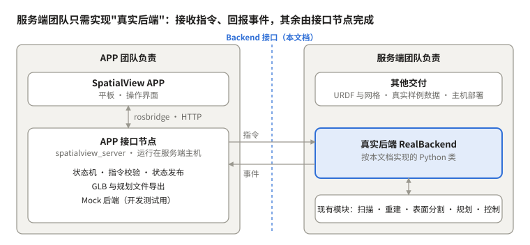

# SpatialView 服务端对接接口文档（草案）

| 文档版本 | 日期 | 说明 |
| --- | --- | --- |
| 1 | 2026-10-09 | 初稿，由 APP 团队拟定，待服务端团队补充和确认 |

**阅读说明**

- 本文档面向服务端团队，定义"真实后端"需要实现的接口。读完即可开始开发，不需要了解 APP、rosbridge 或 APP 与服务端之间的消息。
- 【服务端填写】：需要服务端团队补充的信息，汇总在第 11 节。
- 【待确认】：APP 团队拟定的默认做法，请确认或提出修改，汇总在第 12 节。
- 背景资料：[需求文档](需求文档.md)、[架构设计](架构设计.md)。

## 1 概述

### 1.1 分工

SpatialView 是现场操作员使用的平板 APP，用于发起扫描、选择表面、发起规划、控制清洗任务。APP 不直接访问服务端的现有模块，而是通过一个 **APP 接口节点**（`spatialview_server`）。接口节点由 APP 团队开发，运行在服务端主机上，分为两部分：

- **核心**（APP 团队）：作业状态机、指令校验、向 APP 发布状态、导出模型和规划文件。
- **后端**（服务端团队）：把核心的指令交给现有模块执行，并把结果和设备状态回报给核心。



| 内容 | 负责方 |
| --- | --- |
| APP；接口节点的核心；对 APP 的接口；GLB 与规划文件导出；mock 后端 | APP 团队 |
| 真实后端（本文档定义的接口）；现有算法与控制模块 | 服务端团队 |
| 机械臂 URDF 与网格；真实样例数据 | 服务端团队提供 |
| 主机部署（rosbridge、nginx、systemd） | APP 团队提供配置文件，服务端团队在主机上安装 |

### 1.2 后端要做什么

**接口节点调用后端的 8 个指令方法，后端让现有模块去执行，完成后通过事件回报结果；同时持续回报机械臂和激光的状态。**

以下工作都由核心完成，后端不需要处理：判断作业阶段、判断指令是否允许、过滤重复指令、生成和管理 ID、导出文件、与 APP 通信。后端收到的每个指令都已经过核心校验。

### 1.3 交付物

| # | 交付物 | 说明 | 时间点 |
| --- | --- | --- | --- |
| 1 | 本文档的填写与确认 | 第 11、12 节 | M1 结束前 |
| 2 | 机械臂 URDF 与网格 | 根坐标系为 `base_link`；包含末端工具，工具末端坐标系与规划使用的 TCP 一致；网格优先 STL，需要颜色时用 DAE；关节名与规划输出一致。URDF 有变更时通知 APP 团队重新打包 APP | M1 |
| 3 | 真实样例数据 | 至少一组真实的重建结果（网格 + 表面分割）和对应的规划结果，格式见 10.2 | M2 |
| 4 | 真实后端 | 实现第 3–8 节，通过一致性测试（10.1） | M3 |
| 5 | 主机部署与现场联调 | 第 9 节、10.3 | M4 |

里程碑的定义见[架构设计](架构设计.md)第 9 节。

## 2 基本约定

| 项目 | 约定 |
| --- | --- |
| 语言与运行方式 | Python 3.10（ROS 2 Humble 自带）；后端类在接口节点进程内运行 |
| 访问现有模块 | 通过接口节点传入的 rclpy 节点创建客户端、订阅等；具体方式由服务端团队决定 |
| 坐标系 | 所有几何数据都在机械臂 `base_link` 下，Z 轴向上；不做 Y-up 等任何轴变换 |
| 单位 | 长度米，角度弧度，时间秒；四元数顺序为 x、y、z、w |
| 数组 | numpy 数组，形状和类型见第 6 节 |
| ID | `model_id`、`plan_id`、`task_id` 由核心生成，后端当作不透明的字符串原样使用 |
| 并发 | 同一时间最多只有一个进行中的操作（扫描与重建、规划、任务三者之一）；`emergency_stop`、`set_laser` 可在任何时候调用 |
| 文字 | 回报中的 `message`、告警的标题和说明会直接显示给现场操作员，使用简短中文，不写技术细节 |

## 3 接口总览

### 3.1 代码骨架

类型定义由接口节点包中的 `spatialview_server.backend_api` 提供，后端直接导入：

```python
from spatialview_server.backend_api import (
    Backend, EventSink, CommandRejected,
    OpResult, RobotCondition, LaserState,
    SegmentedMesh, SurfaceInfo, PlanData,
)

class RealBackend(Backend):
    def __init__(self, node: rclpy.node.Node, config: dict): ...

    # 生命周期
    def start(self, sink: EventSink) -> None: ...
    def shutdown(self) -> None: ...

    # 指令（第 4 节）
    def start_scan(self, model_id: str) -> None: ...
    def start_plan(self, plan_id: str, model_id: str, surface_ids: list[str]) -> None: ...
    def start_task(self, task_id: str, plan_id: str) -> None: ...
    def pause_task(self, task_id: str) -> None: ...
    def resume_task(self, task_id: str) -> None: ...
    def stop_task(self, task_id: str) -> None: ...
    def emergency_stop(self) -> None: ...
    def set_laser(self, on: bool) -> None: ...
```

核心交给后端的事件接口：

```python
class EventSink(Protocol):
    # 操作结果（5.1）
    def scan_finished(self, model_id: str, result: OpResult, message: str = "") -> None: ...
    def reconstruct_finished(self, model_id: str, result: OpResult,
                             mesh: SegmentedMesh | None = None, message: str = "") -> None: ...
    def plan_finished(self, plan_id: str, result: OpResult,
                      plan: PlanData | None = None, message: str = "") -> None: ...
    def task_finished(self, task_id: str, result: OpResult, message: str = "") -> None: ...

    # 状态上报（5.2）
    def robot_condition(self, condition: RobotCondition, message: str = "") -> None: ...
    def laser_state(self, state: LaserState) -> None: ...
    def progress(self, op_id: str, percent: float) -> None: ...
    def exec_time(self, task_id: str, seconds: float) -> None: ...
    def alarm_raised(self, code: str, level: str, title: str, detail: str) -> None: ...
    def alarm_cleared(self, code: str) -> None: ...
```

枚举与异常：

```python
class OpResult(str, Enum):
    SUCCEEDED = "SUCCEEDED"
    FAILED = "FAILED"            # 操作本身失败，如重建失败、规划无解
    INTERRUPTED = "INTERRUPTED"  # 因故障、急停、机械臂离线等原因中断
    STOPPED = "STOPPED"          # 仅用于任务：执行了 stop_task

class RobotCondition(str, Enum):
    OK = "OK"
    FAULT = "FAULT"
    ESTOP = "ESTOP"
    OFFLINE = "OFFLINE"

class LaserState(str, Enum):
    OFF = "OFF"
    ON = "ON"
    ERROR = "ERROR"

class CommandRejected(Exception):
    def __init__(self, code: str, message: str): ...
```

**加载方式**：接口节点通过参数 `backend_class` 加载后端，例如 `spatialview_backend.real:RealBackend`。后端代码可以放在服务端团队自己的 ROS 包和仓库中，只依赖 `spatialview_server` 包。构造参数中的 `config` 来自参数文件 `backend.yaml` 的 `backend_config` 部分，内容由服务端团队定义。

### 3.2 一次操作的完整过程

| 操作 | 核心调用 | 后端回报（按顺序） |
| --- | --- | --- |
| 扫描 | `start_scan(model_id)` | （可选）`progress` → `scan_finished`；扫描成功时继续：（可选）`progress` → `reconstruct_finished`（附网格） |
| 规划 | `start_plan(plan_id, model_id, surface_ids)` | （可选）`progress` → `plan_finished`（附规划） |
| 清洗任务 | `start_task(task_id, plan_id)`；期间可能调用 `pause_task`、`resume_task`、`stop_task` | （可选）`exec_time` → `task_finished` |
| 急停 | `emergency_stop()` | `robot_condition(ESTOP)`；进行中的扫描或任务以 INTERRUPTED 结束 |
| 激光开关 | `set_laser(on)` | `laser_state` |

**每个以 `start_` 开头的操作，后端必须回报对应的结束事件，并且只回报一次**：扫描回报 `scan_finished`，扫描成功时再回报一次 `reconstruct_finished`；规划回报 `plan_finished`；任务回报 `task_finished`。核心依靠结束事件推进作业状态：漏报会让作业一直停在"进行中"，重复的回报会被忽略并记录。

## 4 指令

核心只在条件满足时调用以下方法，后端不需要再判断作业阶段。所有方法都必须**立即返回**（见第 7 节），耗时的工作放在后端自己的线程或异步回调中进行。

| 方法 | 核心何时调用 | 后端要做的事 | 之后回报 |
| --- | --- | --- | --- |
| `start_scan(model_id)` | 用户开始扫描；机械臂为 OK | 机械臂运动完成扫描；扫描成功后自动进行重建和表面分割 | `scan_finished`；成功时再 `reconstruct_finished` |
| `start_plan(plan_id, model_id, surface_ids)` | 用户开始规划；`model_id` 为当前模型 | 对 `surface_ids` 中的表面规划清洗路径 | `plan_finished` |
| `start_task(task_id, plan_id)` | 用户开始清洗；机械臂为 OK | 按 `plan_id` 对应的规划执行清洗，激光由任务按工艺段自动开关；此前手动开启的激光也由任务接管 | `task_finished` |
| `pause_task(task_id)` | 执行中用户暂停 | 机械臂减速停止，同时关闭激光，保持可以继续的状态 | 无 |
| `resume_task(task_id)` | 已暂停时用户继续；机械臂为 OK | 从暂停处继续执行，激光由任务重新开启 | 无 |
| `stop_task(task_id)` | 执行中或已暂停时用户停止 | 机械臂有序停止，关闭激光，结束任务 | `task_finished(STOPPED)` |
| `emergency_stop()` | 用户按下软件急停；任何时候 | 立即触发控制器的软件急停 | `robot_condition(ESTOP)`；中断进行中的操作 |
| `set_laser(on)` | 开启：用户开启，且没有进行中的操作、机械臂为 OK。关闭：用户关闭，或核心按安全规则自动关闭（开始扫描时；机械臂故障、急停、离线时；APP 断开时），任何时候都可能调用 | 开启前检查联锁；开关激光 | `laser_state` |

**补充说明**

- **规划的表面列表**：`surface_ids` 总是一个明确的列表（用户没有选择时，核心已展开为全部可清洗表面），只包含该模型中可清洗的表面。后端可以只规划其中一部分（例如部分表面不可达）：在 `PlanData.surface_ids` 中给出实际规划的表面，并在 `plan_finished` 的 `message` 中说明未规划的原因，APP 会据此提示操作员。
- **执行的轨迹**：`start_task` 执行的必须是该 `plan_id` 回报的 `PlanData` 中的同一条轨迹，APP 用它显示路径和动画。后端内部可以使用更密的轨迹，但时间轴必须一致。
- **保留当前数据**：新模型、新规划生成成功之前，旧的仍然有效；扫描或规划失败时，核心会继续使用旧的 `model_id`、`plan_id`。因此后端在新的扫描或规划进行期间，必须保留当前模型（含表面分割）和当前规划。
- **开启激光被拒绝**：联锁不满足时抛出 `CommandRejected("INTERLOCK", "安全门未关闭")`，消息会直接显示给操作员。
- **执行中关闭激光**：`set_laser(False)` 只关闭激光，任务和机械臂继续运动；之后的工艺段不再自动开启激光，暂停后继续时才恢复【待确认】。
- **急停**：
  - 必须在任何时候、任何线程中立即执行，不能被其他方法持有的锁或进行中的操作阻塞；可以被重复调用。
  - 急停后，后端把进行中的扫描或任务以 INTERRUPTED 结束。重建、规划是纯计算，不受急停影响，照常完成。
  - V1 不提供复位指令，复位在设备上完成【待确认】；复位后后端回报 `robot_condition(OK)`。
- **生命周期**：
  - `start(sink)`：节点启动时调用一次。后端在这里连接现有模块，并在 2 秒内回报一次当前的 `robot_condition` 和 `laser_state`；连不上控制器时回报 OFFLINE。回报之前，核心把机械臂按 OFFLINE 处理，不发出任何运动指令。
  - 接口节点每次启动都是一个新的会话，之前的模型和规划全部作废。如果启动时发现机械臂仍在执行上一次会话留下的扫描或任务，后端应有序停止它、关闭激光，并上报告警【待确认】。否则 APP 上没有任何可以停止它的按钮，只剩急停。
  - `shutdown()`：节点退出时调用，释放资源。

## 5 事件

### 5.1 操作结果

| 事件 | 可用的 result | 附带数据 |
| --- | --- | --- |
| `scan_finished(model_id, …)` | SUCCEEDED、FAILED、INTERRUPTED | — |
| `reconstruct_finished(model_id, …)` | SUCCEEDED、FAILED | 成功时必须附 `mesh`（6.2） |
| `plan_finished(plan_id, …)` | SUCCEEDED、FAILED | 成功时必须附 `plan`（6.3） |
| `task_finished(task_id, …)` | SUCCEEDED、STOPPED、INTERRUPTED | — |

- 失败或中断时，`message` 写明原因，例如"扫描时相机无图像""机械臂报关节超限"。APP 会弹出提示框显示（需求 5.5）。
- 成功时 `message` 一般为空，两种情况例外：规划成功但部分表面未能规划时，说明未规划的原因（第 4 节）；清洗完成时可以给出简要说明（例如用时），显示在完成提示框中。
- 任务因其他原因无法继续（例如控制器拒绝轨迹），同样以 INTERRUPTED 结束，并在 `message` 中说明。
- 事件中的 ID 必须是对应指令传入的 ID。ID 不属于当前操作的事件（例如中断之后才到达的迟到回报）会被核心忽略。

### 5.2 状态上报

| 事件 | 是否必须 | 何时回报 | 说明 |
| --- | --- | --- | --- |
| `robot_condition` | 是 | 启动时一次；之后每次变化 | 见 5.3；FAULT、OFFLINE 时在 `message` 中写原因 |
| `laser_state` | 是 | 启动时一次；之后每次变化 | 包括任务自动开关激光引起的变化；变为 ERROR 时，同时用告警说明原因 |
| `alarm_raised`、`alarm_cleared` | 是 | 设备异常出现和消失时 | 见 6.4 |
| `progress` | 否 | 扫描、重建、规划期间，频率不限 | `op_id` 为当前的 `model_id` 或 `plan_id`；百分比 0–100，针对当前所处的步骤，扫描和重建各自从 0 开始；不回报时 APP 只显示"进行中" |
| `exec_time` | 否 | 执行期间，建议每秒 1–2 次 | 本次任务实际已执行的时间（秒），不含暂停时间；不回报时核心按开始、暂停、继续的时刻自行计算 |

### 5.3 机械臂状态

后端只回报机械臂是否可用（`RobotCondition`）。APP 上显示的"运行中""暂停"由核心结合作业阶段得出，后端不需要关心：

| 后端回报 | 含义 | APP 显示 |
| --- | --- | --- |
| OK | 控制器正常，可以接受运动指令 | 就绪；扫描、执行、停止过程中显示"运行中"；暂停时显示"暂停" |
| FAULT | 控制器报故障 | 故障；核心自动生成"机械臂故障"告警，说明为 `message` |
| ESTOP | 处于急停（软件或硬件触发） | 急停 |
| OFFLINE | 与控制器失去连接 | 离线；核心自动生成告警 |

多个情况同时存在时，按 OFFLINE、ESTOP、FAULT 的顺序回报第一个。

## 6 数据格式

### 6.1 什么是表面分割

重建得到的是一整块三角网格。**表面分割**是把这块网格的三角面划分成若干个"表面"（例如工件的顶面、侧面、某个凹槽），每个表面有一个 ID，并标明能否清洗。

它在两个地方被用到，两处必须使用**同一份分割**：

1. **APP 选面**：接口节点把每个表面导出为 GLB 中的一个节点，操作员在平板上点选表面，APP 把选中的 `surface_id` 发回服务端（需求 6.4、11.5）。
2. **路径规划**：`start_plan` 传入的就是这些 `surface_id`，规划模块要据此找到对应的几何区域并规划路径。

因此，分割必须在重建完成时产生，随 `reconstruct_finished` 一起回报。分割由重建模块自带、还是由单独的表面识别步骤产生，由服务端团队决定【服务端填写】。

### 6.2 SegmentedMesh：重建结果

采用"一整块网格 + 每个三角面一个表面编号"的形式，与多数分割算法的输出形式一致：

```python
@dataclass
class SurfaceInfo:
    surface_id: str     # 本模型内唯一，只含字母、数字、下划线、连字符，如 "surface_02"
    selectable: bool    # 能否清洗；不能清洗的表面在 APP 中显示为深灰色，不能选择

@dataclass
class SegmentedMesh:
    vertices: np.ndarray           # (N, 3) float32，base_link，米
    triangles: np.ndarray          # (M, 3) uint32，顶点下标
    triangle_surface: np.ndarray   # (M,) uint32，每个三角面所属表面在 surfaces 中的下标
    surfaces: list[SurfaceInfo]
    normals: np.ndarray | None = None   # (N, 3) float32 顶点法线；为空时由接口节点计算
```

要求：

- 三角面不超过 30 万个；表面数量建议不超过 500 个。重建网格更大时回报简化后的网格，但简化后的表面划分必须与规划使用的一致【待确认】。
- 每个三角面恰好属于一个表面；每个表面至少包含一个三角面。
- 三角面朝向一致（逆时针为外侧）最好；不一致时仍能显示，但光照可能不均匀。
- 不需要颜色和纹理。

接口节点负责按表面拆分并写成 GLB（需求 11.5），相邻表面的公共顶点也由它复制，后端不需要处理。

### 6.3 PlanData：规划结果

```python
@dataclass
class PlanData:
    surface_ids: list[str]          # 实际规划的表面
    joint_names: list[str]          # 与 URDF 中的关节名一致
    joint_times: np.ndarray         # (K,) float64，从 0 开始严格递增，秒
    joint_positions: np.ndarray     # (K, J) float64，转动关节为弧度、移动关节为米，列顺序与 joint_names 一致
    tcp_times: np.ndarray           # (L,) float64，从 0 开始严格递增，秒
    tcp_positions: np.ndarray       # (L, 3) float64，base_link，米
    tcp_process_on: np.ndarray      # (L,) bool，该点是否处于工艺段（激光开启）
    tcp_orientations: np.ndarray | None = None  # (L, 4) float64，四元数 x、y、z、w；V1 不显示姿态，可以不提供
```

要求：

- 关节轨迹和 TCP 路径使用同一条时间轴，两者最后一个点的时间相等（误差 1 毫秒以内），即任务总时长。
- 时间按实际执行的速度给出，APP 按它播放轨迹动画、显示执行进度。
- 点要足够密：APP 在相邻两点之间做线性插值来播放动画、连线来显示路径，建议相邻点的时间间隔不超过 0.1 秒。
- 点数上限不限；超过 10 万点时，接口节点为显示抽稀（需求 11.6），不影响后端执行。
- `joint_names` 应与 URDF 一致；确实无法一致时，可以在 APP 配置的 `joint_name_map` 中映射（需求 10.2）。
- `joint_names` 包含执行中会运动的全部关节（包括外部轴）；URDF 中未列出的关节在动画中保持为 0。
- 关节角按实际转动连续给出，不做 ±π 回绕，否则 APP 插值时关节会反向转一大圈。

### 6.4 告警

```python
sink.alarm_raised(code="LASER_COOLING", level="ERROR",
                  title="激光器冷却异常", detail="冷却水温度过高，请检查冷水机")
sink.alarm_cleared(code="LASER_COOLING")
```

- 上报范围：工艺设备异常（例如激光器、扫描设备）和现有模块不可用（例如规划模块未启动），对应需求 9.1 中的"工艺设备异常""服务端异常"。机械臂故障和离线由核心根据 `robot_condition` 生成，后端不必重复上报。
- `code`：全大写字母、数字和下划线，以设备或模块名开头，例如 `LASER_`、`SCANNER_`、`PLANNER_`。同一个 `code` 同时只有一条活动告警，重复调用 `alarm_raised` 只更新内容。
- `level`：`WARNING`（不影响作业）或 `ERROR`（影响作业）。
- 告警表示持续存在的设备异常，异常消失时必须调用 `alarm_cleared`。一次性的失败（例如规划失败）不使用告警，在结束事件的 `message` 中说明。
- 以下 code 由核心使用，后端不能使用：`ROBOT_FAULT`、`ROBOT_OFFLINE`、`SCAN_FAILED`、`RECONSTRUCT_FAILED`、`PLAN_FAILED`、`BACKEND_ERROR`。
- 需要上报的设备告警清单【服务端填写】。

## 7 时序与线程要求

| 项目 | 要求 |
| --- | --- |
| 指令方法的返回时间 | 目标 100 毫秒以内，最长 500 毫秒 |
| `emergency_stop` 的返回时间 | 50 毫秒以内；不被其他方法或进行中的操作阻塞 |
| 状态变化的回报 | 发生后 200 毫秒以内调用对应事件 |
| 调用线程 | 指令方法可能在不同线程中被调用；`emergency_stop` 可能与其他方法同时被调用 |
| `EventSink` | 线程安全；每次调用只是放入队列，立即返回；可以在任何线程中调用，包括指令方法内部 |
| ROS 回调 | 用传入的 `node` 创建客户端和订阅时，使用后端自己的回调组（建议 `ReentrantCallbackGroup`），不要长时间阻塞执行器线程 |

## 8 错误处理

| 情况 | 后端的做法 | 核心的处理 |
| --- | --- | --- |
| 指令不能执行（联锁不满足、设备未就绪等） | 抛出 `CommandRejected(code, message)`，`code` 为 `INTERLOCK`、`ROBOT_NOT_READY` 或 `INTERNAL_ERROR` | 拒绝该指令，`message` 显示给操作员 |
| 指令方法抛出其他异常 | — | 按 `INTERNAL_ERROR` 拒绝；记录异常堆栈；向操作员显示"服务端内部错误" |
| 操作开始后失败 | 回报结束事件，result 为 FAILED 或 INTERRUPTED | 作业回到发起前的阶段（需求 4.2） |
| 回报的网格或规划不符合第 6 节 | — | 按该操作失败处理，日志中写明哪一项不符合，便于排查 |
| 机械臂变为 FAULT、ESTOP 或 OFFLINE 后 5 秒内，进行中的扫描或任务仍未回报结束 | — | 按 INTERRUPTED 处理，并产生 `BACKEND_ERROR` 告警；之后任一操作正常回报结束时移除该告警 |
| 事件中的 ID 不属于当前操作 | — | 忽略并记录 |

## 9 部署配合

APP 团队在仓库的 `deploy/` 目录中提供全部配置文件，服务端团队在服务端主机上安装：

| 项目 | 内容 |
| --- | --- |
| 系统 | Ubuntu 22.04 + ROS 2 Humble |
| 软件包 | `ros-humble-rosbridge-suite`、`nginx`、`python3-numpy`；Python 包 `pygltflib` |
| 网络 | 固定 IP（默认 192.168.1.100）；只接入隔离的现场网络，不接办公网和互联网；开放 9090（rosbridge）和 8080（文件服务）端口 |
| 访问限制 | rosbridge 只放行 `/spatialview/*`（需求 8.3）；该限制已写在提供的配置中，安装时不要放开 |
| 启动 | systemd 服务 `spatialview.service` 开机启动 rosbridge 和接口节点；nginx 作为系统服务运行 |
| 后端配置 | 参数文件 `backend.yaml`：`backend_class` 指向真实后端；`backend_config` 由服务端团队定义 |
| 文件目录 | 接口节点写入、nginx 读取，默认 `/var/lib/spatialview/files` |
| 日志 | 接口节点的调用日志和后端日志，默认位于 `/var/log/spatialview/` |

## 10 验证方式

### 10.1 一致性测试

`spatialview_server` 包提供后端一致性测试（pytest）。测试用一个记录事件的 sink 驱动后端，检查：

- 指令方法的返回时间；
- 每个操作恰好回报一次结束事件，且 ID 正确；
- 回报的网格和规划符合第 6 节；
- 暂停、继续、停止、急停、激光开关后的事件顺序；
- 启动后 2 秒内回报初始状态。

mock 后端在持续集成中运行同一套测试。服务端团队可以在仿真环境或真实设备上运行：

```bash
pytest --backend=spatialview_backend.real:RealBackend --backend-config=backend.yaml
```

涉及机械臂运动的用例（扫描、执行、急停）必须在安全条件下、由现场人员看护运行。

### 10.2 样例数据

真实样例（交付物 3）保存为 numpy 的 `.npz` 文件：网格一个文件，规划一个文件，字段名与 6.2、6.3 的属性名一致；表面信息拆成 `surface_ids`、`selectable` 两个数组。APP 团队用 `tools/validate` 检查格式，并用它在平板上验证显示效果、选面和性能。

### 10.3 现场联调

接口节点、真实后端和 APP 一起，在现场按[需求文档](需求文档.md) 12.4 的验收场景测试。

## 11 服务端填写项

| # | 项目 | 需要的信息 | 服务端填写 |
| --- | --- | --- | --- |
| 1 | 现有模块 | 扫描、重建、表面分割、规划、执行、激光分别由哪个模块提供；调用方式（Topic、Service、Action 或库） | |
| 2 | 表面分割 | 由哪一步产生；典型和最多的表面数量；"能否清洗"如何判定 | |
| 3 | 耗时 | 扫描、重建、规划的典型耗时；能否提供进度 | |
| 4 | 机械臂状态 | 如何得到 OK、FAULT、ESTOP、OFFLINE，以及故障原因 | |
| 5 | 软件急停 | 对应的底层接口；急停后如何复位 | |
| 6 | 激光 | 开关接口；状态来源；联锁条件 | |
| 7 | 执行 | 暂停后能否从暂停处继续；能否提供实际已执行时间 | |
| 8 | 规划输出 | 轨迹点的密度和典型点数；能否给出 TCP 姿态（V1 可以不提供）；规划时能否识别不可达的表面 | |
| 9 | 设备告警 | 需要上报的告警清单（code、级别、含义） | |
| 10 | URDF | ROS 包名、关节名、网格格式；是否包含末端工具，工具坐标系与 TCP 的关系；是否有外部轴 | |

## 12 待确认的默认做法

| # | 默认做法 | 出处 |
| --- | --- | --- |
| 1 | 接口节点启动时，后端停止上一次会话未完成的扫描或任务，关闭激光，并上报告警 | 第 4 节"生命周期"；需求 13.3 第 10 项 |
| 2 | 停止任务后激光关闭；再次开始时从头执行 | 需求 13.3 第 2 项 |
| 3 | 急停复位只在设备上完成，V1 不提供复位指令 | 需求 13.3 第 3 项 |
| 4 | 执行中手动关闭激光后，之后的工艺段不自动开启，暂停后继续时恢复 | 需求 13.3 第 5 项 |
| 5 | V1 不支持取消扫描、重建、规划；急停只中断扫描，不中断重建和规划 | 需求 13.3 第 6 项 |
| 6 | 清洗完成后，同一规划可以再次执行 | 需求 13.3 第 8 项 |
| 7 | 回报的网格可以是简化后的网格，但表面划分与规划使用的一致 | 6.2 |