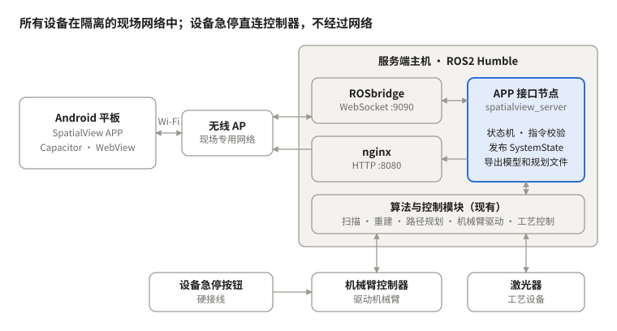
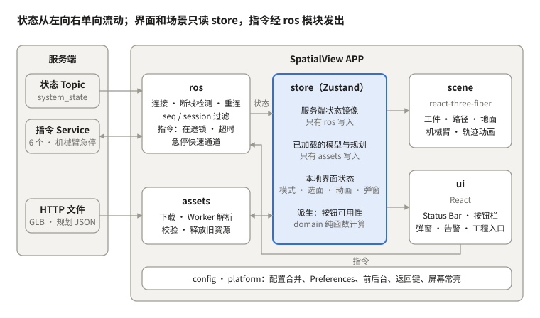
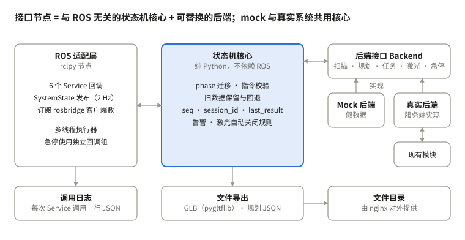

# SpatialView 系统架构设计

| 文档版本 | 日期 | 说明 |
| --- | --- | --- |
| 1 | 2026-10-09 | 初稿，依据[需求文档](需求文档.md)第 2 版 |

本文档说明系统怎么搭：部署结构、仓库结构、接口约定的管理方式、APP 内部架构、服务端 APP 接口节点、开发测试环境和开发计划。界面行为、接口字段、按钮规则以需求文档为准，本文只引用其章节编号（写作"需求 x.y"），不重复定义。

读者：APP 前端开发、服务端开发。

## 1 架构原则

1. **服务端权威**：作业阶段、模型、规划、告警只在服务端 APP 接口节点中维护。APP 是这份状态的镜像，加上一个指令发送器。
2. **单一状态入口**：Topic 推送、GetSystemState、指令回复中的状态，都经过 APP 内同一个入口（stateSync）进入 store，规则只写一次。
3. **单向数据流**：ros → store → scene / ui。场景和界面只读 store，用户操作通过指令发给服务端，结果再从状态入口回来。
4. **业务规则写成纯函数**：按钮可用性、结果提示判断、阶段迁移、轨迹插值等逻辑不依赖 React、three.js 或 ROS，可以直接做单元测试。服务端的状态机核心同理。
5. **接口约定只有一个来源**：`spatialview_msgs` 中的 `.msg`、`.srv` 文件是前后端唯一的接口定义，两端代码都以它为准。
6. **优先使用现成组件**：能用成熟开源库完成的部分不自己实现，不写自定义着色器。

## 2 部署结构



| 设备 | 运行内容 | 说明 |
| --- | --- | --- |
| Android 平板 | SpatialView APP | 离线安装包安装；WebView 版本在交付时确定（需求 3.5） |
| 无线 AP | — | 现场专用，不接入办公网或互联网（需求 8.3） |
| 服务端主机 | ROS2 Humble、rosbridge_server、nginx、APP 接口节点、现有算法与控制模块 | 固定 IP，开机自动启动 |
| 机械臂控制器、激光器 | — | 由现有控制模块驱动 |
| 设备急停按钮 | — | 硬接线到控制器，不经过网络和服务端 |

服务端主机上与 APP 相关的进程：

| 进程 | 端口 | 配置要点 |
| --- | --- | --- |
| rosbridge_server（rosbridge_websocket） | 9090 | `topics_glob`、`services_glob` 只放行 `/spatialview/*`，`params_glob` 必须设置（需求 8.3） |
| nginx | 8080 | 根目录为文件导出目录；返回 `Access-Control-Allow-Origin: *`；对 `.json` 开启 gzip |
| spatialview_server（APP 接口节点） | — | 运行在 `/spatialview` 命名空间，节点名 `app_interface` |

启动方式：一个 systemd 服务运行 `ros2 launch spatialview_server bringup.launch.py`，同时启动 rosbridge 和接口节点；nginx 作为系统服务单独运行。服务端主机重启或该 systemd 服务重启，即需求 7.5 所说的"服务端重启"。

## 3 代码仓库结构

前端、接口定义、接口节点放在同一个仓库中。接口有变化时，两端代码和接口定义在同一次提交、同一次评审中修改，不会出现版本错位。

```text
SpatialView/
├── docs/                         需求文档、架构设计、图
├── app/                          APP（Vite + React + TypeScript + Capacitor）
│   ├── src/
│   │   ├── main.tsx
│   │   ├── config/               默认配置、覆盖合并、配置校验
│   │   ├── platform/             Capacitor 封装：Preferences、前后台、返回键、屏幕常亮
│   │   ├── ros/                  连接管理、状态同步、指令通道、接口类型与校验
│   │   ├── store/                Zustand store 与 selector
│   │   ├── domain/               纯函数业务规则
│   │   ├── assets/               模型、规划、机械臂的加载与释放；规划解析 Worker
│   │   ├── scene/                react-three-fiber 场景组件、轨迹动画
│   │   └── ui/                   界面组件
│   ├── public/robot/             机械臂 URDF 与网格（随 APP 打包）
│   ├── tests/                    单元测试、接口约定测试
│   ├── android/                  Capacitor 生成的 Android 工程（提交到仓库）
│   ├── capacitor.config.ts
│   └── package.json
├── ros2_ws/src/
│   ├── spatialview_msgs/         接口定义（.msg / .srv）
│   └── spatialview_server/       APP 接口节点：状态机核心、ROS 适配层、后端接口、mock 后端、文件导出
├── deploy/
│   ├── docker-compose.dev.yml    开发用后端环境：rosbridge + 接口节点（mock）+ nginx
│   ├── nginx/spatialview.conf
│   └── systemd/spatialview.service
└── tools/
    ├── sample_data/              生成样例 GLB 与规划文件（性能原型和 mock 共用）
    └── validate/                 校验 GLB、规划文件是否符合需求 11.5、11.6
```

分工建议（待确认，见第 11 节）：APP 团队负责 `app/`、`spatialview_msgs`、接口节点的核心与 mock 后端；服务端团队负责实现"真实后端"，把接口节点接到现有模块上。

## 4 接口约定的管理

### 4.1 接口定义文件

`spatialview_msgs` 包含：

| 目录 | 文件 |
| --- | --- |
| msg | `SystemState.msg`、`Alarm.msg`、`OperationResult.msg` |
| srv | `GetSystemState.srv`、`StartScan.srv`、`StartPlan.srv`、`TaskControl.srv`、`EmergencyStop.srv`、`SetLaser.srv` |

字段与需求 11.2、11.3 一致。枚举值用 ROS 2 的字符串常量写在 `.msg` 中，服务端代码直接引用，不手写字符串，例如：

```text
# SystemState.msg（节选）
string INTERFACE_VERSION="1.0"
string PHASE_NO_MODEL="NO_MODEL"
string PHASE_SCANNING="SCANNING"
# ……
string interface_version
string phase
```

### 4.2 APP 侧的接口类型

- `app/src/ros/contract.ts` 中手写与 `.msg` 一一对应的 TypeScript 类型，以及同样结构的 zod 校验规则，并定义 APP 期望的 `INTERFACE_VERSION`。
- 收到的每条 SystemState 和每个指令回复都先经过 zod 校验。校验失败视为接口不匹配，产生本地告警，处理方式同需求 7.7。
- 收到不认识的枚举值时（例如服务端新增了阶段），对应显示为"未知"，除急停和关闭激光外的指令按钮不可用。
- 接口约定测试（见 8.2）对 mock 服务端逐个调用全部接口，用同一套 zod 规则校验返回，并检查 TS 中的 `INTERFACE_VERSION` 与 `.msg` 中的常量一致。

### 4.3 版本规则

| 变化 | 版本号 | 说明 |
| --- | --- | --- |
| 新增字段、新增枚举值 | 次版本号 +1 | 旧 APP 忽略新字段，可继续使用 |
| 删除或重命名字段、改变字段含义、改变状态迁移规则 | 主版本号 +1 | 旧 APP 会提示接口版本不匹配（需求 7.7） |

## 5 APP 架构

### 5.1 分层与数据流



| 模块 | 职责 | 可以写入 store 的部分 | 依赖 |
| --- | --- | --- | --- |
| platform | 封装 Capacitor 插件：Preferences、前后台事件、返回键、屏幕常亮 | — | Capacitor 插件 |
| config | 内置默认配置、覆盖配置合并（需求 10.1）、配置校验 | — | platform |
| ros | 连接管理、状态同步、指令通道 | 连接状态、服务端状态镜像、在途指令、最近结果 ID | roslib、config |
| assets | 模型、规划、机械臂的下载、解析、校验、释放 | 已加载的模型与规划、加载类本地告警 | three.js 加载器、urdf-loader |
| domain | 纯函数业务规则 | — | 无 |
| store | Zustand store、selector | — | domain |
| scene | 三维场景组件、轨迹动画 | 动画进度 | three.js、r3f、drei |
| ui | 界面组件 | 场景模式、选择集合、弹窗队列 | store、ros 的指令通道 |

依赖方向只能从上层指向下层：ui、scene → store → domain；ros、assets 写 store；domain 不依赖任何模块。

### 5.2 store

```ts
type ConnStatus = 'connecting' | 'connected' | 'reconnecting';
type SceneMode = 'browse' | 'select' | 'animate';

interface AssetSlot<T> {
  id: string | null;                        // 对应的 model_id / plan_id
  status: 'idle' | 'loading' | 'ready' | 'error';
  data: T | null;
}

interface AppState {
  // ros 写入
  conn: { status: ConnStatus; sessionId: string | null; seq: number };
  server: SystemState | null;               // 服务端状态镜像
  inflight: CommandKey | null;              // 在途指令（急停、关闭激光不占用）
  lastResultId: string | null;              // 需求 5.5 的结果提示判断

  // assets 写入
  model: AssetSlot<LoadedModel>;
  plan: AssetSlot<LoadedPlan>;
  localAlarms: LocalAlarm[];

  // ui、scene 通过 action 写入
  mode: SceneMode;
  selection: ReadonlySet<string>;           // surface_id 集合
  animation: { playing: boolean; t: number; speed: number };
  dialogs: Dialog[];                        // 确认框、结果提示框队列
}
```

- 按钮可用性不存进 store，由 selector 调用 `domain/availability.ts` 实时计算（需求 3.2）。
- 场景模式的自动退出（需求 6.4、6.6）由一个订阅 `server.phase` 的 store 监听完成，不散落在组件里。

### 5.3 连接管理

APP 侧的连接状态与 Status Bar 文案（需求 5.2）一一对应：

| 状态 | 进入条件 | Status Bar |
| --- | --- | --- |
| connecting | APP 启动、点击刷新连接、回到前台 | 正在连接… |
| connected | GetSystemState 成功并完成订阅 | 已连接 |
| reconnecting | WebSocket 关闭或出错、状态超时、connecting 失败 | 连接断开，正在重连… |

实现要点：

- 每次连接尝试都新建一个 `ROSLIB.Ros` 实例，并给它一个递增的"代号"。旧实例的回调到达时，代号不等于当前代号就直接丢弃，避免旧连接的迟到事件干扰新连接。
- 断开时统一执行清理：取消订阅、关闭旧实例、让所有未完成的 Service 调用立即失败、解除在途锁。8 小时运行中会反复重连，清理不彻底会累积监听器和内存。
- 状态超时看门狗：每收到一条 `system_state` 就重置计时器，超过 `state_timeout_ms` 按断线处理（需求 7.2）。
- 回到前台（`resume` 事件）时执行一次刷新连接（需求 7.3）。

### 5.4 状态同步

stateSync 是服务端状态进入 store 的唯一入口，Topic、GetSystemState、指令回复都调用它：

1. zod 校验（4.2）。
2. `session_id` 与当前记录不同：接受，重置 `seq`；如果之前已加载模型，弹出服务端重启提示（需求 7.5）。
3. `seq` 小于当前值：丢弃；大于或等于：接受（需求 7.6）。
4. 检查 `interface_version` 主版本号（需求 7.7）。
5. 写入 `server`。
6. `last_result.id` 与 `lastResultId` 不同：APP 启动后的第一份状态只记录不弹框，之后按需求 5.5 的表格加入结果提示框。

模型和规划的下载不在 stateSync 中触发，由 assets 模块订阅 `server.model_id`、`server.plan_id` 自行处理（5.6）。

### 5.5 指令通道

| 指令 | 在途锁 | 超时 | 失败处理 |
| --- | --- | --- | --- |
| 普通指令（扫描、规划、开始、暂停、继续、停止、开启激光） | 发出时加锁，回复或超时后解锁 | `service_timeout_ms` | 超时提示"服务端无响应，请检查连接"；被拒绝时显示服务端的 `message` |
| 关闭激光 | 不受已有锁限制，也不加全局锁 | `service_timeout_ms` | 同上 |
| 急停 | 不受锁限制、不加锁，可重复按 | `estop_timeout_ms` | 未连接或失败时立即醒目提示（需求 8.1） |

- 指令回复中的 `state` 交给 stateSync 应用，与 Topic 走同一条路径。
- 发送前再调用一次可用性检查作为防御，但最终是否合法由服务端判断（需求 8）。
- roslib 的 Service 调用本身没有超时，由指令通道用计时器实现。

### 5.6 资源加载

assets 模块订阅 `server` 中的 `model_id`、`plan_id`，与已加载的 ID 比较后决定加载、替换或清除（需求 7.1 第 4 步）。

**通用规则**

- 每次加载带上目标 ID 和一个 `AbortController`。目标 ID 变化时中止旧下载；加载完成时 ID 已不是当前值的，结果直接丢弃。
- 新资源准备好之后才替换旧资源，替换后释放旧的几何体和材质（three.js 不会自动回收 GPU 资源，需求 12.2）。
- 加载失败产生本地告警（需求 9.1）；刷新连接时因为本地没有成功加载的 ID，会自动重新下载。

**工件模型**

1. `fetch` 下载 GLB，`GLTFLoader.parseAsync` 解析。
2. 校验：场景 extras 中的 `model_id` 与当前一致；每个 Surface 节点都是单 primitive 的 mesh，且带有 `surface_id`（需求 11.5）。
3. 建立 `surface_id → mesh` 索引，给每个 mesh 指定共享材质，计算包围盒和包围球。
4. 写入 `model`，场景自动执行一次"恢复默认视角"。

**规划文件**

两组各 10 万点的规划 JSON 约 15–20 MB，在主线程解析会让界面卡顿数百毫秒，因此放到 Web Worker 中处理：

1. Worker 下载并解析 JSON，校验 `plan_id`、`model_id`（需求 11.6）。
2. Worker 生成绘制和动画需要的类型化数组：工艺段与空行程段的线段坐标、每段的结束时间、箭头的位置与朝向、关节轨迹的时间与关节角。
3. 以可转移对象（transferable）方式交回主线程，不复制数据。
4. 主线程按 `joint_name_map` 将关节名与 URDF 对应，对不上时产生本地告警（需求 6.6）。
5. 主线程创建线条几何体，写入 `plan`。

**机械臂**

APP 启动时用 urdf-loader 从 `public/robot` 加载一次，`package://` 按配置映射（需求 3.3）。模型常驻内存，只在轨迹动画模式中挂到场景上。

### 5.7 三维场景

```text
<Canvas frameloop="demand">           相机 up 为 Z 轴
├── CameraRig                         OrbitControls、默认视角、缩放限制、禁用平移
├── Lights
├── Ground                            drei Grid，旋转到 XY 平面（drei 默认在 XZ 平面）
├── Bvh firstHitOnly                  拾取加速
│   └── Workpiece                     工件，材质随模式和选择切换
├── TcpPath                           工艺段、空行程段、进度叠加线、箭头、起点终点标签
└── RobotPreview                      仅轨迹动画模式挂载
```

- **材质**：只建 4 个共享材质（默认、选中、不可选、淡化），切换时替换 mesh 的材质引用，不新建材质。
- **拾取**：r3f 的点击事件自带 `delta`（按下到抬起的像素距离），大于 `tap_threshold_px` 的视为拖动，忽略；否则从命中对象的 `userData.surface_id` 取表面，不可选的忽略（需求 6.4）。
- **路径进度**：给定时间 `t`，在每段结束时间数组中二分查找已走过的段数，设置叠加绿色线的绘制数量（`instanceCount`）。`t` 在轨迹动画中来自动画时钟，在执行中来自 `server.exec_time`（需求 6.5）。
- **轨迹动画**：`useFrame` 中按倍速推进动画时钟，用 `domain/interpolation.ts` 二分查找相邻轨迹点并线性插值，调用 urdf-loader 的 `setJointValue` 设置关节角（需求 6.6）。
- **按需渲染**：OrbitControls 变化时 drei 会自动请求重绘；store 中与场景有关的字段变化时调用 `invalidate()`；动画播放期间每帧请求重绘。

### 5.8 界面

```text
App
├── StatusBar           APP 名称（工程入口）、机械臂、作业、服务、告警
├── SceneArea
│   ├── Canvas（5.7）
│   ├── SceneOverlay    进度提示、加载提示、断线遮罩、"暂无模型"
│   ├── SelectionToolbar
│   └── AnimationBar
├── ButtonPanel         各按钮的可用性和文字全部来自 availability selector
│   └── EStopButton     独立组件，直接调用急停通道
├── DialogHost          按队列显示确认框、结果提示框
├── AlarmPanel
└── EngineeringPanel    仅在编译开关打开时打包
```

- **对话框**：确认框记录对应的指令。DialogHost 每次渲染都检查该指令是否仍可用，不可用时自动关闭且不发送（需求 5.4）。
- **返回键**：platform 模块注册 `backButton` 监听后，系统默认的退出行为被接管。处理顺序：有弹窗时关闭弹窗；处于选面或轨迹动画模式时退出模式；其他情况不做任何事（需求 3.5）。
- **工程入口**：编译开关 `VITE_ENABLE_ENGINEERING` 关闭时，EngineeringPanel 和长按逻辑都不进入打包产物。密码在打包时以 SHA-256 摘要写入，不在产物中保存明文（需求 10.3）。

### 5.9 业务规则（domain）

| 文件 | 内容 | 对应需求 |
| --- | --- | --- |
| `availability.ts` | 输入连接状态、服务端状态、在途指令、场景模式、加载状态、本地告警，输出每个按钮的可用性、文字、是否需要确认 | 5.3、5.4 |
| `phase.ts` | 阶段显示文字；各阶段的场景内容（需求 6.3 的表格写成数据） | 4.2、6.3 |
| `results.ts` | 根据 `last_result` 决定是否弹框、弹什么 | 5.5 |
| `stateOrder.ts` | `session_id`、`seq` 的接受规则 | 7.6 |
| `interpolation.ts` | 时间二分查找、关节角线性插值、路径进度 | 6.5、6.6 |
| `configMerge.ts` | 覆盖配置合并规则 | 10.1 |

这些文件全部有单元测试。`availability.ts` 的测试逐行覆盖需求 5.3 的表格和 8 条全局规则。

### 5.10 打包与发布

- Capacitor 配置：`server.androidScheme: "http"`、允许明文流量、横屏锁定（需求 3.5）。
- 版本：APP 版本号写在 `package.json`，同步到 Android 的 versionName/versionCode；`INTERFACE_VERSION` 写在 `contract.ts`。
- 打包流程：`npm run build` → `npx cap sync android` → Gradle 生成签名的 release APK。签名密钥不放进仓库。
- 交付：离线安装包（APK）通过 USB 或文件传输安装；同时记录该批平板使用的 WebView 版本。
- 调试：debug 包开启 WebView 远程调试，电脑上用 Chrome 的 `chrome://inspect` 查看日志和性能。

### 5.11 新增依赖

在需求 3.1 的基础上，架构上增加两个库：

| 库 | 用途 |
| --- | --- |
| zod | 配置校验、服务端消息的运行时校验 |
| Vitest | APP 单元测试与接口约定测试 |

## 6 服务端 APP 接口节点



### 6.1 结构

`spatialview_server` 是一个 Python（rclpy）包：

| 模块 | 职责 |
| --- | --- |
| `core/` | 状态机核心：阶段迁移、指令校验、旧数据保留与回退、`seq`、`session_id`、`last_result`、告警、激光自动关闭规则。纯 Python，不导入 rclpy |
| `ros_adapter.py` | ROS 适配层：6 个 Service、SystemState 定时发布、订阅 rosbridge 客户端数，把 ROS 消息与核心的数据结构互相转换 |
| `backends/base.py` | 后端接口定义 |
| `backends/mock.py` | mock 后端：用样例数据模拟扫描、重建、规划、执行 |
| `backends/real.py` | 真实后端：由服务端团队实现，调用现有模块 |
| `export/` | 导出 GLB 和规划 JSON |
| `call_log.py` | Service 调用日志 |

核心不依赖 ROS，可以直接用 pytest 测试全部迁移；mock 和真实系统共用同一个核心，mock 的行为就是真实接口节点的行为。

### 6.2 状态迁移

指令的受理条件（不满足时的拒绝码见需求 11.3）：

| 指令 | 受理条件 |
| --- | --- |
| StartScan | 阶段为无模型、模型就绪或规划就绪；机械臂不处于故障、急停、离线 |
| StartPlan | 阶段为模型就绪或规划就绪；`model_id` 为当前模型；`surface_ids` 都存在且可处理 |
| TaskControl START | 阶段为规划就绪；`plan_id` 为当前规划；机械臂不处于故障、急停、离线 |
| TaskControl PAUSE / RESUME / STOP | 阶段分别为执行中 / 已暂停 / 执行中或已暂停；不校验 `plan_id` |
| SetLaser 开启 | 阶段为无模型、模型就绪或规划就绪；机械臂不处于故障、急停、离线；联锁满足 |
| SetLaser 关闭、EmergencyStop | 任何状态 |

迁移表（"发起前阶段"指开始扫描或开始规划时记录下来的阶段）：

| 当前阶段 | 事件 | 新阶段 | 同时发生 |
| --- | --- | --- | --- |
| 无模型、模型就绪、规划就绪 | StartScan 受理 | 扫描中 | 记录发起前阶段；关闭手动开启的激光 |
| 扫描中 | 扫描完成 | 重建中 | — |
| 扫描中 | 扫描失败 | 发起前阶段 | 扫描失败告警；结果 SCAN FAILED |
| 扫描中 | 故障或急停 | 发起前阶段 | 结果 SCAN INTERRUPTED |
| 重建中 | 重建完成 | 模型就绪 | 导出 GLB；替换模型；清除规划；结果 RECONSTRUCT SUCCEEDED |
| 重建中 | 重建失败 | 发起前阶段 | 重建失败告警；结果 RECONSTRUCT FAILED |
| 模型就绪、规划就绪 | StartPlan 受理 | 规划中 | 记录发起前阶段；移除规划失败告警 |
| 规划中 | 规划完成 | 规划就绪 | 导出规划 JSON；替换规划；结果 PLAN SUCCEEDED |
| 规划中 | 规划失败 | 发起前阶段 | 规划失败告警；结果 PLAN FAILED |
| 规划就绪 | START 受理 | 执行中 | 激光转由任务控制 |
| 执行中 | PAUSE 受理 | 已暂停 | 机械臂停止并关闭激光 |
| 已暂停 | RESUME 受理 | 执行中 | 激光由任务重新开启 |
| 执行中、已暂停 | STOP 受理 | 停止中 | — |
| 停止中 | 停止完成 | 规划就绪 | 结果 TASK STOPPED |
| 执行中 | 执行完成 | 规划就绪 | 结果 TASK SUCCEEDED |
| 执行中、已暂停、停止中 | 故障或急停 | 规划就绪 | 结果 TASK INTERRUPTED |
| — | 节点启动 | 无模型 | 生成新的 `session_id`；清空文件目录 |

补充规则：

- StartScan 受理时移除扫描失败、重建失败、规划失败三类告警（需求 9.1）。
- 重建中、规划中发生故障或急停不改变阶段（需求 4.2）。
- 手动开启的激光，在机械臂故障或急停时、rosbridge 客户端数降为 0 且阶段不是执行中、已暂停、停止中时，由核心调用后端关闭（需求 8.2）。
- `progress`、`exec_time` 的变化只随定时发布下发，不触发立即补发；其他字段变化时立即补发。

### 6.3 指令处理顺序

每个普通指令的 Service 回调按以下顺序执行，保证需求 7.6 的 `seq` 规则成立：

1. 加锁。
2. 核心校验；不受理时直接返回拒绝和当前状态。
3. 核心完成阶段迁移，调用后端对应方法（后端方法必须立即返回，耗时工作在后端自己的线程中进行）。后端同步抛出异常时撤销迁移，返回 INTERNAL_ERROR。
4. 以新的 `seq` 发布 SystemState，并保留这份状态。
5. 解锁，在回复中带上第 4 步的同一份状态。
6. 写调用日志。

急停回调例外：先直接调用后端的 `emergency_stop()`，再进入上述流程更新状态，不等待锁以外的任何操作。

### 6.4 执行器与线程

- 使用 `MultiThreadedExecutor`。
- 急停 Service 单独放在一个回调组中，其他 Service、定时发布、客户端数订阅各自分组，急停回调不需要排在其他回调后面。
- 后端通过线程安全的事件接口把结果交给核心，核心内部用一把锁保护全部状态。

这一设计在开发初期就采用，成本很低；需求 13.2 第 10 项仍保留为联调时的实测项。

### 6.5 后端接口

```python
class Backend(Protocol):
    """所有方法必须立即返回；耗时工作完成后通过 events 回报。"""

    def start_scan(self) -> None: ...
    def start_plan(self, model: ModelRef, surface_ids: list[str]) -> None: ...  # 空列表表示全部可处理表面
    def start_task(self, plan: PlanRef) -> None: ...
    def pause_task(self) -> None: ...
    def resume_task(self) -> None: ...
    def stop_task(self) -> None: ...
    def emergency_stop(self) -> None: ...
    def set_laser(self, on: bool) -> None: ...
```

后端回报给核心的事件：

| 事件 | 携带内容 |
| --- | --- |
| ScanFinished | 是否成功、失败原因 |
| ReconstructFinished | 是否成功、网格数据（各表面的顶点、法线、三角面及是否可处理）、失败原因 |
| PlanFinished | 是否成功、使用的表面列表、关节轨迹、TCP 路径、失败原因 |
| TaskFinished | 完成、停止或中断，以及原因 |
| RobotStateChanged | 机械臂状态 |
| LaserStateChanged | 激光状态 |
| Progress | 当前阶段进度百分比、`exec_time` |
| AlarmRaised / AlarmCleared | 设备类告警 |

真实后端需要把现有模块的输出转换成以上数据结构；具体格式待服务端团队确认（第 11 节）。

### 6.6 mock 后端

- 扫描、重建、规划的耗时可配置（默认分别为 10 秒、5 秒、5 秒），期间按比例回报进度。
- 执行按规划时长推进 `exec_time`，支持加速倍率，方便快速测试完成流程。
- 模型和规划使用 `tools/sample_data` 生成的样例。
- 故障注入：提供调试服务 `/spatialview_mock/inject`，可触发机械臂故障、急停与复位、扫描失败、重建失败、规划失败、联锁不满足。这个命名空间不匹配 `/spatialview/*`，生产环境的 rosbridge 不会放行；开发环境的 rosbridge 额外放行它，供自动化测试使用。
- 服务端重启：直接重启节点进程。

### 6.7 文件导出

- 目录：`<文件根目录>/models/<model_id>.glb`、`<文件根目录>/plans/<plan_id>.json`，由 nginx 对外提供。
- 写入方式：先写临时文件再重命名，文件完整后才更新状态中的 URL，APP 不会下载到半个文件。
- 保留策略：保留当前与上一份模型、规划，更早的删除；节点启动时清空目录（重启后旧数据作废，需求 7.5）。
- ID：带时间戳生成，例如 `model_20261009T153012`、`plan_20261009T153512`，服务端重启后也不会重复。
- GLB：用 pygltflib 逐个表面写入节点、单 primitive、节点和场景 extras（需求 11.5），坐标直接使用 `base_link`，不做任何轴变换。
- 规划 JSON：超过 10 万点时为显示抽稀，抽稀时保留每个工艺段的起点和终点（需求 11.6）。
- 导出产物在开发和联调时用 `tools/validate` 校验。

### 6.8 调用日志

每次 Service 调用写一行 JSON：时间、Service 名、请求参数、是否受理、拒绝码、调用前后的阶段、耗时。按文件大小轮转。

## 7 关键流程

### 7.1 启动与连接

1. APP 启动：合并配置，加载机械臂模型，开启屏幕常亮，Status Bar 显示"正在连接…"。
2. 新建 roslib 连接；成功后调用 GetSystemState，结果交给 stateSync。
3. 订阅 `system_state`，启动状态超时看门狗，Status Bar 显示"已连接"。
4. assets 发现 `model_id`、`plan_id` 与本地不同，开始下载；3D 区显示"正在加载模型…"。
5. 服务端如果正处于执行中，APP 直接显示执行中，并按 `exec_time` 给路径着色（需求 12.4 场景 2）。

### 7.2 开始规划

1. 用户点击"开始规划"：availability 判断可用，合并确认框（需求 5.4）确认后，指令通道加在途锁，调用 StartPlan。
2. 服务端：校验通过，阶段变为规划中，调用后端开始规划，发布新状态，回复受理与同一份状态。
3. APP：stateSync 应用状态，解除在途锁，退出选面模式，3D 区显示"正在规划…"。
4. 后端回报规划完成：导出规划 JSON，核心替换规划、阶段变为规划就绪，立即补发状态。
5. APP：assets 发现 `plan_id` 变化，在 Worker 中解析后显示路径。
6. 如果规划失败：阶段回到发起前阶段，旧规划不变；APP 根据新的 `last_result` 弹出"规划失败"提示框。

### 7.3 急停

1. 用户按下急停：不确认、不检查在途锁，直接调用 EmergencyStop，超时为 `estop_timeout_ms`。
2. 服务端：急停回调在独立回调组中执行，先调用后端的 `emergency_stop()`，再更新状态并回复。
3. 机械臂状态变为急停；执行中的任务中断，阶段回到规划就绪，APP 弹出"清洗已中断"。
4. 未连接、超时或失败：APP 立即醒目提示"急停发送失败，请立即使用设备急停按钮"。

### 7.4 断线与重连

1. APP 发现 WebSocket 关闭或超过 3 秒没有状态：清理连接，Status Bar 显示"连接断开，正在重连…"，3D 区加遮罩。
2. 服务端：rosbridge 客户端数降为 0；核心关闭手动开启的激光（执行中除外）；正在执行的任务继续。
3. APP 每 2 秒重试一次连接，成功后走 7.1 的第 2、3 步。
4. `session_id` 不变：按最新状态恢复显示，断线期间产生的结果照常弹出提示框；`session_id` 变化：提示服务端已重启、原模型作废。

## 8 开发环境与测试

### 8.1 开发环境

- `deploy/docker-compose.dev.yml` 启动开发用后端：ROS2 Humble + rosbridge + 接口节点（mock 后端）+ nginx，对外暴露 9090 和 8080 端口。
- APP 日常开发在电脑的 Chrome 中运行 Vite 开发服务器，连接本机的开发后端，与平板上运行的是同一份代码。
- 平板联调时，修改工程入口中的地址，指向开发电脑或现场服务端。
- `tools/sample_data` 生成符合需求 11.5、11.6 的样例：约 30 万三角面、约 500 个表面的 GLB，以及两组各 10 万点的规划文件。M0 的性能原型和 mock 后端共用这批数据。

### 8.2 测试分层

| 层次 | 工具 | 内容 | 运行时机 |
| --- | --- | --- | --- |
| APP 业务规则 | Vitest | 5.9 中的全部纯函数，按钮可用性逐行覆盖需求 5.3 | 每次提交 |
| 服务端核心 | pytest | 6.2 迁移表的每一行、指令受理条件、激光自动关闭、`seq` 规则 | 每次提交 |
| 接口约定 | Vitest + 开发后端 | 逐个调用全部接口，用 zod 校验返回；检查接口版本常量一致 | 每次合并到 main |
| 设备验收 | 人工，目标平板 | 需求 12.4 的验收场景 | 每个里程碑 |
| 性能 | 目标平板 | 需求 12.2 的指标 | M0、M4 |

持续集成在 GitHub Actions 中运行前三层。服务端核心不依赖 ROS，单元测试不需要 ROS 环境；接口约定测试在 CI 中通过 docker compose 启动开发后端。

## 9 开发计划

按里程碑推进，每个里程碑有明确的完成标准。时间安排在确定人员后另行制定。

| 里程碑 | 内容 | 完成标准 |
| --- | --- | --- |
| M0 技术验证 | 样例数据生成工具；在目标平板 WebView 中运行性能原型（工件 + 机械臂 + 路径）；验证 Capacitor 明文连接和跨域下载 | 帧率满足需求 12.2；平板能连上 rosbridge 并下载文件 |
| M1 接口与骨架 | `spatialview_msgs`；接口节点的核心、ROS 适配层、mock 后端；开发用 docker 环境；APP 的 config、ros、store、domain，Status Bar 和按钮栏（暂不含 3D） | 对 mock 跑通全部指令与状态迁移；接口约定测试通过；可用性单元测试覆盖需求 5.3 全表 |
| M2 三维场景 | 模型加载、相机与手势、地面网格、选面、TCP 路径、轨迹动画、规划解析 Worker | 需求第 6 节全部功能在 mock 上可用 |
| M3 安全与完善 | 急停、激光规则、确认框、结果提示框、告警面板、断线与重启处理、返回键、工程入口、打包发布流程 | 需求 12.4 场景 1–8 在 mock 上通过 |
| M4 联调验收 | 服务端团队完成真实后端；现场联调；8 小时稳定性测试 | 需求 12.4 全部场景在真实系统上通过；性能指标复测达标 |

M0 不通过时，需要重新评估 Web 技术路线（例如降低模型规模或改为原生渲染），后续里程碑都依赖这个结论。

## 10 架构决策

| 决策 | 选择 | 理由 | 未采用的方案 |
| --- | --- | --- | --- |
| APP 技术 | Web 技术 + Capacitor | three.js 生态成熟；可以在电脑浏览器中开发调试 | 原生 Android 3D 渲染 |
| 通信 | rosbridge | 服务端已是 ROS2，不需要自定义协议和网关 | 自建 WebSocket 或 gRPC 网关 |
| 状态下发 | 单一 SystemState | 断线恢复只需一次获取；不会出现多个 Topic 之间的不一致 | 按模块拆分多个 Topic |
| 大文件 | 独立 HTTP 服务 | 避免 base64 膨胀，不阻塞急停等消息 | 经 rosbridge 传输 |
| 接口节点 | 状态机核心 + 可替换后端 | mock 与真实系统共用一套状态机；核心可脱离 ROS 测试 | mock 和真实节点各写一套 |
| 规划解析 | Web Worker | 避免大 JSON 解析阻塞触摸和渲染 | 主线程解析 |
| 消息校验 | zod 运行时校验 | 接口不一致时立即给出明确告警，而不是界面行为异常 | 只依赖 TypeScript 类型 |
| 仓库 | 单仓库 | 接口定义与两端代码同步修改、同时评审 | 前端、服务端、接口各一个仓库 |

## 11 待确认问题与风险

### 11.1 待确认问题

| # | 问题 | 建议做法 |
| --- | --- | --- |
| 1 | 接口节点由谁开发、放在哪个仓库？ | APP 团队在本仓库开发核心、ROS 适配层和 mock 后端；服务端团队实现真实后端。采用后需同步修改需求 12.4、13.1 中"服务端提供 mock 节点"的表述 |
| 2 | 现有模块以什么形式提供扫描、重建、规划、执行的结果（话题、服务、动作、文件）？重建结果中的表面分割是什么格式？ | 服务端团队给出说明后，确定真实后端的转换方式 |
| 3 | 现有模块能否提供机械臂状态、激光状态和执行进度？ | 不能直接提供的，由真实后端汇总或估算 |
| 4 | 服务端主机的操作系统、能否安装 nginx 和配置 systemd？ | 生产环境只需要 ROS2、nginx 和 systemd，不要求 docker |

### 11.2 风险

| 风险 | 影响 | 应对 |
| --- | --- | --- |
| 平板 WebView 渲染性能不足 | Web 技术路线不成立 | M0 首先在目标平板上验证 |
| rosbridge 对 ROS 2 自定义嵌套消息、并发 Service 调用的行为与预期不符 | 指令回复异常或急停延迟 | M1 用接口约定测试和急停延迟测试尽早暴露 |
| 导出的 GLB 不符合规范（如做了 Y-up 转换、多 primitive） | 模型错位或无法选面 | 导出代码与 `tools/validate` 一同开发，联调前先校验 |
| 现场 Wi-Fi 不稳定 | 频繁断线、软件急停失效 | AP 选型与信道规划；软件急停只作辅助，依赖设备急停 |
| 8 小时运行内存增长 | 长时间运行后卡顿或崩溃 | 统一的资源释放规则（5.6）和连接清理（5.3）；按需求 12.2 做循环测试 |
