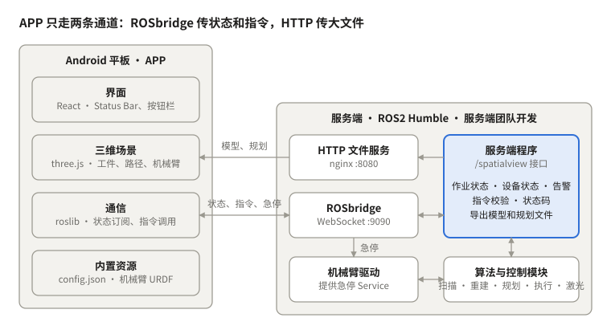
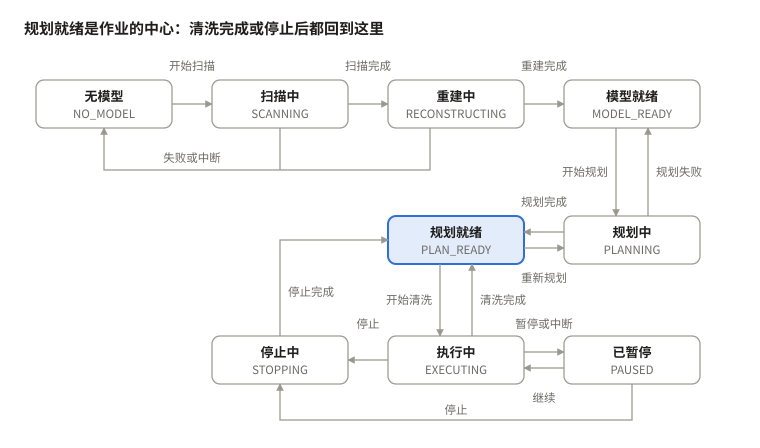

# SpatialView 机械臂作业控制 APP 需求文档 V1.0

| 文档版本 | 日期 | 说明 |
| --- | --- | --- |
| 1 | 2026-10-09 | 初稿 |
| 2 | 2026-10-09 | 评审修订：补全状态迁移与中断处理、急停与激光安全规则、选面模式独占、操作结果提示、接口命名与白名单、配置简化、联调与验收 |

## 1 项目概述

SpatialView V1.0 是一个**由服务端状态驱动的机械臂任务操作终端**：前端负责展示、选择、控制，服务端负责算法、状态、数据生成和机械臂执行。APP 不定义为数字孪生系统。

运行环境：Android 平板，横屏；采用 Web 技术开发，使用 Capacitor 打包为 Android APP。

**V1.0 功能范围**

- 发起扫描，等待服务端完成扫描与三维重建
- 加载并浏览重建后的工件三维模型
- 选择工件表面，发起路径规划
- 显示 TCP 路径；播放轨迹动画（机械臂按规划轨迹运动的前端演示）
- 开始、暂停、继续、停止清洗任务；软件急停
- 激光开关
- 显示机械臂状态、作业阶段、服务端连接状态和告警

**V1.0 明确不做**

- 点云显示与处理、三维重建、路径规划、表面识别、碰撞检测等一切算法
- 根据实时关节状态同步机械臂姿态（数字孪生）
- 加载历史模型与历史规划
- 设置页面（仅保留隐藏的工程配置入口，见 10.3）
- 标定：保留为需求项，V1 不设计流程、不实现交互

## 2 系统架构

APP 只连接服务端的两个入口：ROSbridge 传状态和指令，HTTP 传大文件。服务端新增一个 APP 接口节点，负责汇总状态、校验指令、导出文件，使 APP 不依赖服务端内部的节点结构。



- **ROSbridge（WebSocket）**：一个状态 Topic（SystemState）和六个指令 Service，消息都很小。
- **HTTP**：工件模型 GLB（约 10 MB 量级）和规划文件。大文件不经过 ROSbridge，避免 JSON/base64 编码导致体积膨胀，也避免阻塞急停等消息。
- **随 APP 打包**：配置文件和机械臂 URDF，不从服务端下载。

## 3 技术方案

前端采用 TypeScript + React + three.js，各项能力优先使用成熟开源库，最后用 Capacitor 打包为 Android APP。

### 3.1 选用的开源库

| 用途 | 库 | 在本项目中的作用 |
| --- | --- | --- |
| 构建 | Vite + TypeScript | 工程脚手架 |
| 界面 | React | 按钮栏、Status Bar、弹窗、告警面板 |
| 状态管理 | Zustand | 全局唯一 store：服务端状态镜像 + 少量本地状态 |
| 3D 渲染 | three.js + @react-three/fiber | 三维场景 |
| 3D 辅助 | @react-three/drei | OrbitControls（旋转缩放）、Line（粗线）、Bvh（拾取加速）、Html（场景内标签）、Grid（地面网格） |
| 拾取加速 | three-mesh-bvh（经 drei Bvh 使用） | 30 万三角面下的点击拾取 |
| 工件模型 | three.js GLTFLoader | 加载 GLB |
| 机械臂模型 | urdf-loader | 直接加载 URDF 及其网格，按关节名设置关节角 |
| ROSbridge 通信 | roslib（roslibjs） | 订阅 Topic、调用 Service |
| 打包 | Capacitor | Android 外壳 |
| 屏幕常亮 | @capacitor-community/keep-awake | 运行期间保持亮屏 |
| 前后台切换、返回键 | @capacitor/app | 回到前台时重新同步状态；拦截 Android 返回键 |
| 配置存储 | @capacitor/preferences | 保存工程入口修改后的配置 |

所有依赖锁定版本（提交 lock 文件），避免不同时间打包出不同行为。

### 3.2 前端模块划分

- **config**：加载内置默认配置，合并工程入口的覆盖配置
- **ros**：连接、断线检测、自动重连、Service 调用封装（超时、在途锁）
- **store**：服务端状态镜像 + 本地界面状态（场景模式、选面集合、动画进度）
- **scene**：工件、机械臂、TCP 路径、地面网格、相机、拾取、轨迹动画
- **ui**：Status Bar、按钮栏、确认弹窗、结果提示框、告警面板、工程入口

规则：只有 ros 模块写入服务端状态镜像；界面和场景只读 store。按钮是否可用由 store 计算得出，不在各组件中分散判断。

### 3.3 机械臂模型

URDF 及其网格文件随 APP 一起打包，不从服务端下载，用 urdf-loader 直接加载。与预先转成 GLB 相比，这样省去了转换工具和额外的关节描述文件，关节定义与服务端使用的 URDF 同源。

要求：

- 网格优先使用 STL，需要颜色时使用 DAE。这两种格式由 urdf-loader 内置的加载器直接支持，不需要额外开发。
- `package://` 路径在配置中映射到 APP 内的资源目录。
- URDF 更新时需要重新打包 APP。

### 3.4 Lichtblick 的参考方式

[Lichtblick](https://github.com/lichtblick-suite/lichtblick) 由 Foxglove Studio 分支而来，同样基于 TypeScript 和 React，许可证为 MPL-2.0。本项目把它作为**参考实现**，不 fork、不嵌入：它是面向开发者的通用调试工具，体量大、控件多，与本 APP"少控件、面向现场操作员"的定位相反。

值得参考的部分：rosbridge 连接与消息处理、3D 面板中 Z 轴向上的场景约定、URDF 渲染、相机控制与拾取。

许可证注意：MPL-2.0 是文件级 copyleft。直接复制或修改其源文件，这些文件必须继续以 MPL-2.0 开源；只参考思路、自行实现则不受影响。**建议只参考，不复制源码。**

### 3.5 Capacitor 打包要点

- **混合内容**：Capacitor 默认以 `https://localhost` 提供页面，而 ROSbridge 是 `ws://`、文件服务是 `http://`，会被浏览器拦截。需在 capacitor.config 中设置 `server.androidScheme: "http"`，并在 Android 清单中允许明文流量（`usesCleartextTraffic`）。
- **跨域**：从服务端 HTTP 下载模型和规划文件属于跨域请求，服务端需返回 `Access-Control-Allow-Origin` 头。
- **横屏锁定**：MainActivity 设置 `android:screenOrientation="landscape"`，禁止自动旋转。
- **渲染**：依赖平板系统自带的 Android System WebView，要求支持 WebGL 2。现场网络不接入互联网（见 8.3），WebView 不会自动更新：交付时确定 WebView 版本，性能验证在该版本上进行；WebView 和 APP 的升级都通过离线安装包完成。
- **返回键**：有弹窗时关闭弹窗；处于选面模式或轨迹动画模式时退出该模式；其他情况下无作用。返回键永远不退出 APP。
- **防误退出（可选）**：V1 使用 Android 系统自带的"屏幕固定"功能即可，不单独开发 Kiosk 模式。

## 4 系统状态模型

系统状态由两个独立的枚举描述，全部由服务端给出，APP 不自行推导：**机械臂状态**（robot_state）和**作业阶段**（phase）。两者都显示在 Status Bar 上；作业阶段同时决定按钮和场景内容。

### 4.1 机械臂状态

| 值 | 显示 | 含义 |
| --- | --- | --- |
| READY | 就绪 | 可以接受运动任务 |
| RUNNING | 运行中 | 正在运动（扫描或清洗） |
| PAUSED | 暂停 | 清洗任务暂停中 |
| FAULT | 故障 | 控制器报故障 |
| ESTOP | 急停 | 处于急停状态（软件或硬件触发） |
| OFFLINE | 离线 | 服务端与机械臂控制器未连接 |

### 4.2 作业阶段与迁移

| 值 | 显示 |
| --- | --- |
| NO_MODEL | 无模型 |
| SCANNING | 扫描中 |
| RECONSTRUCTING | 重建中 |
| MODEL_READY | 模型就绪 |
| PLANNING | 规划中 |
| PLAN_READY | 规划就绪 |
| EXECUTING | 执行中 |
| PAUSED | 已暂停 |
| STOPPING | 停止中 |



**基本原则**：新模型、新规划**生成成功后才替换旧的**；失败或中断时回到发起前的阶段，已有的模型和规划保持不变。图中的"失败或中断""规划失败"箭头对应没有旧模型、旧规划的情况。

图中未画出的迁移：

- **重新扫描**：模型就绪、规划就绪时也可以开始扫描。扫描和重建期间旧模型和规划保留；重建成功后新模型替换旧模型，同时清除旧规划（没有历史功能，旧模型不可恢复）；扫描失败、重建失败或扫描被中断时，回到开始扫描前的阶段。
- **重新规划**：规划就绪时也可以开始规划。规划期间旧规划保留；新规划完成后替换旧规划；规划失败时回到规划就绪，旧规划不变。
- **故障或急停**：机械臂状态变为故障或急停，复位前开始扫描、开始清洗不可用（见 5.3）。对作业阶段的影响：
  - 扫描中：扫描中断，回到开始扫描前的阶段。
  - 执行中、已暂停、停止中：任务中断，回到规划就绪，模型和规划保留，可以重新开始清洗。
  - 重建中、规划中：纯计算任务不受影响，照常完成。
- **服务端重启**：phase 为无模型，重启前的模型和规划作废，需要重新扫描（APP 的处理见 7.5）。
- 每次迁移都由服务端完成，APP 只发指令、跟随结果。

## 5 主界面

主界面固定为"顶部 Status Bar + 左侧 3D 区 + 右侧按钮栏"，没有菜单和二级页面。每个按钮是否可用，完全由第 4 节的系统状态和本地场景模式计算得出。

### 5.1 布局

```text
┌────────────────────────────────────────────────────────────────────────────────┐
│ SpatialView   机械臂：就绪   作业：规划就绪   服务：已连接 [刷新连接]   无告警 │
├──────────────────────────────────────────────────────────┬─────────────────────┤
│                                           [恢复默认视角] │  开始扫描           │
│                                                          │  选面               │
│                     3D 显示区域                          │  开始规划           │
│                                                          │  轨迹动画           │
│   Loading 提示、选面工具条、动画播放条                   │ ─────────────────── │
│   都显示在 3D 区内部                                     │  开始清洗/暂停/继续 │
│                                                          │  停止               │
│                                                          │  激光：关闭         │
│                                                          │ ─────────────────── │
│                                                          │  ████ 急停 ████     │
└──────────────────────────────────────────────────────────┴─────────────────────┘
```

急停按钮为红色、独立放置在按钮栏底部，尺寸明显大于其他按钮，与"停止"之间有分隔。具体视觉稿后续设计。

### 5.2 Status Bar

从左到右按重要性排列。

| 区域 | 显示内容 | 颜色 |
| --- | --- | --- |
| APP 名称 | "SpatialView"，固定在最左侧，同时是工程入口（见 10.3） | 默认文字色 |
| 机械臂 | 就绪 / 运行中 / 暂停 / 故障 / 急停 / 离线；未连接服务时显示"未知" | 绿 / 蓝 / 黄 / 红 / 红底白字 / 灰 / 灰 |
| 作业 | 当前作业阶段，显示文字见 4.2；未连接服务时显示"未知" | 默认文字色 |
| 服务 | 已连接 / 正在连接… / 连接断开，正在重连…；旁边固定有"刷新连接"按钮 | 绿 / 黄 / 红 |
| 告警 | 无告警 / N 个告警；点击展开告警面板 | 灰 / 按最高级别显示黄或红 |

- "正在连接…"：APP 启动、点击刷新连接、回到前台时的连接过程。
- "连接断开，正在重连…"：断线后自动重连期间一直显示这一条，不随每次重试来回切换。
- 不显示 ROS 节点、Topic 等技术信息。执行进度只通过路径着色体现（见 6.5），Status Bar 不显示百分比。

### 5.3 按钮可用性

先按顺序套用以下全局规则，再查下表：

1. **急停始终可按**：任何状态下都可以按，不受下列任何规则限制。已连接时立即发送；未连接或发送失败时立即醒目提示（见 8.1）。
2. **关闭激光始终可用**：激光不处于关闭状态时，只要已连接，"关闭激光"在任何阶段、任何机械臂状态下都可用，也不受在途锁定、接口版本和选面模式限制。
3. **未连接服务**：除急停外，只有"刷新连接"可用。
4. **有指令在途**（已发出、尚未收到服务端回复）：所有指令按钮不可用，急停和关闭激光除外。
5. **接口版本不匹配**（见 7.7）：所有指令按钮不可用，急停和关闭激光除外。
6. **机械臂为故障、急停或离线**：开始扫描、开始清洗、开启激光不可用。选面、开始规划、轨迹动画不会让机械臂运动，仍然可用。
7. **选面模式中**：按钮栏中只有"开始规划"可用，急停和关闭激光除外。其他操作须先选完（点击开始规划）或退出选面（见 6.4）。
8. **本地加载中**：模型或规划文件在本地下载、解析期间，依赖它们的按钮（选面、开始规划、轨迹动画、开始清洗）不可用。

已连接、机械臂不处于故障/急停/离线、无指令在途、不在选面模式时，各阶段的按钮状态如下（✓ 可用，— 不可用）。急停不列入表中；"激光"列指开启激光，关闭激光见规则 2。

| 阶段 | 开始扫描 | 选面 | 开始规划 | 轨迹动画 | 主按钮 | 停止 | 激光 |
| --- | --- | --- | --- | --- | --- | --- | --- |
| 无模型 | ✓ | — | — | — | 开始清洗 — | — | ✓ |
| 扫描中 | 正在扫描… | — | — | — | 开始清洗 — | — | — |
| 重建中 | 正在重建… | — | — | — | 开始清洗 — | — | — |
| 模型就绪 | ✓（需确认） | ✓ | ✓ | — | 开始清洗 — | — | ✓ |
| 规划中 | — | — | 正在规划… | — | 开始清洗 — | — | — |
| 规划就绪 | ✓（需确认） | ✓ | ✓（需确认） | ✓ | 开始清洗 ✓ | — | ✓ |
| 执行中 | — | — | — | — | 暂停 ✓ | ✓ | — |
| 已暂停 | — | — | — | — | 继续 ✓ | ✓ | — |
| 停止中 | — | — | — | — | 开始清洗 — | — | — |

### 5.4 确认对话框

| 操作 | 何时弹出 | 提示文案 |
| --- | --- | --- |
| 开始扫描 | 已有模型时 | 扫描完成后将替换当前模型，并清除当前规划。是否继续？ |
| 开始规划 | 未选择任何表面，或已有规划时 | 合并为一个对话框，按情况列出：<br>"当前未选择表面，将对全部可处理表面进行路径规划。"<br>"规划完成后将替换当前规划。"<br>最后一行"是否继续？" |
| 开始清洗 | 每次 | 机械臂将开始运动，请确认作业区域内无人。是否开始清洗？ |
| 停止 | 每次 | 确认停止当前任务？ |
| 开启激光 | 每次 | 确认开启激光？ |
| 关闭激光、急停 | 从不 | 按下立即发送 |

对话框打开期间，如果对应操作因状态变化已不可用，对话框自动关闭，不发送指令。

### 5.5 Loading 与操作反馈

- **服务端耗时阶段**（扫描、重建、规划）：3D 区中央显示"正在扫描…""正在重建…""正在规划…"；服务端提供进度时同时显示百分比。这些提示由服务端阶段驱动，APP 重启后会自动恢复显示。
- **本地耗时操作**（下载、解析模型和规划文件）：显示"正在加载模型…""正在加载规划…"。
- **指令在途**：被按下的按钮显示转圈。超过配置的超时时间仍无回复，提示"服务端无响应，请检查连接"，并解除锁定。
- **指令被拒绝**：弹出提示，内容为服务端返回的说明文字。
- **操作结果**：服务端异步完成的结果用提示框告知，需点"确定"关闭。数据来自 SystemState 的 `last_result`（见 11.2）。

  | 结果 | 提示框标题 | 提示框内容 |
  | --- | --- | --- |
  | 清洗完成 | 清洗完成 | 服务端说明 |
  | 清洗中断（故障或急停） | 清洗已中断 | 中断原因 |
  | 扫描中断 | 扫描已中断 | 中断原因 |
  | 扫描、重建、规划失败 | 扫描失败 / 重建失败 / 规划失败 | 失败原因 |

  扫描成功、规划成功、用户主动停止不弹提示框，画面变化本身就是反馈。

  判断规则：APP 记住最近一次看到的 `last_result.id`，收到不同的 id 时弹出提示框。APP 启动后收到的第一份状态只记录 id、不弹框，避免 APP 重启后重复提示旧结果；断线重连不清除记录，断线期间产生的结果在重连后照常提示。

- **连接断开**：3D 区覆盖半透明遮罩，提示"连接断开，画面内容可能已过期"。
- **服务端重启**：提示框"服务端已重启，原模型和规划已失效，请重新扫描"（见 7.5）。

## 6 三维场景

工件始终是场景的中心。所有数据使用同一个坐标系，前端不做任何坐标变换。机械臂只在轨迹动画中出现。

### 6.1 坐标系与单位

- 场景世界坐标即机械臂 `base_link`：Z 轴向上，长度单位为米，角度单位为弧度。
- 工件 GLB 顶点、TCP 路径、机械臂 URDF 根节点都在这个坐标系下，前端直接使用。
- three.js 相机的 up 方向设为 Z 轴（与 Lichtblick 的做法一致）。
- **注意**：glTF 标准约定 Y 轴向上，Blender 等导出工具会自动做坐标转换。服务端导出 GLB 时必须直接写入 `base_link` 坐标，**禁止做 Y-up 转换**。

### 6.2 相机与手势

所有模式下手势保持一致：

| 手势 | 作用 |
| --- | --- |
| 单指拖动 | 绕工件中心旋转 |
| 单指轻点 | 选面模式下选择或取消表面；其他模式下无作用 |
| 双指捏合 | 缩放 |
| 平移 | 不支持 |

- 旋转中心为工件包围盒中心。无模型时使用配置中的默认中心。
- 点击与拖动的区分：手指按下到抬起的移动距离小于阈值（可配置，默认 8 像素）视为点击。
- 缩放有最近、最远距离限制（相对于工件包围球半径，可配置），防止相机钻进模型或缩到看不见。
- "恢复默认视角"按钮：相机回到配置的默认观察方向，距离自动调整到工件完整充满 3D 区。新模型加载完成后自动执行一次。
- 按需渲染：画面没有变化时不重绘（react-three-fiber 的 `frameloop="demand"`），降低平板发热和耗电；手势操作和动画播放期间连续渲染。

### 6.3 各阶段的场景内容

| 阶段或模式 | 工件 | TCP 路径 | 机械臂 | 其他元素 |
| --- | --- | --- | --- | --- |
| 无模型 | — | — | — | 中央提示"暂无模型，请开始扫描" |
| 扫描中、重建中 | 旧模型（若有）淡化显示 | — | — | 进度提示 |
| 模型就绪 | 显示 | — | — | — |
| 规划中 | 显示 | — | — | 进度提示 |
| 规划就绪 | 显示 | 显示 | — | — |
| 选面模式 | 显示，可点选高亮 | 隐藏 | — | 选面工具条 |
| 轨迹动画模式 | 显示 | 显示，按动画进度着色 | 显示并运动 | 播放条；"轨迹动画 · 非实际位置"标签 |
| 执行中、已暂停、停止中 | 显示 | 显示，按执行进度着色 | — | — |

- **地面网格**：所有阶段都显示，位于 `base_link` 的 XY 平面（z = 0），作为方向和尺度参照。网格范围和间距可配置（见 10.2），用 drei Grid 绘制。
- 机械臂只在轨迹动画中出现。原因是 APP 不显示机械臂的实际姿态，在其他任何时候显示一个机械臂，都可能被现场人员误认为是真实位置。

### 6.4 选面

- **进入**：模型就绪或规划就绪时点击"选面"。隐藏 TCP 路径，相机恢复默认视角。
- **工具条**（3D 区顶部）：已选 N 个表面 ｜ 清空选择 ｜ 退出选面。
- **模式独占**：选面模式中，按钮栏只有"开始规划"可用（急停和关闭激光除外）。用户须**选完后点击开始规划**，或**点击退出选面**，才能进行其他操作。
- **点选**：单指轻点命中某个表面节点，读取其 `surface_id`。未选中则加入选择，已选中则移除。
- **不可处理的表面**（GLB 中标记为不可选）：以深灰色显示，点击无反应。
- **高亮**：选中的表面换成醒目的高亮材质（如橙色）。
- **初始选择**：如果当前已有规划，进入时预先选中该规划使用的表面（`plan_surface_ids`）；否则为空。
- **选择集合是本地状态**：退出选面后保留，退出后点击"开始规划"同样使用这份选择；模型 ID 变化时清空；APP 重启后不恢复。
- **开始规划**：发送当前 `model_id` 和选择集合，确认规则见 5.4。规划请求被接受后自动退出选面模式。
- **自动退出**：阶段离开模型就绪、规划就绪时（例如服务端重启后回到无模型），自动退出选面模式。
- **实现方式**：drei 的 Bvh 加速拾取，react-three-fiber 点击事件返回命中的对象；GLTFLoader 会把节点的 `extras` 放进 `userData`，从中读取 `surface_id`，不需要任何三角面映射表。

### 6.5 TCP 路径

- 数据来自规划文件（见 11.6），按点的顺序连线。
- **工艺段**（激光开启）：粗实线，蓝色。**空行程段**：细虚线，灰色。
- **方向**：起点、终点用文字标签"起点""终点"标出，沿线按固定间距（可配置）绘制小箭头。
- **进度着色**：轨迹动画和执行期间，已经走过的部分改为绿色。执行期间的进度取 SystemState 的 `exec_time`（实际已执行时间），与规划文件中的 `t` 对齐；实际执行速度与规划不一致时着色会有偏差，V1 接受。
- **线宽**以屏幕像素计（drei Line），缩放时粗细不变。
- **遮挡**：路径正常参与深度测试，被工件挡住的部分不可见，用户旋转视角即可查看；工件材质设置多边形偏移，防止贴近表面的路径闪烁。
- **实现方式**：尽量使用现成组件，不写自定义着色器。工艺段、空行程段各用一个 drei Line（线段模式）绘制，不按段分别创建对象；进度着色叠加一条绿色线，通过调整绘制范围实现，不在每帧重建几何；箭头用 three.js InstancedMesh 批量绘制；起点、终点标签用 drei Html。

### 6.6 轨迹动画

- 仅在"规划就绪"阶段可进入。纯前端演示，**不向服务端发送任何指令**。
- 进入后显示机械臂，3D 区顶部常驻"轨迹动画 · 非实际位置"标签，底部出现播放条：
  - 播放 / 暂停、重新播放、退出
  - 可拖动的进度条，显示当前时间 / 总时长
  - 倍速：1× / 5× / 20×（档位可配置）
- **驱动方式**：按 `t`（time_from_start）对相邻两个轨迹点做线性插值，得到各关节角，通过 urdf-loader 设置到机械臂模型上。TCP 路径按同一时间轴做进度着色。
- 播放结束后停在最后一帧。
- **退出**：点击"退出"或返回键；阶段离开"规划就绪"（开始清洗、重新规划、重新扫描、服务端重启等）时自动退出，机械臂隐藏。断线本身不退出动画，重连后如果阶段已离开规划就绪，再自动退出。
- 规划文件中的关节名与 URDF 不一致时，产生本地告警"规划数据与机械臂模型不匹配"，轨迹动画不可用。

## 7 连接与状态同步

APP 不保存任何业务状态。连接建立后的第一件事是向服务端获取完整状态，之后完全跟随服务端。启动、自动重连、刷新连接、回到前台，全部走同一个连接流程。

### 7.1 连接流程

1. 按配置地址建立 ROSbridge WebSocket 连接。
2. 调用 GetSystemState 获取完整状态，检查接口版本（见 7.7）和 `session_id`（见 7.5）。
3. 订阅 `system_state` Topic。
4. 应用状态：`model_id` 与本地已成功加载的不同，就重新下载模型；`plan_id` 不同，就重新下载规划；为空则清除对应显示。模型或规划加载失败后，点击"刷新连接"会重新下载。
5. Status Bar 显示"服务：已连接"，按钮按新状态启用。

### 7.2 断线判定与自动重连

满足任一条件即判定断线：WebSocket 关闭或出错；超过 `state_timeout_ms`（默认 3000 毫秒）没有收到 `system_state`。服务端按固定频率发布状态，所以"收不到状态"本身就是心跳失效，不需要另做心跳接口。

断线后每隔 `reconnect_interval_ms`（默认 2000 毫秒）自动重试，不限次数，Status Bar 一直显示"连接断开，正在重连…"。

### 7.3 刷新连接

点击后主动断开旧连接，立即执行 7.1 的流程，Status Bar 显示"正在连接…"。成功提示"连接成功"；失败提示"服务端连接失败，请检查网络"，之后继续自动重连。

APP 从后台回到前台时（Capacitor 的 resume 事件），自动执行一次刷新连接，因为 Android 可能在后台暂停了 WebView 的定时器和网络。

刷新连接和断线重连都不会要求重新扫描：只要服务端没有重启，模型和规划照常有效。

### 7.4 断线期间

**APP 界面**

- Status Bar 显示"服务：连接断开，正在重连…"，机械臂和作业都显示"未知"。
- 除急停和"刷新连接"外，所有按钮不可用。急停仍可按，按下后提示"急停发送失败，请立即使用设备急停按钮"。
- 3D 区保留最后的画面，加半透明遮罩。正在播放的轨迹动画不退出（见 6.6）。
- 选面的选择集合保留；重连后如果 `model_id` 没变，继续有效。
- 告警面板保留断线前的服务端告警，并标注"以下为断线前的告警"；另加本地告警"网络连接断开"。
- 在途指令的锁定立即解除。重连后一律以服务端状态为准，不重发、不推测结果。

**服务端行为**

- APP 断线不影响服务端正在执行的任务，清洗继续执行到完成，除非在设备上急停。
- 非执行阶段手动开启的激光，服务端在 APP 断开时自动关闭（见 8.2）。
- 断线期间软件急停无效，现场必须使用设备急停按钮。

### 7.5 服务端重启

- 每条 SystemState 都带 `session_id`，服务端每次启动生成一个新值。APP 运行期间发现 `session_id` 与之前不同，说明服务端重启过。
- 服务端重启后 phase 为无模型，重启前的模型和规划作废。
- 如果重启前 APP 已加载模型，弹出提示框"服务端已重启，原模型和规划已失效，请重新扫描"，并清除场景中的模型和路径。
- 刷新连接、断线重连时 `session_id` 不变，不提示、不要求重新扫描。
- APP 自身重启时没有之前的 `session_id`，直接按服务端当前状态显示。

### 7.6 状态消息的顺序

每条 SystemState 都带 `session_id` 和递增的 `seq`（每发布一次加 1）。APP 只应用 `seq` 大于或等于当前值的消息；`session_id` 变化时重新开始计数，接受任何 `seq`。

服务端处理指令时，先完成阶段切换并以新的 `seq` 发布 Topic，再在指令回复中带上同一份状态。APP 收到回复后立即应用，按钮不会在"收到回复"和"收到下一条 Topic"之间来回闪烁；回复和 Topic 的 `seq` 相同，先到后到都不会被丢弃。

### 7.7 接口版本检查

SystemState 中的 `interface_version` 与 APP 期望的接口版本主版本号不一致时，产生本地告警"接口版本不匹配"，除急停和关闭激光外的所有指令按钮不可用。期望的接口版本编译在 APP 中，不放在配置文件里。

## 8 安全相关

所有指令是否合法由服务端最终判断（状态是否允许、ID 是否匹配、是否重复）。APP 禁用按钮只是改善体验，不是安全措施。

### 8.1 停止与急停

| 项目 | 停止 | 急停 |
| --- | --- | --- |
| 目的 | 有序结束当前任务 | 异常时尽快请求机械臂停止 |
| 外观 | 普通按钮，位于主按钮旁 | 红色大按钮，独立放在按钮栏底部 |
| 确认 | 需要 | 不需要，按下立即发送 |
| 可用条件 | 执行中、已暂停 | 始终可按；不受在途锁定限制，可重复按 |
| 接口 | TaskControl（STOP） | EmergencyStop |
| 之后的状态 | 停止中 → 规划就绪 | 机械臂状态变为"急停"；作业阶段按 4.2 回退 |

- 急停发送失败（未连接或超时）时，立即醒目提示"急停发送失败，请立即使用设备急停按钮"。
- 急停按钮下方常驻小字"软件急停不能替代设备急停"。软件急停依赖无线网络和服务端，断线时无效。
- V1 APP 不提供急停复位功能，只显示急停状态。复位方式待服务端确认（见 13.2）。

### 8.2 激光

- 显示三种状态：关闭、开启、异常。
- **开启**：仅在非执行阶段、机械臂不处于故障/急停/离线时可用（见 5.3），需要确认。服务端负责联锁判断，条件不满足时拒绝并返回原因。
- **关闭**：激光不处于关闭状态时，只要已连接就可用，不需要确认（5.3 规则 2）。关闭只关闭激光，不影响机械臂运动和任务状态。执行中关闭后激光保持关闭，任务不会在后续工艺段自动重新开启（待确认，见 13.2）。
- **清洗执行期间**激光由任务自动控制，按钮只显示状态和提供关闭。
- **暂停**：机械臂停止运动，同时关闭激光；继续时由任务重新开启激光。暂停与关闭激光是两个独立的操作。
- **服务端自动关闭手动开启的激光**：
  - 开始扫描时；
  - 机械臂故障或急停时；
  - APP 断开时（服务端通过 rosbridge 的客户端连接数判断）。
  - 开始清洗时不关闭，激光转由任务控制。
- 扩展：后续增加其他工艺设备时，按钮栏中"激光"位置扩展为"工艺设备"分组，每台设备一行，显示状态和开关。

### 8.3 终端与网络

- V1 假设同一时间只有一台平板进行操作（待确认）。服务端的 ID 校验和状态校验能防止多终端操作造成模型与规划错配，但 V1 不做权限管理。
- ROSbridge 没有身份验证，网络上任何设备都能连接。服务端和平板必须部署在隔离的现场网络中，不接入办公网或互联网。
- rosbridge 默认允许访问服务端的所有 Topic、Service 和参数，连接者可以绕过 APP 接口节点的校验，直接调用内部接口。部署时将 `topics_glob`、`services_glob` 限定为 `/spatialview/*`；`params_glob` 也必须设置（留空表示全部放行），APP 不使用参数。

## 9 告警

告警列表由服务端维护，随 SystemState 下发；APP 只额外产生少量本地告警。V1 不提供告警确认或手动消除操作。

### 9.1 告警来源

| 来源 | 告警 | 何时消失 |
| --- | --- | --- |
| 服务端 | 机械臂故障、工艺设备异常、服务端异常 | 故障恢复后由服务端移除 |
| 服务端 | 扫描失败、重建失败、规划失败 | 下一次开始扫描时，三类全部移除；下一次开始规划时，移除规划失败 |
| APP 本地 | 网络连接断开 | 重新连接后 |
| APP 本地 | 模型加载失败、规划加载失败 | 重新加载成功后 |
| APP 本地 | 接口版本不匹配、规划数据与机械臂模型不匹配 | 条件不再成立后 |

扫描、重建、规划失败在发生时还会弹出提示框告知原因（见 5.5），告警只用于事后查看。

### 9.2 显示

- Status Bar 显示告警数量，颜色取当前最高级别：警告为黄，错误为红。
- 点击展开告警面板，按时间倒序列出，每条显示：级别色块、告警名称、简单说明、发生时间；错误码以小号灰字显示在末尾。
- 断线期间面板保留断线前的服务端告警，并标注"以下为断线前的告警"。
- 告警字段定义见 11.2 Alarm 消息。

## 10 配置

通信地址、时间参数、场景参数和机械臂资源映射放在一个 JSON 配置文件中，修改它们不需要改代码。

Topic 和 Service 的名称与类型、枚举值字符串、消息字段结构属于接口约定（第 11 节），固定在代码中，不通过配置修改；约定变化时升级 `interface_version`。

### 10.1 加载方式

- APK 内置一份默认配置 `config.json`。
- 工程入口保存的修改存放在 Capacitor Preferences 中，只保存改过的字段，并记录保存时的 `config_version`。
- 启动时合并：覆盖配置中存在的字段使用覆盖值，不存在的字段使用默认值；数组整体替换，不逐项合并。
- APK 升级后，旧的覆盖配置仍按上述规则生效。默认配置与覆盖配置的 `config_version` 不一致时，工程入口中给出提示。
- "恢复默认"即删除覆盖配置。

### 10.2 配置文件结构

```json
{
  "config_version": 1,
  "server": {
    "rosbridge_url": "ws://192.168.1.100:9090",
    "http_base_url": "http://192.168.1.100:8080"
  },
  "timing": {
    "state_timeout_ms": 3000,
    "reconnect_interval_ms": 2000,
    "service_timeout_ms": 5000,
    "estop_timeout_ms": 1000
  },
  "robot": {
    "urdf": "robot/robot.urdf",
    "packages": { "my_robot_description": "robot" },
    "joint_name_map": {}
  },
  "scene": {
    "default_view_direction": [1.0, -1.0, 0.8],
    "default_target": [0.8, 0.0, 0.3],
    "tap_threshold_px": 8,
    "zoom_min_ratio": 0.3,
    "zoom_max_ratio": 6.0,
    "path_arrow_spacing_m": 0.1,
    "grid_size_m": 4.0,
    "grid_cell_m": 0.1
  },
  "animation": { "speeds": [1, 5, 20] }
}
```

说明：

- `robot.packages` 把 URDF 中的 `package://` 前缀映射到 APP 内的资源目录。
- `robot.joint_name_map` 用于规划文件关节名与 URDF 关节名不一致时的映射，默认为空。
- `scene.default_target` 是无模型时相机的观察中心，单位为米。
- `scene.grid_size_m`、`scene.grid_cell_m` 是地面网格的边长和格子间距，单位为米，网格以 `base_link` 原点为中心。
- 以上数值均为初始建议值，现场调试后再确定。

### 10.3 工程入口

- **入口位置**：Status Bar 最左侧的"SpatialView"字样，长按 5 秒，输入密码（打包时写入，不放在配置文件中）。
- **编译开关**：是否启用工程入口在打包时配置。关闭时长按无反应，修改配置只能重新打包。
- 常用项表单：ROSbridge 地址、HTTP 地址。
- 高级：完整 JSON 文本编辑，保存前检查 JSON 格式和必填字段。
- 恢复默认配置。
- 显示 APP 版本、期望接口版本、默认配置版本、覆盖配置版本。
- 保存后立即按新配置重新连接。

## 11 接口定义

全部接口为 1 个状态 Topic、6 个 Service 和 2 类 HTTP 文件。原需求中的 RobotStatus、Alarm、ScanStatus、ReconstructionStatus、ModelInfo、PlanStatus 合并进 SystemState；SurfaceInfo 由 GLB 节点结构取代；History 不再需要。

### 11.1 命名规范与接口总览

命名规范：

- ROS 接口包名为 `spatialview_msgs`。
- 所有 Topic 和 Service 都放在 `/spatialview` 命名空间下，rosbridge 白名单用一条规则即可放行（见 8.3）。APP 接口节点运行在该命名空间下，节点名为 `app_interface`，Topic 和 Service 用相对名称声明即可自动带上前缀。
- Topic 和 Service 名称全小写、下划线分隔；Topic 用名词（`system_state`），Service 用动词开头（`start_scan`）。
- 消息和服务类型名用大驼峰（`SystemState`、`StartScan`），枚举字符串用全大写下划线（`PLAN_READY`）。
- 后续新增接口沿用同一规则，例如工艺设备控制可命名为 `/spatialview/set_device`。

| 类型 | 名称 | 方向 | 用途 |
| --- | --- | --- | --- |
| Topic | `/spatialview/system_state` | 服务端 → APP | 完整系统状态，每秒 2 次，状态变化时立即补发一次 |
| Service | `/spatialview/get_system_state` | APP → 服务端 | 连接时立即获取完整状态 |
| Service | `/spatialview/start_scan` | APP → 服务端 | 开始扫描 |
| Service | `/spatialview/start_plan` | APP → 服务端 | 开始规划 |
| Service | `/spatialview/task_control` | APP → 服务端 | 开始、暂停、继续、停止清洗 |
| Service | `/spatialview/emergency_stop` | APP → 服务端 | 软件急停 |
| Service | `/spatialview/set_laser` | APP → 服务端 | 激光开关 |
| HTTP GET | `http_base_url` + `model_url` | 服务端 → APP | 工件模型 GLB |
| HTTP GET | `http_base_url` + `plan_url` | 服务端 → APP | 规划文件 JSON |

各接口的类型为 `spatialview_msgs/msg/SystemState`、`spatialview_msgs/srv/GetSystemState`、`spatialview_msgs/srv/StartScan`，依此类推。

不使用 ROS2 Action：rosbridge 及各客户端库对 ROS2 Action 的支持程度不一。耗时过程统一用"Service 立即回复受理结果 + SystemState 反映进度"的方式实现。

### 11.2 SystemState 消息

```text
# spatialview_msgs/msg/SystemState
string interface_version        # 例如 "1.0"
string session_id               # 服务端每次启动生成一个新值
uint64 seq                      # 每发布一次加 1；指令回复中的状态与对应的那次 Topic 发布使用同一个 seq
builtin_interfaces/Time stamp

string robot_state              # READY RUNNING PAUSED FAULT ESTOP OFFLINE
string phase                    # NO_MODEL SCANNING RECONSTRUCTING MODEL_READY
                                # PLANNING PLAN_READY EXECUTING PAUSED STOPPING
float32 progress                # 扫描、重建、规划阶段的完成百分比 0–100
                                # 其他阶段或没有进度信息时为 -1
float64 exec_time               # 本次清洗实际已执行的时间，秒，不含暂停时间
                                # 执行中、已暂停、停止中有效，其他阶段为 0；APP 用于路径进度着色

string model_id                 # 当前模型；无模型时为空
                                # 扫描、重建期间保持旧值，新模型生成成功后才更新
string model_url                # 相对路径，例如 /models/model_005.glb
string plan_id                  # 当前规划；无规划时为空
                                # 规划期间保持旧值，新规划生成成功后才更新
string plan_url                 # 相对路径，例如 /plans/plan_005_02.json
string[] plan_surface_ids       # 当前规划实际使用的表面；规划全部表面时也逐个列出

string laser_state              # OFF ON ERROR
Alarm[] alarms                  # 当前活动告警
OperationResult last_result     # 最近一次异步操作的结果；服务端启动后还没有结果时 id 为空
```

```text
# spatialview_msgs/msg/Alarm
string id                       # 告警实例的唯一 ID
string level                    # WARNING ERROR
string code                     # 错误码
string title                    # 告警名称，中文，APP 直接显示
string detail                   # 简单说明，中文，APP 直接显示
builtin_interfaces/Time stamp
```

```text
# spatialview_msgs/msg/OperationResult
string id                       # 每个结果唯一；APP 据此判断是否为新结果（见 5.5）
string operation                # SCAN RECONSTRUCT PLAN TASK
string result                   # SUCCEEDED FAILED INTERRUPTED STOPPED
string message                  # 中文说明（失败原因、中断原因等），APP 直接显示
builtin_interfaces/Time stamp
```

### 11.3 Service 定义

所有指令类 Service 的响应部分相同：

```text
---
bool accepted
string code                     # 拒绝原因码，接受时为空
string message                  # 中文说明，APP 直接显示
SystemState state               # 处理该指令后的最新状态
```

| Service | 请求字段 | 说明 |
| --- | --- | --- |
| GetSystemState | 无 | 响应只有 `SystemState state` |
| StartScan | 无 | 开始扫描；旧模型和规划保留到新模型生成成功 |
| StartPlan | `string model_id`、`string[] surface_ids` | `surface_ids` 为空表示全部可处理表面，"空 = 全部"只用在这里；旧规划保留到新规划生成成功 |
| TaskControl | `string command`、`string plan_id` | command 为 START、PAUSE、RESUME、STOP。只有 START 校验 `plan_id`；其他命令作用于当前任务，不校验 `plan_id`，避免 APP 本地规划未同步时停止被拒绝 |
| EmergencyStop | 无 | 任何状态下都接受 |
| SetLaser | `bool on` | 开启时服务端做联锁判断；关闭在任何状态下都接受，只关闭激光，不改变任务状态 |

拒绝原因码：

| code | 含义 |
| --- | --- |
| INVALID_STATE | 当前阶段不允许该操作，包括重复指令 |
| MODEL_MISMATCH | model_id 不是当前模型 |
| PLAN_MISMATCH | plan_id 不是当前规划（仅 START） |
| INVALID_SURFACE | surface_ids 中有不存在或不可处理的表面 |
| ROBOT_NOT_READY | 机械臂故障、急停或离线 |
| INTERLOCK | 激光等联锁条件不满足 |
| INTERNAL_ERROR | 服务端内部错误 |

服务端处理规则：

- Service 必须快速返回（目标 1 秒内），只表示受理或拒绝。扫描、规划、执行等耗时过程通过 phase、progress、exec_time 体现，不阻塞 Service。
- 受理前先完成阶段切换并以新的 `seq` 发布 SystemState，回复中带同一份状态（见 7.6）。
- 重复到达的指令（例如已在扫描中又收到 StartScan）返回 INVALID_STATE。
- 服务端记录每一次 Service 调用（时间、参数、结果），用于现场问题追溯。

### 11.4 HTTP 文件服务

- 服务端提供静态 HTTP 服务（nginx 或 Python 自带的即可），根地址即配置中的 `http_base_url`。
- `model_url`、`plan_url` 为相对路径，由 APP 拼接根地址。服务端不需要知道平板访问它时使用的 IP。
- 文件一经生成内容不再改变，ID 与文件一一对应。当前模型和规划的文件在被替换之前必须一直可以下载。
- 响应头带 `Access-Control-Allow-Origin: *`；建议开启 gzip，对规划 JSON 效果明显。

### 11.5 工件模型 GLB 规范

- **坐标**：`base_link`，Z 轴向上，单位米；导出时禁止做 Y-up 转换。
- **结构**：每个 Surface 是一个独立的 mesh 节点，且只包含一个 primitive（多个 primitive 时 GLTFLoader 会生成 Group，点击命中的是子对象，读不到节点的 extras）。节点名等于 `surface_id`，节点 extras 为 `{"surface_id": "surface_02", "selectable": true}`。
- **模型 ID**：glTF 场景（`scenes[0]`）的 extras 为 `{"model_id": "model_005"}`，APP 校验它与 SystemState 中的 `model_id` 一致。
- 每个三角面恰好属于一个 Surface 节点；相邻表面的公共顶点在各自节点中各存一份。
- 包含法线；不需要纹理和材质，APP 统一着色。
- 规模：不超过 30 万三角面；Surface 数量建议不超过 500（待确认实际数量）。
- V1 不使用 Draco 或 meshopt 压缩：局域网下载 10 MB 量级可以接受，省去解码器集成。
- Surface ID 在同一个 `model_id` 内保持不变；新模型可以重新编号。

### 11.6 规划文件

```json
{
  "plan_id": "plan_005_02",
  "model_id": "model_005",
  "frame_id": "base_link",
  "surface_ids": ["surface_02", "surface_04"],
  "duration": 1260.5,
  "joint_trajectory": {
    "joint_names": ["joint_1", "joint_2", "joint_3", "joint_4", "joint_5", "joint_6"],
    "points": [
      { "t": 0.0, "positions": [0.0, -1.2, 1.5, 0.0, 1.1, 0.0] },
      { "t": 0.1, "positions": [0.01, -1.19, 1.5, 0.0, 1.1, 0.0] }
    ]
  },
  "tcp_path": {
    "points": [
      { "t": 0.0, "p": [0.85, 0.10, 0.42], "q": [0.0, 0.707, 0.0, 0.707], "process_on": false },
      { "t": 0.1, "p": [0.85, 0.11, 0.42], "q": [0.0, 0.707, 0.0, 0.707], "process_on": true }
    ]
  }
}
```

- 单位：米、弧度、秒。`t` 即 `time_from_start`。
- `surface_ids` 为该规划实际使用的表面；规划全部表面时也逐个列出，不使用空数组。
- 两个 points 数组各自按 `t` 递增，最后一个点的 `t` 都等于 `duration`。
- `joint_names` 与 URDF 关节名一致，否则在配置的 `joint_name_map` 中映射。
- `p` 为 TCP 位置；`q` 为姿态四元数，顺序 x、y、z、w。V1 不显示姿态，字段保留以便后续扩展。
- `process_on` 表示该点是否处于工艺段（激光开启）。
- 建议两个数组的点数各不超过 10 万，超过时由服务端为显示抽稀。
- APP 校验文件中的 `plan_id`、`model_id` 与 SystemState 一致，不一致视为加载失败。

## 12 非功能需求

### 12.1 平板

- 开发前必须确定：型号、SoC、GPU、内存、Android 版本、屏幕尺寸、分辨率，以及交付时的 WebView 版本。
- WebView 必须支持 WebGL 2。WebView 和 APP 都通过离线安装包升级（见 3.5）。
- 横屏运行，禁止自动旋转；运行期间保持亮屏。

### 12.2 性能

测试场景：机械臂 URDF + 30 万三角面工件（约 500 个 Surface 节点）+ 10 万点 TCP 路径。以下为建议指标，最终按实际平板确认。

| 指标 | 目标 |
| --- | --- |
| 旋转、缩放、轨迹动画期间帧率 | 稳定接近或达到 30 FPS |
| 选面点击到高亮出现 | 100 毫秒以内 |
| 模型下载完成到显示 | 3 秒以内 |
| 规划文件下载完成到路径显示（两个数组各 10 万点） | 3 秒以内 |
| 急停按下到服务端收到（已连接、网络正常） | 300 毫秒以内 |
| 连续运行 | 8 小时无崩溃、内存无持续增长 |

- **内存**：替换模型和规划时，必须释放旧的几何体和材质（three.js 不会自动回收 GPU 资源）。8 小时测试期间用 mock 服务端循环执行至少 50 轮"扫描 → 加载模型 → 规划 → 加载规划 → 轨迹动画"，只挂机测不出这类泄漏。
- **早期验证**：开发第一周就在目标平板上用 WebView 运行一个原型（30 万面、约 500 个 Surface 节点的 GLB + 机械臂 + 10 万点路径），确认帧率达标，作为 Web 技术路线的验证点。原型的 GLB 必须按 11.5 的节点结构拆分，单个 mesh 的测试结果不能代表实际情况。

### 12.3 UI 原则

- 亮色主题，中文界面。
- 大按钮、大字体、高对比度；触控区域明显大于普通 APP，具体尺寸在视觉稿中确定。
- 状态同时用颜色和文字表达，不只依赖颜色。
- 控件尽量少，没有多层菜单，不出现 ROS、Topic 等技术术语。

### 12.4 联调与验收

- **mock 服务端**：服务端在开发初期提供一个 mock 节点，实现第 11 节的全部接口和第 4 节的状态迁移，用假数据模拟扫描、重建、规划、执行的耗时和进度，并能人为触发故障、急停、操作失败和服务端重启。APP 开发和测试都基于它进行，不依赖真实机械臂。
- **样例数据**：开发初期提供符合 11.5 的样例 GLB、符合 11.6 的样例规划文件，以及机械臂 URDF 和网格。
- **验收用例**：每个功能按本文档编写验收用例，至少覆盖以下场景：

| # | 场景 | 预期结果 |
| --- | --- | --- |
| 1 | 执行中断开平板网络，稍后恢复 | 任务继续执行；重连后状态正确；不要求重新扫描 |
| 2 | 执行中强制结束 APP 后重新打开 | 直接恢复为执行中，路径进度着色正确 |
| 3 | 服务端重启 | 提示原模型和规划已失效，要求重新扫描 |
| 4 | 已连接时按急停；断线时按急停 | 前者延迟达标；后者立即出现失败提示 |
| 5 | 手动开启激光后，开始扫描、触发故障、断开 APP | 激光均被自动关闭；任何阶段都能从 APP 关闭激光 |
| 6 | 扫描中急停；重新扫描失败；重新规划失败 | 回到发起前的阶段，旧模型和规划仍可用 |
| 7 | 清洗完成；清洗中急停；规划失败 | 分别弹出对应的结果提示框，且只弹一次 |
| 8 | 选面模式中操作其他按钮；按返回键 | 其他按钮不可用；返回键退出选面 |
| 9 | 8 小时稳定性 | 满足 12.2 |

## 13 服务端配合事项与待确认问题

### 13.1 服务端需配合实现

- [ ] 按第 11 节实现 `spatialview_msgs` 中的消息和服务，接口节点运行在 `/spatialview` 命名空间下
- [ ] 定频发布 SystemState（每秒 2 次，状态变化时立即补发），并实现 GetSystemState
- [ ] 指令回复前先以新的 `seq` 发布 SystemState，回复中带同一份状态
- [ ] 所有指令做状态、ID、重复校验，返回统一的拒绝原因码；TaskControl 只对 START 校验 `plan_id`
- [ ] 按第 4 节维护 phase：新模型、新规划生成成功后才替换旧的；失败或中断回到发起前的阶段；服务端启动时为无模型
- [ ] 维护 `exec_time` 和 `last_result`
- [ ] 激光：关闭在任何状态下都接受，只关闭激光；暂停时关闭激光；开始扫描、故障、急停、APP 断开时自动关闭手动开启的激光
- [ ] 部署静态 HTTP 文件服务，开启跨域响应头
- [ ] rosbridge 白名单只放行 `/spatialview/*`（见 8.3）
- [ ] 按 11.5 导出工件 GLB（每个表面一个节点、一个 primitive）
- [ ] 按 11.6 输出规划文件
- [ ] 提供机械臂 URDF 及网格文件（优先 STL），用于打包进 APP
- [ ] 记录所有 Service 调用日志
- [ ] 开发初期提供 mock 节点和样例数据（见 12.4）

### 13.2 待确认问题

每个问题都给出了文档当前采用的默认做法，确认后再更新。

| # | 问题 | 当前默认做法 |
| --- | --- | --- |
| 1 | 一个工件通常有多少个表面？ | 不超过 500 个 |
| 2 | 停止后：机械臂如何停止、激光是否自动关闭、能否从中断处继续、是否需要重新规划？ | 回到"规划就绪"，激光自动关闭，再次开始从头执行 |
| 3 | 软件急停对应哪个底层接口？复位是否只能在设备上完成？ | APP 不提供复位 |
| 4 | 开启激光的联锁条件有哪些？ | 开启仅在非执行阶段允许，联锁由服务端判断 |
| 5 | 执行中从 APP 关闭激光后，任务到达后续工艺段时是否自动重新开启激光？ | 不重新开启，保持关闭；暂停后继续时由任务重新开启 |
| 6 | 扫描、重建、规划能否由用户中途取消？ | V1 不支持；急停只中断扫描（机械臂运动），不中断重建和规划 |
| 7 | 同一时间有几台平板操作？ | 仅一台 |
| 8 | 清洗完成后，同一规划能否再次执行？ | 可以，完成后回到"规划就绪" |
| 9 | 平板具体型号与配置？ | 待定，影响性能验证 |
| 10 | 急停 Service 是否会被其他 Service 的处理阻塞？（低优先级） | ROS 2 默认单线程执行器下急停回调需要排队；先在联调时实测其他 Service 处理期间的急停延迟，超过 12.2 的指标再改用独立回调组或线程 |

## 14 产品边界

前端负责**展示 + 选择 + 控制**；服务端负责**算法 + 状态 + 数据生成 + 机械臂执行**。

判断一项新需求该放在哪一端，用两条规则：

- 需要计算几何、点云、路径或碰撞的，放服务端。
- 需要根据多个信号推导系统状态的，放服务端，APP 只显示服务端给出的结论。

这一边界在开发期间保持不变，避免前端逐渐承担算法和状态逻辑。
